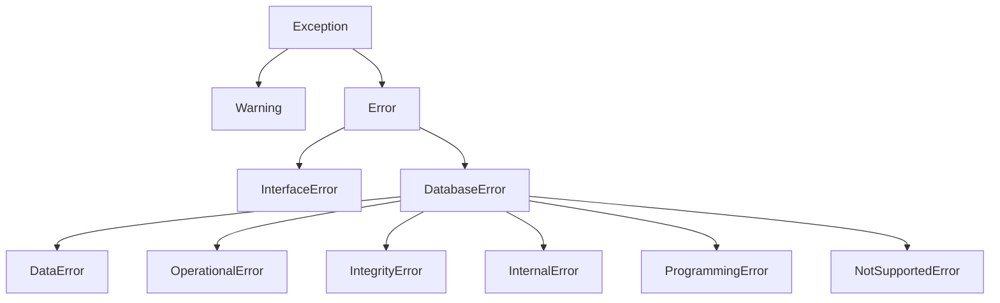

# API Reference

Complete API documentation for pycubrid — a pure Python DB-API 2.0 driver for CUBRID.

---

## Table of Contents

- [Module-Level Attributes](#module-level-attributes)
- [Module-Level Constructor](#module-level-constructor)
  - [`pycubrid.connect()`](#pycubridconnect)
  - [`decode_collections`](#decode_collections)
  - [`json_deserializer`](#json-columns)
  - [`charset`](#charset)
- [Async Module Constructor](#async-module-constructor)
  - [`pycubrid.aio.connect()`](#pycubridaioconnect)
- [Connection Class](#connection-class)
  - [Constructor](#connection-constructor)
  - [Methods](#connection-methods)
    - [`ping()`](#pingreconnecttrue)
  - [Properties](#connection-properties)
  - [Context Manager](#connection-context-manager)
- [Cursor Class](#cursor-class)
  - [Constructor](#cursor-constructor)
  - [Methods](#cursor-methods)
    - [`nextset()`](#nextset)
  - [Properties](#cursor-properties)
  - [Iterator Protocol](#iterator-protocol)
  - [Context Manager](#cursor-context-manager)
- [AsyncConnection Class](#asyncconnection-class)
- [AsyncCursor Class](#asynccursor-class)
- [Lob Class](#lob-class)
  - [Factory Method](#lob-factory-method)
  - [Methods](#lob-methods)
  - [Properties](#lob-properties)
- [TimingStats Class](#timingstats-class)
- [Exception Hierarchy](#exception-hierarchy)
  - [Warning](#warning)
  - [Error](#error)
  - [InterfaceError](#interfaceerror)
  - [DatabaseError](#databaseerror)
  - [DataError](#dataerror)
  - [OperationalError](#operationalerror)
  - [IntegrityError](#integrityerror)
  - [InternalError](#internalerror)
  - [ProgrammingError](#programmingerror)
  - [NotSupportedError](#notsupportederror)
  - [UnknownConnectionOptionWarning](#unknownconnectionoptionwarning)
  - [`get_error_description()`](#get_error_description)
- [Type Objects](#type-objects)
- [Type Constructors](#type-constructors)
  - [Typed Collection Parameters](#typed-collection-parameters)

---

## Module-Level Attributes

These attributes are defined at the module level as required by PEP 249.

| Attribute      | Value     | Description |
|----------------|-----------|-------------|
| `apilevel`     | `"2.0"`   | DB-API specification version |
| `threadsafety` | `1`       | Threads may share the module but not connections |
| `paramstyle`   | `"qmark"` | Question mark parameter style: `WHERE name = ?` |
| `__version__`  | `"1.8.0"` | Package version string |

```python
import pycubrid

print(pycubrid.apilevel)      # "2.0"
print(pycubrid.threadsafety)  # 1
print(pycubrid.paramstyle)    # "qmark"
print(pycubrid.__version__)   # "1.8.0"
```

---

## Module-Level Constructor

### `pycubrid.connect()`

```python
def connect(
    host: str = "localhost",
    port: int = 33000,
    database: str = "",
    user: str = "dba",
    password: str = "",
    decode_collections: bool = False,
    json_deserializer: Any = None,
    ssl: bool | ssl_module.SSLContext | None = None,
    charset: str = "utf-8",
    **kwargs: Any,
) -> Connection
```

Create a new database connection.

**Parameters:**

| Parameter | Type | Default | Description |
|---|---|---|---|
| `host` | `str` | `"localhost"` | CUBRID server hostname or IP address |
| `port` | `int` | `33000` | CUBRID broker port |
| `database` | `str` | `""` | Database name |
| `user` | `str` | `"dba"` | Database user |
| `password` | `str` | `""` | Database password |
| `decode_collections` | `bool` | `False` | Decode SET/MULTISET/SEQUENCE columns into Python collections |
| `json_deserializer` | `Any` | `None` | Callable used to decode JSON columns on fetch; when unset JSON is returned as `str` |
| `charset` | `str` | `"utf-8"` | Codec for SQL text, credentials, character values, names and error text; see [`charset`](#charset) |
| `ssl` | `bool \| ssl_module.SSLContext \| None` | `None` | Opt-in TLS for sync and async broker connections; `True` uses the default verified context with a TLS 1.2 minimum. Connection uses CUBRID's STARTTLS-style upgrade — plaintext `CUBRS` handshake then TLS upgrade before `OPEN_DATABASE`. See [Connection guide](CONNECTION.md#ssltls). |
| `**kwargs` | `Any` | — | Additional parameters such as `connect_timeout`, `read_timeout`, `fetch_size`, `enable_timing`, `no_backslash_escapes`, and `autocommit`. An unrecognised keyword is ignored but reported — see [Unknown Options](#unknown-options) |

#### Unknown Options

A keyword that is not a supported connection option is ignored, but emits an
`UnknownConnectionOptionWarning` naming it (with a spelling suggestion when one
is close), so a typo such as `read_timout=30` is not swallowed silently. The
same applies to `pycubrid.aio.connect()` and to direct `Connection(...)` /
`AsyncConnection(...)` construction. See
[Unknown Options](CONNECTION.md#unknown-options) for how to escalate the warning
to an error or silence it.

#### `decode_collections`

When `False` (the default), collection columns are returned as raw CAS wire `bytes` for backward
compatibility. When `True`, pycubrid decodes supported `SET`, `MULTISET`, and `SEQUENCE` payloads
into Python containers.

#### JSON Columns

`json_deserializer` controls JSON column decoding on fetch:

| Setting | Result |
|---|---|
| `None` (default) | Return JSON columns as `str` |
| `callable` | Pass the raw JSON string to the callable and return its result |

#### `charset`

`charset` (default `"utf-8"`) is the Python codec for SQL text (including
rendered parameters), batch and schema-info arguments, `OPEN_DATABASE`
credentials, character values (`CHAR`, `VARCHAR`, `STRING`, `NCHAR`,
`NCHAR VARYING`, `ENUM`, collection elements), column/table names, defaults and
server error text. Set it to the database charset, for example
`charset="euckr"` for a database created with `ko_KR.euckr` (#86).

- Accepts Python codec names, the CUBRID names `utf8`, `euckr` and
  `iso88591`, and a CUBRID locale such as `"ko_KR.euckr"` (the part after the
  dot is used), normalized to the Python codec name (`"euc_kr"`); `None` means
  the default. Validated before
  any socket work: a non-string raises `TypeError`; an unknown codec, CUBRID
  `binary` and codecs that are not ASCII-transparent (UTF-16/32, UTF-7,
  Shift_JIS, Big5, GBK, GB18030, CP949, ISO-2022, ...) raise `ValueError`;
  credentials the codec cannot encode raise `DataError`.
- Text that cannot be encoded raises `DataError` before any byte of that request
  is sent, on every path (cursors and
  `get_schema_info()`), and the session stays usable. With `euc_kr`, Hangul
  syllables outside KS X 1001 (such as 똠 or 뷁), which Python would encode as
  8-byte makeup sequences, count as unencodable.
- Bytes that cannot be decoded raise `DataError` naming the codec. Ordinary
  cursors keep the session; `get_schema_info()` retires the connection on any
  FC9 reply it cannot parse.
  Error text and LOB file locators are decoded with `errors="replace"`.
- `JSON` values are read back as UTF-8, but a JSON parameter is SQL text and is
  encoded with the connection codec (an emoji in JSON under `euckr` raises
  `DataError` on insert). `NUMERIC`, timezone names, the version string and LOB
  contents are not affected (`CLOB` bytes are in the column charset);
  `pycubrid.Binary(str)` always encodes as UTF-8.
- The broker does no conversion, so a `CHARSET utf8` column in an EUC-KR
  database raises `DataError` under `charset="euckr"`; convert it in SQL with
  `CAST(col AS VARCHAR(n) CHARSET euckr)`.

See [Character Encoding](CONNECTION.md#character-encoding) for the full contract.

**Returns:** A new `Connection` instance.

**Raises:** `OperationalError` if the connection cannot be established.

```python
import pycubrid

# Minimal connection
conn = pycubrid.connect(database="testdb")

# Full connection with timeout
conn = pycubrid.connect(
    host="192.168.1.100",
    port=33000,
    database="production",
    user="app_user",
    password="secret",
    connect_timeout=5.0,
)
```

---

## Async Module Constructor

### `pycubrid.aio.connect()`

```python
async def connect(
    host: str = "localhost",
    port: int = 33000,
    database: str = "",
    user: str = "dba",
    password: str = "",
    decode_collections: bool = False,
    json_deserializer: Any = None,
    ssl: bool | ssl_module.SSLContext | None = None,
    charset: str = "utf-8",
    **kwargs: Any,
) -> AsyncConnection
```

Create and open an async connection.

- Returns a connected `AsyncConnection`.
- Accepts the same collection / JSON decoding kwargs and the same `charset` option as `pycubrid.connect()`.
- Supports `autocommit=True`, applied automatically once the connection is established. `AsyncConnection` itself now accepts `autocommit` directly too (as a keyword-only constructor argument), so constructing it without going through this factory no longer silently drops the flag.
- Provides a similar async surface to the sync API, including `await conn.ping(reconnect=...)`; `create_lob()` remains sync-only, and auto-commit changes go through `await conn.set_autocommit(...)` instead of a property setter.
- Accepts the same `ssl` parameter as `pycubrid.connect()`: `True`, `False`/`None`, or a custom `SSLContext`; when `True`, the default verified context enforces a TLS 1.2 minimum. Async TLS uses CUBRID's STARTTLS-style upgrade — the `CUBRS` handshake is sent in plaintext, then the transport is upgraded via `asyncio.AbstractEventLoop.start_tls()` (bounded by `ssl_handshake_timeout`) before `OPEN_DATABASE`. See the [Connection guide](CONNECTION.md#ssltls) for full details.

```python
import asyncio
import pycubrid.aio

async def main() -> None:
    conn = await pycubrid.aio.connect(database="testdb")
    cur = conn.cursor()
    await cur.execute("SELECT 1")
    print(await cur.fetchone())
    await cur.close()
    await conn.close()

asyncio.run(main())
```

---

## Connection Class

`pycubrid.connection.Connection`

Represents a single connection to a CUBRID database via the CAS broker protocol.

### Connection Constructor

```python
class Connection:
    def __init__(
        self,
        host: str,
        port: int,
        database: str,
        user: str,
        password: str,
        autocommit: bool = False,
        **kwargs: Any,
    ) -> None
```

> **Note:** Do not instantiate `Connection` directly. Use `pycubrid.connect()` instead.

**Selected `**kwargs`:**

| Name | Type | Default | Description |
|---|---|---|---|
| `enable_timing` | `bool \| None` | `None` | Enable optional driver-level timing instrumentation for `connect`, `execute`, `fetch`, and `close` operations. When `None`, falls back to the `PYCUBRID_ENABLE_TIMING` environment variable (truthy values: `1`, `true`, `yes`, case-insensitive). When disabled, the timing module is not imported and `connection.timing_stats` is `None` (zero overhead). See [Timing & Profiling Hooks](PERFORMANCE.md#timing--profiling-hooks). |
| `ssl` | `bool \| ssl.SSLContext \| None` | `None` | TLS configuration shared by sync and async connections. `True` uses the default verified context with `minimum_version = TLSv1_2`; see [Connection guide](CONNECTION.md). |
| `read_timeout` | `float \| None` | `None` | Timeout in seconds for each socket send or receive call (the async connection bounds each whole request round trip instead); not an SQL wall-clock deadline. See [What the timeouts bound](CONNECTION.md#what-the-timeouts-bound). |
| `fetch_size` | `int` | `100` | Server-side fetch batch size. |
| `json_deserializer` | `Callable[[str], Any] \| None` | `None` | Opt-in JSON column decoder. |
| `charset` | `str` | `"utf-8"` | Connection codec; see [`charset`](#charset). Kept across reconnects. |
| `decode_collections` | `bool` | `False` | Decode SET/MULTISET/SEQUENCE columns into Python collections. |

### Connection Methods

#### `connect()`

```python
def connect(self) -> None
```

Establish a TCP CAS session with broker handshake and open the database.
Called automatically by the constructor. Calling on an already-connected instance is a no-op.

**Raises:** `OperationalError` on network failure.

---

#### `close()`

```python
def close(self) -> None
```

Close the connection and all tracked cursors. Sends a `CloseDatabasePacket` to the server. Calling on an already-closed connection is a no-op. After `close()`, any further method calls will raise `InterfaceError`.

```python
conn = pycubrid.connect(database="testdb")
# ... work ...
conn.close()  # Connection and all cursors are closed
```

---

#### `commit()`

```python
def commit(self) -> None
```

Commit the current transaction. Sends `CLOSE_REQ` for query handles still held
by unclosed cursors, then a `CommitPacket` to the server (#485). Rows already
received stay readable. In autocommit mode no `END_TRAN` is sent, so close
cursors to release their server handles; with a statement-pooling broker the
release rides on the next statement instead of its own `CLOSE_REQ`, and a cursor
collected without `close()` is released the same way
([deferred close](PROTOCOL.md), #488). If the CAS recycled its session after an earlier
out-of-transaction reply, the request is preceded by the verified reconnect
described in [CAS recycled at a transaction boundary](CONNECTION.md#cas-recycled-at-a-transaction-boundary).

**Raises:** `InterfaceError` if the connection is closed.

---

#### `rollback()`

```python
def rollback(self) -> None
```

Roll back the current transaction. Sends `CLOSE_REQ` for query handles still
held by unclosed cursors, then a `RollbackPacket` to the server (#485).

**Raises:** `InterfaceError` if the connection is closed.

---

#### `cursor()`

```python
def cursor(self) -> Cursor
```

Create and return a new `Cursor` bound to this connection. The cursor is tracked by the connection and will be closed when the connection closes.

**Returns:** A new `Cursor` instance.

**Raises:** `InterfaceError` if the connection is closed.

```python
conn = pycubrid.connect(database="testdb")
cur = conn.cursor()
cur.execute("SELECT 1 + 1")
print(cur.fetchone())  # (2,)
cur.close()
```

---

#### `get_server_version()`

```python
def get_server_version(self) -> str
```

Return the server engine version string (e.g., `"11.2.0.0378"`).

```python
conn = pycubrid.connect(database="testdb")
print(conn.get_server_version())  # "11.2.0.0378"
```

---

#### `get_last_insert_id()`

```python
def get_last_insert_id(self) -> str | None
```

Return the cached broker-reported identity captured after the most recent INSERT,
as a string, or `None` when unavailable. The corresponding cursor keeps an integer
`lastrowid` snapshot. A later INSERT on another cursor updates the connection cache
without changing the earlier cursor's snapshot. Reading this method performs no I/O.

`commit()`, `rollback()`, and non-INSERT statements preserve the observation. A new
INSERT attempt (including a failed one), nonempty `executemany_batch()`, or physical
connection discard/reconnect clears it. Empty, malformed, or failed identity retrieval
leaves it `None`. An empty batch leaves it unchanged.

A normal transaction boundary keeps the same physical connection and cache.
After an actual connection failure, explicit `ping(reconnect=True)` recovery,
or the automatic reconnect after a failed out-of-transaction `CHECK_CAS`
(#485), clears the connection cache. If the CAS is recycled right after an
autocommit INSERT, the INSERT is committed but `lastrowid` is `None` and a
WARNING is logged. A failed automatic reconnect leaves the connection
disconnected, not closed; `ping(reconnect=True)` reconnects it. The earlier cursor's `lastrowid` snapshot remains
available across that physical connection change.

This is a snapshot of cursor operations whose server response identifies an
INSERT, replacing the previous live broker-state query. It does not refresh for
`CALL`, INSERTs performed inside stored procedures, or out-of-band SQL. If a
procedure inserts rows, return its identity explicitly or query it according to
the procedure's server-side contract; do not use this cached method to discover it.

The broker may retain an earlier identity after an INSERT into a table without an
AUTO_INCREMENT column. The reported ID does not prove the latest INSERT generated
it, and retaining it after rollback does not prove a row exists.

```python
cur.execute("INSERT INTO users (name) VALUES ('alice')")
conn.commit()
print(conn.get_last_insert_id())  # "1"
```

Migration from the previous unavailable `""` result: use `value is None` instead of
`value == ""`, and check before converting to `int`:

```python
value = conn.get_last_insert_id()
new_id = int(value) if value is not None else None
```

Successful values retain their existing string type; `cursor.lastrowid` remains
`int | None`. The async method has the same semantics.

When an empty batch resets the cursor's `lastrowid` to `None`, the connection cache
remains unchanged. If closing a previous query fails before a nonempty batch can
start, both previous identity values remain unchanged and the exception propagates.

---

#### `ping(reconnect=True)`

```python
def ping(self, reconnect: bool = True) -> bool
```

On a healthy session, perform a lightweight `CHECK_CAS` health check without
SQL. Recovery of an automatically configured connection can execute the
read-only escape-mode probe before accepting application SQL.

- Returns `True` when the CAS connection is alive. `CAS_INFO[0]=0` means OUT_TRAN,
  not a disconnected session, and does not itself cause a reconnect. Ordinary
  requests after an OUT_TRAN reply are preceded by an automatic `CHECK_CAS` and
  reconnect only when it fails (#485); a healthy `ping()` also counts as that check.
- With `reconnect=False`, checks an open socket without reconnecting and returns
  `False` when disconnected or when the check fails.
- With `reconnect=True`, probes the existing socket first and attempts one
  reconnect if disconnected, if the check fails with a transport/protocol error,
  or if `CHECK_CAS` returns a negative code (broken CAS-to-DB link).
  `reconnect=False` reports the negative response as `False` without reconnecting
  and closes that broken session (later calls raise `InterfaceError`), as the
  async driver does.
  Only explicitly set autocommit is restored after successful recovery.
  Interrupted SQL is not replayed; the caller must decide whether retry is safe.
  An automatically detected `no_backslash_escapes` mode is probed again on a
  new physical session before use; an explicit `True`/`False` remains pinned.
  A healthy same-session ping does not probe. Probe failure retires the
  replacement and returns `False`, without guessing a mode or replaying SQL.
- A failed reconnect returns `False` whatever the error, including a server
  rejection of `OPEN_DATABASE` such as a wrong password (`-171`) or an unknown
  user (`-165`); before #896 the sync driver raised that `DatabaseError`. The
  async driver behaves the same.

```python
if not conn.ping():
    raise RuntimeError("database connection is unavailable")
```

---

#### `create_lob(lob_type)`

```python
def create_lob(self, lob_type: int) -> Lob
```

Create a new LOB (Large Object) on the server.

**Parameters:**

| Parameter  | Type  | Description |
|------------|-------|-------------|
| `lob_type` | `int` | LOB type code: `23` for BLOB, `24` for CLOB |

**Returns:** A new `Lob` instance.

```python
from pycubrid.constants import CUBRIDDataType

lob = conn.create_lob(CUBRIDDataType.CLOB)  # 24
lob.write(b"Hello, CUBRID!")
```

> **Important:** `Lob` objects cannot be passed as query parameters to `execute()` or the default `executemany()`. Insert strings/bytes directly into CLOB/BLOB columns instead. See [TYPES.md](TYPES.md) for details. The one exception is `executemany(..., prepared=True)` on the sync cursor with autocommit off, which binds a `Lob` of the same connection by its handle.

---

#### `get_schema_info(schema_type, table_name="", pattern_match_flag=1, *, arg2=None)`

```python
def get_schema_info(
    self,
    schema_type: int,
    table_name: str = "",
    pattern_match_flag: int = 1,
    *,
    arg2: str | None = None,
) -> GetSchemaPacket
```

Create a schema result owned by this connection and its current CAS session.
Consume it with `fetch_schema_info()` or abandon it with `close_schema_info()`.

**Parameters:**

| Parameter            | Type  | Default | Description |
|----------------------|-------|---------|-------------|
| `schema_type`        | `int` | —       | Schema type code (see `CCISchemaType`) |
| `table_name`         | `str` | `""`    | Table name filter |
| `pattern_match_flag` | `int` | `1`     | Pattern match flag |
| `arg2` | `str \| None` | `None` | Keyword-only second name/pattern, e.g. an ATTRIBUTE filter |

**Returns:** The raw `GetSchemaPacket`, retaining `query_handle`, `tuple_count` and
`columns`. Each condensed column has only `column_type`, `scale`, `precision` and
`name`; SELECT nullability/default/constraint metadata is not present in FC9.
NULL (`None`) and the empty string are distinct wire arguments. For all ATTRIBUTE
names use `arg2="%"` with flag `2`; NULL is not an all-attributes shortcut.

```python
from pycubrid.constants import CCISchemaType

packet = conn.get_schema_info(CCISchemaType.CLASS, "my_table", 0)
try:
    rows = conn.fetch_schema_info(packet)
finally:
    conn.close_schema_info(packet)  # Also safe after successful consumption.
print(rows)
```

**Available `CCISchemaType` values:**

| Code | Name              | Description |
|------|-------------------|-------------|
| 1    | `CLASS`           | Tables and views |
| 2    | `VCLASS`          | Views |
| 4    | `ATTRIBUTE`       | Columns |
| 11   | `CONSTRAINT`      | Index-family entries |
| 16   | `PRIMARY_KEY`     | Primary keys |
| 17   | `IMPORTED_KEYS`   | Foreign keys (imported) |
| 18   | `EXPORTED_KEYS`   | Foreign keys (exported) |

The owned-object live matrix (#457) verifies these seven types in both sync and
async modes on CUBRID 10.2.18 and 11.4.6, including exact/pattern filters, empty
results, composite keys and multi-FETCH ATTRIBUTE rows. Other `CCISchemaType`
values and native-driver parity are not certified by this matrix.

Interpret rows using `packet.columns` names. CLASS can include views (`TYPE=1`)
as well as ordinary tables (`TYPE=2`). PRIMARY_KEY rows can arrive in attribute-name
order: use `KEY_SEQ` for declared composite-key order. CONSTRAINT reports index
families, not every primary/foreign key; use the dedicated key types for those
relationships. Its page/key fields are not reliable index statistics. Owner-qualified
names and broker-encoded ATTRIBUTE DOMAIN integers are retained as returned;
do not assume names are always unqualified or DOMAIN equals a scalar type constant.

#### `fetch_schema_info(packet)` and `close_schema_info(packet)`

`fetch_schema_info(packet) -> list[tuple[Any, ...]]` eagerly fetches exactly the
advertised rows, then closes the original handle, including zero-row results.
Premature EOF, inconsistent counts or cleanup failure raise instead of returning
partial rows. `close_schema_info(packet) -> None` explicitly abandons the result;
repeat closes of the same owner's retired packet are no-ops. Foreign/unowned
packets and retired fetches raise `InterfaceError` before network I/O. Changing
the raw packet's public fields cannot change the tracked handle or metadata.

Commit/rollback first close active schema handles, then retire ownership. Cursor
statements with effective autocommit do the same before sending SQL, including
`executemany_batch(..., auto_commit=True)` on a manual-commit connection.
With connection autocommit enabled, `get_server_version()` also closes owned
schema handles before its auto-committing version request.
Fetching such a retired packet raises `InterfaceError` locally before another RPC.
Physical disconnect/reconnect and connection close also retire it; results cannot be replayed
in a replacement CAS session. FETCH/CLOSE never reconnect or implicitly commit.
A failed schema creation or close discards its uncertain session; a FETCH error
retains the original exception if cleanup also fails (the cleanup error is logged).
Async methods use `await` and hold the connection lock through fetch/cleanup.
Cancellation during schema I/O discards the session and re-raises cancellation;
cancellation while merely waiting for the lock does not discard another task's session.
`KeyboardInterrupt` or `SystemExit` during async schema FETCH also discards the
uncertain session without sending CLOSE on a stream with a pending reply.

---

### Connection Properties

#### `autocommit`

```python
@property
def autocommit(self) -> bool

@autocommit.setter
def autocommit(self, value: bool) -> None
```

Get or set the auto-commit mode. When enabled, each statement is committed immediately. Setting this property sends a `SetDbParameterPacket` and `CommitPacket` to flush the transaction state on the server. Both take effect on one CAS session: if the CAS is recycled between them, the new value is restored on the replacement session before the `COMMIT` is sent there (at most one reconnect per call). If the `COMMIT` fails, the connection is closed, the previous value is kept and `OperationalError` is raised with the cause chained (#551).

```python
conn = pycubrid.connect(database="testdb")
print(conn.autocommit)  # False

conn.autocommit = True
# Statements now auto-commit
```

---

#### `timing_stats`

```python
@property
def timing_stats(self) -> TimingStats | None
```

Return the per-connection [`TimingStats`](#timingstats-class) accumulator when the connection
was opened with `enable_timing=True` (or with `PYCUBRID_ENABLE_TIMING` set). Returns `None`
when timing is disabled — in which case the timing module is never imported and the hot
path incurs no overhead.

```python
import pycubrid

conn = pycubrid.connect(database="testdb", enable_timing=True)
cur = conn.cursor()
cur.execute("SELECT 1")
cur.fetchall()

stats = conn.timing_stats
assert stats is not None
print(stats)
# TimingStats(connect=1 calls, 12.345ms total, 12.345ms avg,
#             execute=1 calls, 0.987ms total, 0.987ms avg,
#             fetch=0 calls,
#             close=0 calls)

print(stats.execute_count, stats.execute_total_ns)  # 1 987000
```

The escape-mode probe that `connect()` runs on a new session is not counted. The single
row of `SELECT 1` arrives with the execute reply, so `fetchall()` sends no `FETCH` request
and `fetch` stays at 0 (#899).

```python
stats.reset()  # clear all counters
```

See [Timing & Profiling Hooks](PERFORMANCE.md#timing--profiling-hooks) for the full guide.

---

### Connection Context Manager

`Connection` implements the context manager protocol (`__enter__` / `__exit__`).

- On successful exit: calls `commit()` then `close()`.
- On exception: calls `rollback()` then `close()`.
- The block's exception always propagates unchanged: a session it already
  retired is only closed (no rollback or reconnect), and a failed rollback is
  logged and noted on the original exception. `AsyncConnection` (`async with`)
  behaves the same, and a cancelled block stays cancelled. See
  [Context Manager Protocol](CONNECTION.md#context-manager-protocol).

```python
with pycubrid.connect(database="testdb") as conn:
    cur = conn.cursor()
    cur.execute("INSERT INTO users (name) VALUES ('bob')")
    # Auto-commits on exit

# conn is closed here
```

---

## Cursor Class

`pycubrid.cursor.Cursor`

Represents a database cursor for executing SQL statements and fetching results.

### Cursor Constructor

```python
class Cursor:
    def __init__(self, connection: Connection) -> None
```

> **Note:** Do not instantiate `Cursor` directly. Use `connection.cursor()` instead.

### Cursor Methods

#### `execute(operation, parameters)`

```python
def execute(
    self,
    operation: str,
    parameters: Sequence[Any] | None = None,
) -> Cursor
```

Prepare and execute a SQL statement.

**Parameters:**

| Parameter    | Type | Description |
|--------------|------|-------------|
| `operation`  | `str` | SQL statement with optional `?` placeholders |
| `parameters` | `Sequence` or `None` | Non-string positional parameter values to bind |

**Returns:** The cursor itself (for chaining).

After closing the previous query handle, `execute()` clears its result state
before binding parameters or sending the new statement, discarding buffered rows
and any held fetch-page error. If binding or the request fails, `description` is
`None`, `rowcount` is `-1`, `lastrowid` is `None`, and fetch methods raise
`InterfaceError("No result set available")`. A later successful `execute()` can
reuse the cursor. If closing the previous handle fails, `execute()` keeps the
buffered result and its page error; connection invalidation or reconnect handling
may still retire the handle. An undecodable replacement reply may open a new query
handle, which stays tracked for cleanup. This behaviour applies to both `Cursor`
and `AsyncCursor`.

**Raises:**
- `InterfaceError` if the cursor is closed
- `ProgrammingError` on SQL errors or parameter mismatch

```python
# Simple query
cur.execute("SELECT * FROM users")

# Parameterized query (qmark style)
cur.execute("SELECT * FROM users WHERE age > ?", [21])

# INSERT with parameters
cur.execute("INSERT INTO users (name, age) VALUES (?, ?)", ["alice", 30])
```

> **Important:** mappings such as `dict` are not supported for parameter binding. Passing a
> mapping raises `ProgrammingError("parameters must be a sequence")`.

**Supported parameter types:**

| Python Type          | SQL Literal |
|----------------------|-------------|
| `None`               | `NULL` |
| `bool`               | `1` / `0` |
| `str`                | `'escaped'` |
| `bytes`              | `X'hex'` |
| `int`, `float`       | Numeric literal |
| `Decimal`            | Numeric literal |
| `datetime.date`      | `DATE'YYYY-MM-DD'` |
| `datetime.time`      | `TIME'HH:MM:SS'` |
| `datetime.datetime`  | `DATETIME'YYYY-MM-DD HH:MM:SS.mmm'` |
| `Set` / `Multiset` / `Sequence` | `SET{...}` / `MULTISET{...}` / `SEQUENCE{...}` |

---

#### `executemany(operation, seq_of_parameters, *, prepared=False)`

```python
def executemany(
    self,
    operation: str,
    seq_of_parameters: Sequence[Sequence[Any]],
    *,
    prepared: bool = False,
) -> Cursor
```

Execute the same SQL statement repeatedly with different parameter sets. Each element must be a
non-string sequence. For non-SELECT statements, `rowcount` is set to the cumulative total of
affected rows.

With an empty parameter list, `executemany(operation, [])` executes no SQL,
closes any previous query handle, and resets the cursor to `description=None`,
`rowcount=0`, `lastrowid=None`, with no fetchable rows. It returns the cursor.
No request is sent when there is no active query handle. If closing the previous
handle fails, the exception propagates and the handle remains tracked.
The same contract applies to the async cursor.

```python
data = [("alice", 30), ("bob", 25), ("carol", 28)]
cur.executemany("INSERT INTO users (name, age) VALUES (?, ?)", data)
print(cur.rowcount)  # 3
```

##### Partial failure: which rows failed

When rows of a DML batch fail, the server still runs every other row and undoes
only the failing ones (#841). With autocommit on, each successful row is
committed; with autocommit off, `commit()` keeps them and `rollback()` removes
them all. `executemany()` raises the first failing row's error, with the same
class, message, `errno` and `sqlstate` as before, and the exception carries
every row's outcome:

| Attribute | Type | Meaning |
|---|---|---|
| `batch_index` | `int` | Position in `seq_of_parameters` of the row this exception describes (the first failing row, or the interrupted row of a stopped prepared batch) |
| `batch_errors` | `tuple[tuple[int, DatabaseError], ...]` | `(index, error)` for every failed row, in row order; each `error` is mapped like the raised one and has its own `batch_index` |
| `batch_rowcounts` | `tuple[int, ...]` | One entry per executed row, in row order: the row's affected count, or `-1` for a failed row |

`rowcount` stays `-1` after a partial failure, as before: the batch as a whole
failed, and with autocommit off the applied rows may still be rolled back. The
number of applied rows is `sum(c for c in exc.batch_rowcounts if c >= 0)`.

```python
try:
    cur.executemany("INSERT INTO users (id) VALUES (?)", [(1,), (2,), (1,), (3,)])
except pycubrid.IntegrityError as exc:
    print(exc.batch_index)  # 2
    print([i for i, _error in exc.batch_errors])  # [2]
    print(exc.batch_rowcounts)  # (1, 1, -1, 1)
    print(cur.rowcount)  # -1
```

Exceptions not raised for a batch row failure have `batch_index`, `batch_errors`
and `batch_rowcounts` set to `None`. A non-DML statement (for example `SELECT`)
runs row by row through `execute()`, stops at the first failure and does not set
them. If the server interrupts a statement (`ER_INTERRUPTED`), it stops there:
`batch_rowcounts` ends at the interrupted row, and the rows past its end did not
run (when the last row is the interrupted one, it covers the whole batch). The literal batch still raises its first failing row's error in that case.
The same contract applies to the async cursor and to
`executemany(..., prepared=True)`.

##### Prepared batch: `prepared=True`

`executemany(..., prepared=True)` (#839) sends an `INSERT`, `UPDATE`, `DELETE`
or `MERGE` as one `PREPARE` and one `EXECUTE_ARRAY` request (function code 21)
that carries every row's values as typed host variables. The default
(`prepared=False`) keeps the literal batch described above. For 10,000-row
batches on CUBRID 10.2-11.4 it took 0.33-0.62x of the literal batch's time for
INSERT, UPDATE and DELETE and 0.12-0.21x for MERGE (see
[PERFORMANCE.md](PERFORMANCE.md#shipped-prepared-batch)).

```python
cur.executemany(
    "INSERT INTO users (name, age) VALUES (?, ?)",
    [("alice", 30), ("bob", None), ("carol", 2**40)],
    prepared=True,
)
```

- **Statements.** Only statements whose first keyword is `INSERT`, `UPDATE`,
  `DELETE` or `MERGE` are accepted (a comment right after the verb, as in
  `INSERT/*x*/INTO`, ends the keyword, #898); anything else (including `SELECT`, `CALL`
  and `WITH ... INSERT`) raises `NotSupportedError`. There is no fallback to the
  literal batch. Every placeholder must be a value the server can type: in a
  `MERGE` source, write `CAST(? AS INT)`.
- **Values.** The prepared host-variable types of
  [PARAMETER_BINDING.md](PARAMETER_BINDING.md#prepared-host-variable-mapping):
  `None`, `bool`, `int` (INT, BIGINT or NUMERIC by range), `float`, `Decimal`,
  `str`, non-empty `bytes`/`bytearray`, `date`, `time` and `datetime`. Each value
  carries its own type byte, so one column may mix types from row to row.
  `pycubrid.types.Set`, `Multiset` and `Sequence` are sent as collections of
  string elements (`str`, `int` or `None`) that the server converts; a `Multiset`
  is sent as a SEQUENCE, because the broker rejects the MULTISET bind kind.
  `pycubrid.Lob` values are accepted on the sync cursor with autocommit off (see
  below).
- **Checks before send.** `seq_of_parameters` may be any iterable of rows (a
  generator is consumed once; the annotation stays `Sequence[Sequence[Any]]`,
  as for the default path). Every row is encoded before any request: a row
  that is not a sequence, rows of different lengths or a value outside the set
  above raises (`ProgrammingError`, `DataError` or `NotSupportedError`) with its
  position, for example `rows[2][1]: nan and inf are not supported by CUBRID`;
  empty rows raise `NotSupportedError`. The value itself never appears in the
  message. After `PREPARE`, a server marker count different from the row length
  raises `ProgrammingError` and no row is executed.
- **Partial failure and `rowcount`.** As with the literal batch, the server runs
  every row and undoes only a failing one. With autocommit on, each successful
  row is committed; with autocommit off, `commit()` keeps the successful rows and
  `rollback()` removes them all. The first failing row's error is raised with the
  same exception mapping and the same per-row attributes as the literal batch
  ([Partial failure](#partial-failure-which-rows-failed)) and `rowcount` stays
  `-1`. On success `rowcount` is the sum of the per-row counts. `lastrowid` is
  `None`.
  With autocommit off, a deadlock or a server shutdown aborts the whole
  transaction and fails the whole request. An interrupted row
  (`ER_INTERRUPTED`) stops the server: the rows after it are not executed, and
  the interruption's error is raised instead of an earlier row's error. Its
  `batch_index` is the interrupted row, `batch_errors` still starts with the
  first failing row, and `batch_rowcounts` ends at the interrupted row, so the
  rows past its end did not run. An interruption of the last row is raised the
  same way.
- **Server text.** Values are coerced as host variables, not as literals, so a
  conversion error reads "Cannot coerce host var to type ..." (error -494, the
  same exception class as the literal batch).
- **LOB values.** A `Lob` from this connection's `create_lob()` is bound by its
  handle. With autocommit on, each row's commit removes every temporary LOB file
  of the session and the second row would fail with -1016, so a batch that
  contains a `Lob` raises `NotSupportedError` before anything is sent: turn
  autocommit off and call `commit()` after the batch. A `Lob` that is closed,
  belongs to another connection or was created before a reconnect raises
  `InterfaceError`. The async cursor rejects `Lob` values with
  `NotSupportedError`.
- **Handles.** The prepared statement handle is released like any other result:
  with the next statement on the cursor, by `commit()`/`rollback()`, or by
  `close()`. With autocommit on and broker statement pooling, the release rides
  on the next statement's request (a `PREPARE_AND_EXECUTE` or the next batch's
  `PREPARE`) instead of a separate `CLOSE_REQ`. With autocommit on, a broker
  that closes its connection right after `PREPARE` makes the batch fail with
  `OperationalError`; nothing is retried automatically.

`prepared=False` keeps every behaviour of the literal batch. A non-bool
`prepared` raises `ProgrammingError`. The same contract applies to
`AsyncCursor.executemany()`.

**Async encoding and cancellation (#882).** `AsyncCursor.executemany()` with
`prepared=True`, and the default literal batch of an `INSERT`, `UPDATE`,
`DELETE` or `MERGE`, encode or render every row synchronously before the first
request, so no other task on the event loop runs meanwhile and a cancellation
cannot interrupt it. Other statements (for example `SELECT`) run one awaited
`execute()` per row: other tasks run between rows, and a cancellation during a
later row lands after the earlier rows' requests. The time is about the cost of encoding the rows, see
[Sync and Async Characteristics](PERFORMANCE.md#sync-and-async-characteristics);
split very large batches if the loop must stay responsive. A slow or blocking
row iterator blocks the loop the same way. Where a cancellation lands:

- Requested while the rows are encoded: raised once encoding ends, before any
  request is sent. The session stays open. Nothing ran on the server.
- After `PREPARE` was sent: the session is retired (the reply could arrive
  later), and `EXECUTE_ARRAY` is never sent.
- After `EXECUTE_ARRAY` (or, for the literal batch, `EXECUTE_BATCH`) was sent: the rows may have run,
  and with autocommit been committed. The session is retired, and the batch is
  never sent again; check the data before you retry.

---

#### `nextset()`

```python
def nextset(self) -> None
```

DB-API compatibility method. pycubrid does not expose multiple server result sets through this
interface, so `nextset()` always returns `None` after checking that the cursor is still open.

```python
assert cur.nextset() is None
```

---

#### `executemany_batch(sql_list, auto_commit)`

```python
def executemany_batch(
    self,
    sql_list: list[str],
    auto_commit: bool | None = None,
) -> list[tuple[int, int]]
```

Execute multiple **distinct** SQL statements in a single batch request to the server. This is more efficient than calling `execute()` in a loop when the SQL statements differ.

**Parameters:**

| Parameter     | Type | Description |
|---------------|------|-------------|
| `sql_list`    | `list[str]` | List of complete SQL statements |
| `auto_commit` | `bool` or `None` | Override auto-commit for this batch (default: connection setting) |

**Returns:** List of `(statement_type, result_count)` tuples.

```python
results = cur.executemany_batch([
    "CREATE TABLE t1 (id INT AUTO_INCREMENT PRIMARY KEY, val VARCHAR(50))",
    "INSERT INTO t1 (val) VALUES ('hello')",
    "INSERT INTO t1 (val) VALUES ('world')",
])
# results: [(4, 0), (20, 1), (20, 1)]
# statement_type 4 = CREATE_CLASS, 20 = INSERT
```

> **Note:** `executemany_batch` is a pycubrid extension, not part of PEP 249. Once the previous query handle is closed, prior cursor result state is cleared before the batch request. A failed batch, including transport or response-parse errors, leaves `description=None`, `rowcount=-1`, `lastrowid=None`, and no fetchable rows. A per-statement error still raises the appropriate database exception; successful partial results do not establish a final row count. The exception carries `batch_index`, `batch_errors` and `batch_rowcounts` with positions in `sql_list` (see [Partial failure](#partial-failure-which-rows-failed)). If closing the previous handle fails, no batch is sent and the handle remains tracked. SQL passed directly to `executemany_batch` is rendered by the caller, so it is not generation-fenced: after an automatic reconnect (#485) it is sent to the new session as given. Only SQL that `execute()`/`executemany()` render from parameters is rejected when the session changed after binding.

---

#### `fetchone()`

```python
def fetchone(self) -> tuple[Any, ...] | None
```

Fetch the next row of a query result set. Returns `None` when no more rows are available. Automatically fetches more rows from the server when the local buffer is exhausted (100 rows per fetch).

```python
cur.execute("SELECT name, age FROM users")
row = cur.fetchone()
if row:
    name, age = row
```

> **Note on explicit connection recovery**: A normal `CAS_INFO[0]=0` response
> does not replace the session or invalidate a cursor. If an actual connection
> failure is followed by successful `ping(reconnect=True)` recovery while a
> result is only partially buffered, rows already in the buffer remain readable.
> Once exhausted, subsequent `fetchone()`/`fetchmany()`/`fetchall()` calls raise
> `OperationalError` with the existing message `result set lost due to broker
> reconnect mid-fetch` because the former server-side handle is no longer valid.
> Re-execute the query explicitly; it is never replayed automatically.
> `execute()` and `close()` reset the invalidation flag.

> **Transaction-boundary fetching:** `commit()` and `rollback()` invalidate
> query handles, not rows already received into the local buffer. Cached rows
> remain readable, and fully buffered or exhausted results retain normal EOF
> behavior. If an unfinished result requires another server FETCH after its
> handle was invalidated, sync and async `fetchone()`/`fetchmany()`/`fetchall()`
> raise `InterfaceError` rather than silently reporting EOF. A `fetchmany()` or
> `fetchall()` crossing that boundary does not return a successful partial list;
> it may already have consumed local rows before raising. Execute a new query
> explicitly to continue. There is no transparent SELECT replay or holdable-result
> guarantee; reconnect invalidation retains its separate `OperationalError`.

> **Data errors on a later fetch page (#507):** When a FETCH page contains a
> value pycubrid cannot represent (text invalid in the connection charset
> \#492, an unresolved zone #413, a zero date #512), the `fetchone()`,
> `fetchmany()` or `fetchall()` call (or iteration step) that reaches the page
> raises `DataError`. The whole page is withheld, including its rows before the
> bad value. Rows that call had already collected are not lost: the next fetch
> calls return them without contacting the server, so a `fetchmany()` or
> `fetchall()` after the error returns those rows (possibly fewer than
> requested). After that, every fetch raises the same `DataError` again without
> requesting the page, until `execute()` or `close()`; no row of the failing
> page or after it is ever returned. The connection stays usable and the
> cursor keeps its server handle. Sync and async cursors behave the same. To
> read past the value, convert it in SQL (see [Zero Date or Datetime
> Value](TROUBLESHOOTING.md#zero-date-or-datetime-value)) and execute again.

---

#### `fetchmany(size)`

```python
def fetchmany(self, size: int | None = None) -> list[tuple[Any, ...]]
```

Fetch the next `size` rows. If `size` is omitted or `None`, use
`cursor.arraysize`. An explicit `size` must be a plain Python `int`; floats,
booleans and other types raise `ProgrammingError` before consuming rows or
requesting another page. Zero and negative integers return an empty list
without consuming rows or contacting the server, and emit a
`DeprecationWarning` (see below). These rules also apply to
`AsyncCursor.fetchmany()`. Closed-cursor and missing-result checks run first.

```python
cur.execute("SELECT * FROM users")
batch = cur.fetchmany(10)  # Up to 10 rows
```

> **Deprecated: `fetchmany(size)` with `size <= 0`.** Starting with pycubrid
> 1.13.0, sync and async `fetchmany()` emit a `DeprecationWarning` that points
> at the calling line when an explicit integer `size` is 0 or negative. The
> result is unchanged in 1.x (`[]`, no row consumed, no FETCH sent). pycubrid
> 2.0 will raise `ProgrammingError("size must be a positive integer")` instead,
> the same rule the `arraysize` setter already applies
> ([#678](https://github.com/cubrid-lab/pycubrid/issues/678)). Omitted/`None`
> sizes and positive integers do not warn. Skip the call when the
> computed size can reach 0; this works on 1.x and 2.0:
>
> ```python
> rows = cur.fetchmany(remaining) if remaining > 0 else []
>
> # AsyncCursor
> rows = await cur.fetchmany(remaining) if remaining > 0 else []
> ```

---

#### `fetchall()`

```python
def fetchall(self) -> list[tuple[Any, ...]]
```

Fetch all remaining rows of a query result. Returns an empty list if no rows remain.

```python
cur.execute("SELECT * FROM users")
all_rows = cur.fetchall()
for row in all_rows:
    print(row)
```

---

#### `callproc(procname, parameters)`

```python
def callproc(
    self,
    procname: str,
    parameters: Sequence[Any] = (),
) -> Sequence[Any]
```

Call a stored procedure. Constructs and executes a `CALL procname(?, ?, ...)` statement.
`procname` must be a single identifier or non-empty dot-separated identifiers
(for example, `schema.my_procedure`). Empty segments such as `schema..proc`
raise `ProgrammingError` before any SQL is executed.

**Returns:** The original `parameters` sequence (as per PEP 249).

A stored function's return value is the one row of the result set: fetch it
with `fetchone()`. The same holds for `execute("CALL ...")` (including method
calls such as `CALL find_user('dba') ON CLASS db_user`) and `EVALUATE`. Each
value carries its own type on the wire and is decoded like a column of that
type (`INT` to `int`, `VARCHAR` to `str`, `DATETIME` to `datetime`, an object
to its `"OID:@page|slot|volume"` string, SQL `NULL` to `None`); before #542
these values came back as raw `bytes`. `description` reports the column type as
`NULL` (`0`) because the broker announces no type for it.

```python
cur.callproc("my_procedure", [1, "hello"])
cur.callproc("my_function")
(value,) = cur.fetchone()
```

---

#### `setinputsizes(sizes)`

```python
def setinputsizes(self, sizes: Any) -> None
```

DB-API no-op. Accepted for compatibility.

---

#### `setoutputsize(size, column)`

```python
def setoutputsize(self, size: int, column: int | None = None) -> None
```

DB-API no-op. Accepted for compatibility.

---

#### `close()`

```python
def close(self) -> None
```

Close the cursor and release the active query handle. Calling on an already-closed cursor is a no-op.

---

### Cursor Properties

#### `description`

```python
@property
def description(self) -> tuple[DescriptionItem, ...] | None
```

Return result-set metadata for the last executed statement, or `None` if no query has been executed or the last statement did not return rows.

Each item is a 7-tuple:

```python
(name, type_code, display_size, internal_size, precision, scale, null_ok)
#  str    int        None           None          int       int    bool
```

| Index | Field          | Type   | Description |
|-------|----------------|--------|-------------|
| 0     | `name`         | `str`  | Column name |
| 1     | `type_code`    | `int`  | CUBRID data type code (see `CUBRIDDataType`) |
| 2     | `display_size` | `None` | Not used |
| 3     | `internal_size`| `None` | Not used |
| 4     | `precision`    | `int`  | Column precision |
| 5     | `scale`        | `int`  | Column scale |
| 6     | `null_ok`      | `bool` | Whether the column is nullable |

`null_ok` is `True` when the broker reports that the column permits NULL, and
`False` for NOT NULL and primary-key columns. CAS transmits the inverse
`is_non_null` flag; pycubrid converts it to the PEP 249 meaning in both sync and
async cursors. Size fields remain `None`, and collection type codes remain
16/17/18; this correction does not select a CUBRIDdb compatibility profile.

```python
cur.execute("SELECT name, age FROM users")
for col in cur.description:
    print(f"{col[0]}: type={col[1]}, precision={col[4]}, nullable={col[6]}")
```

---

#### `rowcount`

```python
@property
def rowcount(self) -> int
```

Number of rows affected by the last `execute()` call. Returns `-1` for SELECT statements or if no statement has been executed. After a failed batch it is `-1`, even when some rows were applied.

---

#### `lastrowid`

```python
@property
def lastrowid(self) -> int | None
```

Last generated auto-increment identifier for an INSERT statement. `None` if no INSERT has been executed or the table has no auto-increment column.

```python
cur.execute("INSERT INTO users (name) VALUES ('alice')")
print(cur.lastrowid)  # e.g., 1
```

---

#### `arraysize`

```python
@property
def arraysize(self) -> int

@arraysize.setter
def arraysize(self, value: int) -> None
```

Default number of rows for `fetchmany()`. Defaults to `1`.

The value must be a positive integer. Booleans and floats are not accepted.
This validation also applies to `AsyncCursor.arraysize`.

**Raises:** `ProgrammingError` if the value is not a positive integer. An invalid
assignment leaves the previous value unchanged.

---

### Iterator Protocol

`Cursor` implements the iterator protocol, allowing you to iterate directly over result rows:

```python
cur.execute("SELECT name, age FROM users")
for name, age in cur:
    print(f"{name} is {age} years old")
```

Calls `fetchone()` internally. Raises `StopIteration` when no more rows.

---

### Cursor Context Manager

```python
with conn.cursor() as cur:
    cur.execute("SELECT 1")
    print(cur.fetchone())
# cur is automatically closed
```

---

## AsyncConnection Class

`pycubrid.aio.connection.AsyncConnection`

Async counterpart to `Connection` for use with `asyncio`, with a similar surface rather than full method-for-method parity.

### Selected Methods

| Method | Signature | Notes |
|---|---|---|
| `cursor()` | `def cursor(self) -> AsyncCursor` | Returns an async cursor immediately; do **not** await it |
| `commit()` | `async def commit(self) -> None` | Commit current transaction |
| `rollback()` | `async def rollback(self) -> None` | Roll back current transaction |
| `close()` | `async def close(self) -> None` | Close connection and tracked cursors |
| `ping()` | `async def ping(self, reconnect: bool = True) -> bool` | Native `CHECK_CAS` health check with optional reconnect |
| `get_server_version()` | `async def get_server_version(self) -> str` | Fetch engine version |
| `get_last_insert_id()` | `async def get_last_insert_id(self) -> str \| None` | Cached broker identity as a string, or `None` |
| `get_schema_info()` | `async def get_schema_info(...) -> GetSchemaPacket` | Returns the parsed packet object |
| `fetch_schema_info()` | `async def fetch_schema_info(packet) -> list[tuple[Any, ...]]` | Eager rows, then original-handle cleanup |
| `close_schema_info()` | `async def close_schema_info(packet) -> None` | Explicit, idempotent abandonment |
| `set_autocommit()` | `async def set_autocommit(self, value: bool) -> None` | Sends `SetDbParameterPacket` and `CommitPacket` |

`AsyncConnection` exposes async `ping()` parity with sync `Connection.ping()`. `create_lob()` remains sync-only.
Concurrent awaiters on the same `AsyncConnection` are serialized with a per-connection
`asyncio.Lock`, so shared use is safe but requests still execute one at a time.

While `await conn.connect()` opens a session and configures it (backslash-escape probe,
autocommit) — including the reconnect done by `ping(reconnect=True)` and `connect()` after
`close()` — other tasks' operations on the same connection wait for that setup. If setup
fails, the session is discarded and each waiting task raises its own exception (#554): a
pycubrid error is re-raised as a new instance of the same class (or of the nearest
`pycubrid.exceptions` class when a subclass has a different constructor) with the same
`code`, `errno`, `sqlstate` and `error_source` (#952) and the original as `__cause__`; any other error as
`OperationalError` naming it (`connection setup failed in another task: TimeoutError()`);
and a cancelled setup as `OperationalError` — cancelling the task that runs `connect()`
cancels only that task. A waiting task that is itself cancelled still raises
`asyncio.CancelledError`. The CHECK_CAS recovery inside a request (#485) runs under the
connection lock instead; its failure is raised in the request that triggered it, and
later requests find the connection closed (`InterfaceError`).

A request that passed that wait before the setup began, and then takes the lock while the
setup task has released it for its escape probe, sends nothing and raises the retryable
`OperationalError` ("connection setup in progress; retry operation") (#894). This refusal
never drops or replaces the session being set up: `get_schema_info()`, `commit()`,
`rollback()` and cursor statements raise it before any cleanup or `CHECK_CAS` recovery, so
the setup task's probe and `ping(reconnect=True)` still succeed. A schema result from the
replaced session was already retired, so `fetch_schema_info()` still raises
`InterfaceError` ("schema result has been retired") and `close_schema_info()` is still a
no-op for it.

`AsyncConnection.__init__` accepts a keyword-only `autocommit: bool = False` argument, applied
automatically the first time `await conn.connect()` completes — the same effect as
`await conn.set_autocommit(True)`, but usable when constructing `AsyncConnection` directly
instead of through the `pycubrid.aio.connect()` factory.

```python
async with await pycubrid.aio.connect(database="testdb") as conn:
    cur = conn.cursor()
    await cur.execute("INSERT INTO logs (msg) VALUES (?)", ["ok"])
    await conn.set_autocommit(True)
    await cur.close()
```

### `set_autocommit(value)`

`AsyncConnection.autocommit` is read-only; use `await conn.set_autocommit(True)` to change it.
Like the sync setter, this sends both `SetDbParameterPacket` and `CommitPacket` on one CAS session, with the same recycle and failure behavior (#551).

### `ping(reconnect=True)`

```python
async def ping(self, reconnect: bool = True) -> bool
```

On a healthy session, perform a lightweight native `CHECK_CAS` health check
without SQL. Recovery can execute the read-only escape-mode probe.

- Returns `True` when the CAS connection is alive.
- Issues the native `CHECK_CAS` round-trip when the socket is open. `CAS_INFO[0]=0`
  denotes OUT_TRAN after a transaction boundary, not a disconnected session.
  Ordinary requests after an OUT_TRAN reply are preceded by an automatic
  `CHECK_CAS` and reconnect only when it fails (#485).
- With `reconnect=False`, does not reconnect; returns `False` when disconnected
  or when the check fails.
- With `reconnect=True`, probes the existing socket first and attempts one
  reconnect if disconnected, after a transport/protocol failure, or when
  `CHECK_CAS` returns a negative code (broken CAS-to-DB link).
  `reconnect=False` reports the negative response as `False` without reconnecting
  and closes that broken session (later calls raise `InterfaceError`), as the
  sync driver does.
  Only explicitly set autocommit is restored; arbitrary SQL is never replayed.
  Automatic `no_backslash_escapes` detection runs on each new physical session,
  not on healthy same-session checks; explicit `True`/`False` remains pinned.
  Probe failure retires the replacement and returns `False`. Parameterized SQL
  bound against a prior session generation is rejected before send rather than
  silently rebound or replayed; retry is the caller's decision.
- A failed reconnect returns `False` whatever the error, including a server
  rejection of `OPEN_DATABASE` such as a wrong password (`-171`), as in the sync
  driver.

```python
if not await conn.ping(reconnect=False):
    await conn.ping(reconnect=True)
```

---

## AsyncCursor Class

`pycubrid.aio.cursor.AsyncCursor`

Async counterpart to `Cursor`.

### Selected Methods

| Method | Signature | Notes |
|---|---|---|
| `execute()` | `async def execute(self, operation: str, parameters: Sequence[Any] \| None = None) -> AsyncCursor` | Sequence-only parameter binding, same rules as sync cursor |
| `executemany()` | `async def executemany(self, operation: str, seq_of_parameters: Sequence[Sequence[Any]], *, prepared: bool = False) -> AsyncCursor` | Batch path for non-SELECT statements; `prepared=True` sends PREPARE + EXECUTE_ARRAY (no `Lob` values) |
| `fetchone()` | `async def fetchone(self) -> tuple[Any, ...] \| None` | Returns one row or `None` |
| `fetchmany()` | `async def fetchmany(self, size: int \| None = None) -> list[tuple[Any, ...]]` | Omitted/`None` uses `arraysize`; plain `int` required, nonpositive integers return `[]` with a `DeprecationWarning` (2.0 raises `ProgrammingError`) |
| `fetchall()` | `async def fetchall(self) -> list[tuple[Any, ...]]` | Returns remaining rows |
| `nextset()` | `async def nextset(self) -> None` | DB-API compatibility method; always returns `None` |
| `close()` | `async def close(self) -> None` | Releases active query handle |

```python
cur = conn.cursor()          # not awaitable
await cur.execute("SELECT * FROM users WHERE age > ?", [21])
rows = await cur.fetchall()
assert await cur.nextset() is None
```

---

## Lob Class

`pycubrid.lob.Lob`

Represents a CUBRID Large Object (BLOB or CLOB).

A `Lob` belongs to the physical session it was created or wrapped on (#932).
After `ping(reconnect=True)` or a failed out-of-transaction `CHECK_CAS` probe
replaces that session, `read()` and `write()` of the older `Lob` raise
`InterfaceError` ("LOB handle belongs to an earlier physical session") before
any request is sent. They do not reconnect, retry or adopt the new session. If
the replacement happens in the `CHECK_CAS` probe of the call itself, that call
raises `OperationalError` ("LOB handle lost due to broker reconnect") and later
calls raise `InterfaceError`. Create the LOB again with
`connection.create_lob()`, or fetch the row again and wrap its handle in a new
`Lob`. `Lob` does not record whether its handle was created or fetched, so this
also applies to a handle of a committed row. Async connections have no LOB
support.

### Lob Factory Method

#### `Lob.create(connection, lob_type)`

```python
@classmethod
def create(cls, connection: Connection, lob_type: int) -> Lob
```

Create a new LOB object on the server. Prefer using `connection.create_lob()` instead.

**Parameters:**

| Parameter    | Type         | Description |
|--------------|--------------|-------------|
| `connection` | `Connection` | Active database connection |
| `lob_type`   | `int`        | `CUBRIDDataType.BLOB` (23) or `CUBRIDDataType.CLOB` (24) |

**Raises:** `ValueError` if `lob_type` is not BLOB or CLOB.

---

### Lob Methods

#### `write(data, offset)`

```python
def write(self, data: bytes | bytearray | memoryview, offset: int = 0) -> int
```

Write bytes to the LOB starting from `offset`.

`offset` must be a non-negative Python `int`; `type(offset) is not int` is
rejected, so `bool` (a subclass of `int`) and other types such as `float` or
`str` raise `InterfaceError` before the open-LOB check's connection step or
any packet send.

`data` must be `bytes`, `bytearray` or `memoryview` (#898). Anything else,
including `str` and `None`, raises `InterfaceError` after the offset check and
before the connection check or any packet send. A `bytearray` or `memoryview`
is copied through the buffer protocol, so a multi-byte `memoryview` writes
and returns its byte count (`nbytes`), not its item count.

An empty value of any of these types returns `0` without a broker request after the same
open-LOB, offset-type-and-range and connected-connection checks. Existing wire
argument validation still applies before this local return. The LOB's bytes
and handle are unchanged; nonempty writes retain server-acknowledgement checks.
Signed-64-bit packing failures still raise `DataError`, as they do through the
real connection's nonempty write path, with the serialization error as the cause.
This does not introduce async LOB support.

**Returns:** Number of bytes written.

---

#### `read(length, offset)`

```python
def read(self, length: int, offset: int = 0) -> bytes
```

Read up to `length` bytes from the LOB starting from `offset`.

`length` and `offset` must be non-negative Python `int` values; `bool` and
other types such as `float` or `str` raise `InterfaceError` before the
connection check or any packet send.

The read is issued in as many round-trips as the broker requires: CUBRID caps a
single `LOB_READ` response at a fixed size, so `read()` loops internally,
advancing the offset by the bytes returned, until `length` bytes are collected
or the end of the LOB is reached. `read(0)` returns `b""` without a server
round-trip.

**Returns:** The read bytes.

---

### Lob Properties

#### `lob_handle`

```python
@property
def lob_handle(self) -> bytes
```

The raw LOB handle bytes used for server communication.

The handle embeds the LOB size, which the server trusts when a handle is sent
back. After each successful (or partly successful) `write()`, the size field is
raised to `offset + bytes written`, never lowered, as the official CCI driver
does (#441). Before this fix a written handle kept the size it had when it was
created (usually `0`).

---

#### `lob_type`

```python
@property
def lob_type(self) -> int
```

The LOB type code (`23` = BLOB, `24` = CLOB).

---

### LOB Usage Notes

**LOB columns return a dict on fetch**, not a `Lob` object:

```python
cur.execute("SELECT clob_col FROM my_table")
row = cur.fetchone()
lob_info = row[0]
# {'lob_type': 24, 'lob_length': 1234, 'file_locator': '...', 'packed_lob_handle': b'...'}
```

**To insert LOB data**, pass strings/bytes directly:

```python
cur.execute("INSERT INTO my_table (clob_col) VALUES (?)", ["large text content"])
```

---

## TimingStats Class

`pycubrid.timing.TimingStats` — also re-exported as `pycubrid.TimingStats`.

Per-connection accumulator for optional driver-level timing instrumentation. Instances are
created automatically when a connection is opened with `enable_timing=True` (or with
`PYCUBRID_ENABLE_TIMING` set) and are exposed via [`Connection.timing_stats`](#timing_stats).

> **When to use:** quick in-process diagnosis of where wall-clock time is going (connect vs
> execute vs fetch vs close) without reaching for cProfile or external profilers. For deep
> hot-path analysis, prefer the standalone profiling scripts in
> [Performance Investigation](PERFORMANCE.md#performance-investigation).

### Counters

All counters are plain `int` attributes. Durations are nanoseconds captured via
`time.perf_counter_ns()`. Updates are serialised by an internal `threading.Lock` so the
object is safe to read from a thread other than the one driving the connection.

| Attribute | Type | Description |
|---|---|---|
| `connect_count` / `connect_total_ns` | `int` | Total number of `Connection.connect()` calls and cumulative elapsed time. Recorded even on failure. |
| `execute_count` / `execute_total_ns` | `int` | Successful `execute()` and `executemany()` calls on sync and async cursors, and cumulative elapsed time. One `executemany()` call counts once, whatever its path (`EXECUTE_BATCH`, `prepared=True` or the per-row loop). Driver-internal requests, such as the escape-mode probe of a new session, are not counted (#899). |
| `fetch_count`   / `fetch_total_ns`   | `int` | Server `FETCH` requests that `fetchone()` / `fetchmany()` / `fetchall()` send for rows beyond those already buffered, and cumulative elapsed time. Rows that arrive with the execute reply cost no `FETCH`, so a fetch call served from the buffer is not counted. |
| `close_count`   / `close_total_ns`   | `int` | `Connection.close()` calls and cumulative elapsed time. |

### Methods

#### `reset()`

```python
def reset(self) -> None
```

Reset every counter to zero atomically. Useful for measuring a specific code section after
a warm-up phase.

#### `__repr__()`

Returns a human-readable summary, e.g.:

```
TimingStats(connect=1 calls, 12.345ms total, 12.345ms avg,
            execute=10 calls, 4.200ms total, 0.420ms avg,
            fetch=10 calls, 1.500ms total, 0.150ms avg,
            close=0 calls)
```

### Async parity

`pycubrid.aio.AsyncConnection` accepts the same `enable_timing` keyword and exposes the
same `timing_stats` property with identical semantics. Async durations include event-loop
scheduling latency — treat them as end-to-end client-side latency, not pure server time.

---

## Exception Hierarchy

pycubrid implements the full PEP 249 exception hierarchy:



All exceptions have `msg` (str) and `code` (int) attributes. `DatabaseError` and its subclasses additionally have `errno` (int | None) and `sqlstate` (str | None).

---

### Warning

```python
class Warning(Exception):
    def __init__(self, msg: str = "", code: int = 0) -> None
```

Raised for important warnings (e.g., data truncation during insertion).

---

### Error

```python
class Error(Exception):
    def __init__(self, msg: str = "", code: int = 0) -> None
```

Base class for all pycubrid errors.

---

### InterfaceError

```python
class InterfaceError(Error)
```

Raised for errors related to the database interface — calling methods on closed connections/cursors, invalid arguments, etc.

---

### DatabaseError

```python
class DatabaseError(Error):
    def __init__(
        self,
        msg: str = "",
        code: int = 0,
        errno: int | None = None,
        sqlstate: str | None = None,
    ) -> None
```

Base class for database-side errors. Includes `errno` and `sqlstate` for server-reported error details.

An exception raised for a failed row of an `executemany()` or `executemany_batch()`
batch also has `batch_index` (`int`), `batch_errors`
(`tuple[tuple[int, DatabaseError], ...]`) and `batch_rowcounts` (`tuple[int, ...]`),
described in [Partial failure](#partial-failure-which-rows-failed) (#841). On
every other `DatabaseError` they are `None`. They survive `pickle` and `copy`, and
`str()` and `repr()` do not include them.

`error_source` (read-only, `str | None`, #903) says who generated an error the
broker reported. The broker puts an indicator before each error code
(`CAS_ERROR_INDICATOR` or `DBMS_ERROR_INDICATOR` in CUBRID `src/broker/cas.h`):

| `error_source` | Indicator | Example |
|---|---|---|
| `"cas"` | `-1`: the CAS itself | `get_schema_info()` with an invalid schema type: `errno=-1015` |
| `"server"` | `-2`: the database server | a syntax error (`-493`), a wrong password (`-171`), a failed batch row |
| `None` | none | an error the driver raised itself, such as a closed connection or a malformed reply |

`errno` and `code` keep the number on the wire. The driver does not request the
renewed CAS numbering, so a CAS error keeps its old value (`-1000` to `-1200`,
the CAS code plus 9000). That range overlaps server codes; `error_source` tells
them apart. `CAS_ER_NOT_AUTHORIZED_CLIENT` (`-1018`, a client address rejected by
the broker's access control) is sent with the server indicator and reports
`"server"`. `error_source` survives `pickle` and `copy`, and is not part of
`str()` or `repr()`.

---

### DataError

```python
class DataError(DatabaseError)
```

Raised for data processing problems (division by zero, numeric overflow, etc.).
Also raised when a fetched character value (`CHAR`, `VARCHAR`, `NCHAR`, `ENUM`)
or column name is not valid in the connection [`charset`](#charset) (a `JSON`
value: not valid UTF-8), when text sent to the server cannot be encoded with
it (nothing of that request is sent), and when a `TIMESTAMPTZ`/`TIMESTAMPLTZ`/
`DATETIMETZ`/`DATETIMELTZ` value names a zone region the client's IANA time
zone database cannot resolve (install `tzdata`) or an offset outside ±24 hours
(#413). The reply was fully read, so with ordinary cursors the connection stays
usable; on a later fetch page, rows collected before that page are still
returned first (see *Data errors on a later fetch page* under
[`fetchone()`](#fetchone), #507). `get_schema_info()` retires the connection on any FC9 reply it cannot
parse.

---

### OperationalError

```python
class OperationalError(DatabaseError)
```

Raised for database operation errors (unexpected disconnect, memory errors, transaction failures, connection lost).

---

### IntegrityError

```python
class IntegrityError(DatabaseError)
```

Raised when relational integrity is affected (foreign key violation, duplicate key, constraint violation), including a `DELETE`, `UPDATE` or `TRUNCATE` blocked by a referencing foreign key.

---

### InternalError

```python
class InternalError(DatabaseError)
```

Raised for internal database errors (invalid cursor state, out-of-sync transactions).

---

### ProgrammingError

```python
class ProgrammingError(DatabaseError)
```

Raised for programming errors (SQL syntax errors, table not found, wrong number of parameters, unsupported parameter types).

---

### NotSupportedError

```python
class NotSupportedError(DatabaseError)
```

Raised when an unsupported method or API is called.

---

### UnknownConnectionOptionWarning

```python
class UnknownConnectionOptionWarning(UserWarning)
```

A Python **warning category**, not a PEP 249 exception — it sits outside the
hierarchy above and is deliberately distinct from `pycubrid.Warning` (the
PEP 249 database warning, which is raised).

Emitted when a connection constructor receives a keyword it does not recognise.
The keyword is still ignored, but the warning names it — with a spelling
suggestion when one is close — so a typo such as `read_timout=30` is not
swallowed silently.

```python
import warnings
import pycubrid

# Strict: an unknown connection option becomes an error.
warnings.simplefilter("error", pycubrid.UnknownConnectionOptionWarning)

# Lenient: silence it (e.g. in a wrapper that forwards arbitrary kwargs).
warnings.simplefilter("ignore", pycubrid.UnknownConnectionOptionWarning)
```

See [Unknown Options](CONNECTION.md#unknown-options).

---

### Error Classification

pycubrid primarily classifies server errors by their numeric error code, not by
message wording. Native `-631` (`ER_NULL_CONSTRAINT_VIOLATION`), `-922`
(`ER_FK_INVALID`, inserting or updating a child row without a parent), `-924`
(`ER_FK_RESTRICT`, deleting or updating a referenced parent row) and `-1284`
(`ER_TRUNCATE_PK_REFERRED`, truncating a referenced parent table on CUBRID 11.4;
10.2 reports `-924`) raise `IntegrityError` with SQLSTATE `23000`, even when the
message is localized. Dropping a referenced primary key (`-923`,
`ER_FK_CANT_DROP_PK_REFERRED`) rejects a schema change and remains
`DatabaseError`. Single statements and per-statement batch failures preserve
the original numeric value in both `code` and `errno`. Unknown codes remain
`DatabaseError` rather than being classified from constraint-like message text.

Native `-493` (`ER_PT_SYNTAX`) and `-494` (`ER_PT_SEMANTIC`) use
`ProgrammingError` / `42000`, with syntax and semantic descriptions respectively.
`-493` can accompany either malformed SQL or an unknown class; the code alone
does not establish a missing-table SQLSTATE. Native `-671`
(`ER_CSS_RECV_OR_SEND`) uses `OperationalError` / `08S01`, not an integrity error.
Native `-4` (`ER_INTERRUPTED`, an interrupted statement on a live session) uses
`OperationalError` / `HY008` (operation canceled), not the `08S01` communication
link failure that pools and ORMs treat as a dead connection (#895). The connection
stays open, but the server may have aborted the interrupted transaction (after
`cubrid killtran` the next statement reports `-111`), so roll back before reusing it.
Native `-3`
(`ER_OUT_OF_VIRTUAL_MEMORY`) and the I/O errors `-13`, `-14` and `-15`
(`ER_IO_READ`, `ER_IO_WRITE`, `ER_IO_WRITE_OUT_OF_SPACE`) use `OperationalError`, and
`-2` (`ER_GENERIC_ERROR`) uses `InternalError`.
The authentication failures `-165` (`ER_AU_INVALID_USER`) and `-171`
(`ER_AU_INVALID_PASSWORD`) use `OperationalError` / `28000` (invalid
authorization specification) in both drivers (#903); earlier releases raised
`DatabaseError` / `HY000`.
SQLSTATE values are driver translations of the native meanings. Batch dispatch
uses the same known-code SQLSTATE lookup as single statements, retaining the
class default for unknown codes.

Consumers must not infer missing tables from `-493` alone or from generated
description text. The corresponding SQLAlchemy reflection correction is tracked
in [sqlalchemy-cubrid #454](https://github.com/cubrid-lab/sqlalchemy-cubrid/issues/454).

The native identifiers are defined in the CUBRID server header
[`src/base/error_code.h`](https://github.com/CUBRID/cubrid/blob/a761f59ad7a5ee25e6de4c42847a947e0fd7574e/src/base/error_code.h)
(release/11.4; release/10.2 has the same values except `-1284`) and its
[official CCI copy](https://github.com/CUBRID/cubrid-cci/blob/7d1eb8f40f04089b8218d08e36e2c24a2de11b24/src/cci/base_error_code.h).
Every code in the driver's tables is one of these server codes. Client-side
driver codes, such as CCI `CCI_ER_*` or JDBC `UErrorCode`, are never sent by the
broker and are not listed. Protocol error responses with the generic failure code
`-1` (`ER_FAILED`) retain the existing message-based fallback below; per-statement
batch dispatch remains code-based:

| Keywords in error message | Exception raised |
|---------------------------|-----------------|
| `unique`, `duplicate`, `foreign key`, `constraint violation` | `IntegrityError` |
| `syntax`, `unknown class`, `does not exist`, `not found` | `ProgrammingError` |
| All others | `DatabaseError` |

---

### `get_error_description()`

```python
pycubrid.get_error_description(code: int) -> str | None
```

Returns the driver's short English description of a native CUBRID server error
code, or `None` when the code is not in the driver's table. The table is a
fixed subset built into the driver and the lookup does not query the server.
A missing entry only means there is no description: the lookup never raises,
and a server error with an unlisted code is still raised as `DatabaseError`.

```python
import pycubrid

pycubrid.get_error_description(-493)    # 'Syntax error'
pycubrid.get_error_description(-4)      # 'Interrupted'
pycubrid.get_error_description(-99999)  # None
```

The same text appears in the `repr()` of an exception that carries a known
code, for example
`ProgrammingError('...', errno=-493, description='Syntax error')`. It is a
diagnostic aid: classify errors by exception class and by `code`/`errno`, as
described above, not by this text.

---

## Type Objects

PEP 249 type objects for comparing `cursor.description` type codes:

| Type Object | Description | Matching CUBRID types |
|-------------|-------------|----------------------|
| `STRING`    | String types | `CHAR`, `STRING`, `NCHAR`, `VARNCHAR`, `ENUM`, `CLOB`, `JSON` |
| `BINARY`    | Binary types | `BIT`, `VARBIT`, `BLOB` |
| `NUMBER`    | Numeric types | `SHORT`, `INT`, `BIGINT`, `FLOAT`, `DOUBLE`, `NUMERIC`, `MONETARY` |
| `DATETIME`  | Date/time types | `DATE`, `TIME`, `DATETIME`, `TIMESTAMP` |
| `ROWID`     | Row ID types | `OBJECT` |

```python
import pycubrid

cur.execute("SELECT name FROM users")
type_code = cur.description[0][1]

if type_code == pycubrid.STRING:
    print("It's a string column")
```

---

## Type Constructors

PEP 249 constructor functions:

| Constructor         | Return Type          | Description |
|---------------------|----------------------|-------------|
| `Date(y, m, d)`     | `datetime.date`      | Construct a date |
| `Time(h, m, s)`     | `datetime.time`      | Construct a time |
| `Timestamp(y,m,d,h,m,s)` | `datetime.datetime` | Construct a timestamp |
| `DateFromTicks(t)`  | `datetime.date`      | Date from Unix ticks |
| `TimeFromTicks(t)`  | `datetime.time`      | Time from Unix ticks |
| `TimestampFromTicks(t)` | `datetime.datetime` | Timestamp from Unix ticks |
| `Binary(s)`         | `bytes`              | Binary string from bytes |

```python
import pycubrid

d = pycubrid.Date(2025, 1, 15)
t = pycubrid.Time(14, 30, 0)
ts = pycubrid.Timestamp(2025, 1, 15, 14, 30, 0)
b = pycubrid.Binary(b"\x00\x01\x02")
```

### Typed Collection Parameters

```python
class Set(elements: Iterable[Any] = ())
class Multiset(elements: Iterable[Any] = ())
class Sequence(elements: Iterable[Any] = ())
```

Defined in `pycubrid.types` and exported from `pycubrid` (added in #567). Each
wraps its elements in an immutable `tuple` and binds as one typed CUBRID
collection literal through `execute()`/`executemany()` on ordinary sync and
async cursors. Plain `set`/`list`/`tuple` parameters stay rejected.

| Class | Literal | Server semantics |
|---|---|---|
| `Set` | `SET{...}` | duplicates removed, order not kept |
| `Multiset` | `MULTISET{...}` | duplicates kept, order not kept |
| `Sequence` | `SEQUENCE{...}` (same type as `LIST{...}`) | duplicates and order kept |

| Member | Description |
|---|---|
| `.elements` | The stored `tuple` of elements |
| `iter()`, `len()` | Iterate over / count the elements |
| `==`, `hash()` | Equal only to the same class with equal elements (order-sensitive for all three) |

- Elements take the scalar parameter types (`None`, `bool`, `int`, `float`,
  `Decimal`, `str`, `bytes`, `bytearray`, `date`, `time`, `datetime`) and are
  rendered by the same hardened renderer; anything else, including a nested
  collection, raises `ProgrammingError`.
- A single `str`/`bytes`/`bytearray` argument raises `TypeError`; subclassing
  raises `TypeError`; setting an attribute raises `AttributeError`.
- A `dict` argument raises `TypeError` for all three classes (its keys would
  be used silently and its values dropped). `Sequence` additionally raises
  `TypeError` for a `set`/`frozenset` argument, since its iteration order is
  not guaranteed; `Set` and `Multiset` accept a `set`/`frozenset`.
- The instances are safe to `copy.copy()` (always returns the same object),
  `copy.deepcopy()` (the same object when every element is itself immutable;
  an independent copy, with independently copied elements, when an element
  such as `bytearray` is mutable) and `pickle` (round-trips to an equal
  instance). Re-invoking `__init__` on an existing instance is a no-op and
  cannot mutate it.
- Fetched collections are not returned as these classes: with
  `decode_collections=True` they stay `frozenset` (`SET`) and `list`
  (`MULTISET`/`SEQUENCE`).
- `Sequence` is also a name in `typing`/`collections.abc`; `from pycubrid
  import *` shadows it (and `Set`) with these classes. Prefer an explicit
  import, e.g. `from pycubrid.types import Sequence as CubridSequence`, when
  both are needed in the same module.

```python
from pycubrid import Multiset, Sequence, Set

cur.execute(
    "INSERT INTO t (tags, words, steps) VALUES (?, ?, ?)",
    (Set([1, 2, 3]), Multiset(["a", "a"]), Sequence([3, 1, 2])),
)
```

See [Parameter Binding](PARAMETER_BINDING.md#typed-collection-parameters).
