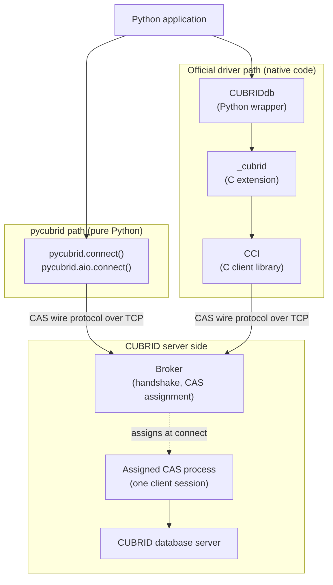

# CAS Architecture and Protocol Concepts

An advanced, reader-facing introduction to how pycubrid talks to CUBRID: what
the Broker, a CAS process, the CAS wire protocol and CCI are, and where the
DB-API calls you already use meet that protocol. You do not need this page to
write your first program; start with [Your First CUBRID Connection](quickstart.md).

This page explains concepts only. The authoritative details stay in the
[CAS Protocol Reference](PROTOCOL.md) (frames, every function code, packet
layouts), the [Architecture](ARCHITECTURE.md) page (request flow, module
boundaries) and the [Connection Guide](CONNECTION.md) (options, TLS,
reconnect behavior). When this page and those pages differ, they win.

---

## Two meanings of "CAS"

In CUBRID, **CAS** means **Common Application Server**: a server process,
managed by the CUBRID Broker, that runs SQL on behalf of one connected client.
Every "CAS" in pycubrid's documentation and code (CAS process, CAS info,
`CHECK_CAS`, CAS wire protocol) uses this meaning.

It is unrelated to **Compare-And-Swap (CAS)**, the atomic "update only if the
value is still what I read" operation used for lock-free programming and for
optimistic concurrency control, for example conditional (ETag-based) writes in
Azure Blob Storage. pycubrid offers no compare-and-swap primitive. In SQL the
usual optimistic pattern is a conditional update such as
`UPDATE ... SET ..., version = version + 1 WHERE id = ? AND version = ?`,
followed by a check that `cursor.rowcount` is `1`.

## The pieces

| Component | What it is | Who provides it |
|---|---|---|
| CUBRID Broker | Listens for client connections (port 33000 by default), answers the connection handshake and assigns a CAS process to the client | CUBRID server installation |
| CAS process | A broker-managed process that serves one client connection at a time: it receives requests, runs SQL against the database server and returns results | CUBRID server installation |
| CUBRID database server | The database engine that stores data and executes queries for the CAS process | CUBRID server installation |
| CAS wire protocol | The binary request/response format spoken over TCP between a client driver and the Broker/CAS (protocol version 8 in pycubrid) | Defined by CUBRID; implemented by each driver |
| CCI | CUBRID's C client interface library; it implements the CAS wire protocol in C | CUBRID (`cubrid-cci`) |
| pycubrid | A pure-Python DB-API 2.0 driver that implements the CAS wire protocol itself, with no CCI and no C extension | This project |

pycubrid is a client. It does not implement the Broker, the CAS process, the
database engine or SQL; it only speaks the protocol that the Broker and CAS
already understand. During the handshake it identifies itself with the JDBC
client type (`CLIENT_JDBC = 3`), so the CAS treats it as a JDBC-compatible
client.

## Two client paths

The official Python driver, `CUBRIDdb`, reaches the same server components
through native code; pycubrid replaces that whole native stack with Python.



Read the diagram as **logical** paths. The Broker takes part in connection
setup: it answers the handshake and hands the client to a CAS process, either
on the same socket (broker status `0`) or by returning a CAS port that the
client reconnects to (status greater than `0`). After that, every request of
the session is served by that CAS process; pycubrid does not go back through
the Broker handshake for each request. It repeats the handshake only when it
opens a new physical session, for example after a failed `CHECK_CAS` probe
(see [Operational consequences](#operational-consequences)).

`pycubrid.compat.cubriddb` and `pycubrid.compat.native` are not the native
path: they imitate parts of the official API on top of pycubrid's pure-Python
transport. They are bounded compatibility subsets, not full native parity; see
the [Official Driver API Inventory](UPSTREAM_COMPATIBILITY.md).

## One program, step by step

The program below uses only ordinary DB-API calls. The rest of this section
maps each call to what pycubrid sends. Function codes are written FC*n*; the
complete list is in [Function Codes](PROTOCOL.md#function-codes).

```python
import pycubrid

conn = pycubrid.connect(
    host="localhost", port=33000, database="testdb", user="dba", password=""
)
cur = conn.cursor()
cur.execute("SELECT class_name FROM db_class WHERE owner_name = ?", ("DBA",))
first = cur.fetchone()
more = cur.fetchmany(10)
conn.commit()
cur.close()
conn.close()
```

| Call | Main requests on the wire |
|---|---|
| `pycubrid.connect()` | Handshake, optional redirect, optional TLS upgrade, `OPEN_DATABASE`; then the escape-mode probe (FC41, FC6, FC1 rollback) unless `no_backslash_escapes` is passed |
| `cur.execute()` | `CHECK_CAS` (FC32) when the last reply was out of transaction, then one `PREPARE_AND_EXECUTE` (FC41) carrying the complete SQL text |
| `cur.fetchone()`, `cur.fetchmany()` | Nothing while buffered rows remain; `FETCH` (FC8) when the buffer is empty and the server still has rows |
| `conn.commit()`, `conn.rollback()` | FC32 when the last reply was out of transaction, `CLOSE_REQ_HANDLE` (FC6) for query handles still held by open cursors, then `END_TRAN` (FC1) |
| `cur.close()` | `CLOSE_REQ_HANDLE` (FC6) if the cursor still holds a handle (here it does not: `commit()` released it) |
| `conn.close()` | FC6 for remaining cursor handles, then `CON_CLOSE` (FC31), then the socket is closed |

### Connect

`connect()` opens a TCP socket to the Broker and sends a 10-byte handshake that
starts with the magic string `CUBRK` (plaintext) or `CUBRS` (TLS requested). The
Broker answers with a signed status: `0` keeps the current socket, a positive
value is a CAS port to reconnect to (without a second handshake), and a
negative value rejects the connection with `OperationalError`. With `ssl`
set, the live socket is upgraded to TLS next, before any credentials are sent.

The driver then sends `OPEN_DATABASE` (database, user and password). The reply
carries the first CAS info bytes, broker information such as statement pooling,
and a session ID. Before returning, the driver learns the server's
backslash-escape mode with one short probe query, which it closes and rolls
back; passing `no_backslash_escapes` skips it. `connect(autocommit=True)` then
sends `SET_DB_PARAMETER` (FC5) and an `END_TRAN` (FC1). Details:
[Broker Handshake](CONNECTION.md#broker-handshake) and
[Escape-mode negotiation](PARAMETER_BINDING.md#escape-mode-negotiation).

### Execute

For ordinary `execute()`, pycubrid renders each `?` placeholder into an escaped
SQL literal on the client and sends **one complete SQL string** in a
`PREPARE_AND_EXECUTE` (FC41) request, together with the autocommit flag. The
reply carries a server-assigned **query handle**, the statement type, column
metadata, the total row count and a first batch of rows. After an `INSERT` the
driver also sends `GET_LAST_INSERT_ID` (FC40) to fill `cursor.lastrowid`.

The query handle names a result held by the CAS process. It is valid only on
the physical session (socket and CAS session) that created it.

### Fetch

`fetchone()` and `fetchmany()` first return rows already received. When those
run out and the server reported more rows, the cursor sends `FETCH` (FC8) with
the query handle, the position reached so far and the fetch size (`fetch_size`,
`100` by default). A large result therefore takes several FETCH requests, all
on the same session as the original execute.

### Commit or roll back

`commit()` and `rollback()` first release the query handles still held by open
cursors with `CLOSE_REQ_HANDLE` (FC6), then send `END_TRAN` (FC1) with commit or
rollback. Rows already buffered in a cursor stay readable, but an unfinished
result cannot fetch more. In autocommit mode each statement carries the
autocommit flag instead and no `END_TRAN` is sent per statement.

### Close

`cursor.close()` releases its handle with FC6 if it still holds one. In
autocommit mode on a server with statement pooling the release can instead
ride on the next FC41 request; see
[Packet Framing](PROTOCOL.md#packet-framing) for this deferred close.
`connection.close()` closes the remaining cursors, sends `CON_CLOSE` (FC31) and
closes the socket. Closing is best effort and never reconnects.

## Frame essentials

After the handshake, every request and reply uses the same frame:

| Field | Size | Meaning |
|---|---|---|
| Data length | 4 bytes | Length of the payload only (excluding the 8-byte header), big-endian signed int |
| CAS info | 4 bytes | Session state echoed between client and CAS; the first byte is the transaction state |
| Payload | variable | Request: function code byte and its arguments. Reply: response code, then result data |

- A **function code** (FC) is the first payload byte of a request and selects
  the operation, for example FC41 to run SQL or FC8 to fetch rows.
- A negative **response code** is an error; the driver turns it into the
  matching DB-API exception.
- The first CAS info byte is `1` for IN_TRAN (a transaction is open) and `0`
  for OUT_TRAN (no open transaction). OUT_TRAN does **not** mean the session or
  socket was released.
- The handshake request and reply, and the `OPEN_DATABASE` request, are sent
  without this frame.

The full layout is in [Packet Framing](PROTOCOL.md#packet-framing).

## How values reach the server

pycubrid has two binding paths. Choosing between them is explicit.

| Call | What is sent | Function codes |
|---|---|---|
| `cursor.execute(sql, params)` | One complete SQL string; values are rendered client-side as escaped SQL literals | FC41 |
| `cursor.executemany(sql, rows)` (default) | For `INSERT`, `UPDATE`, `DELETE`, `MERGE`: one batch of rendered SQL strings; other statements run one execute per row | FC20 (batch) or FC41 per row |
| `cursor.executemany(sql, rows, prepared=True)` | One prepared statement and every row's values as typed host variables; no SQL is rendered. `INSERT`, `UPDATE`, `DELETE` and `MERGE` only; sync and async | FC2 (`PREPARE`), then FC21 (`EXECUTE_ARRAY`) |

The ordinary path is **not** server-side prepared binding: the CAS receives
finished SQL, and the driver keeps no statement-handle cache. The opt-in
`prepared=True` path has its own type rules and differences from literals; see
[`executemany(..., prepared=True)`](PARAMETER_BINDING.md#executemany-preparedtrue)
and [Prepared host-variable mapping](PARAMETER_BINDING.md#prepared-host-variable-mapping).
The separate `pycubrid.compat.native` prepared cursor (FC2, FC3) is a bounded
compatibility API, not part of ordinary cursors.

## Operational consequences

### A session is stateful

It is tempting to think of each request as independent. It is not: a
connection is one physical session with one CAS process, and that session
outlives `commit()` and `rollback()`. Session variables and
`SET TRANSACTION ISOLATION LEVEL` live in the CAS session, and query handles,
LOB handles and schema results belong to the session that created them. A new
physical session starts without any of them; pycubrid restores only the
`autocommit` value you set explicitly.

### CHECK_CAS and session replacement

A CAS process may close the socket right after an OUT_TRAN reply (for example
after a memory-limit restart, `cubrid broker reset`, or handing the CAS to
another waiting client). So, when the last reply was OUT_TRAN, pycubrid sends
`CHECK_CAS` (FC32) before the next request, as the JDBC driver does. If the CAS
answers, the same session is kept. If it does not, the driver opens a
replacement session **once for that request** and sends the request there for
the first time; no SQL is replayed, and requests that depend on the lost
session (a FETCH of its result, a LOB of it) raise `OperationalError` instead.
This costs one extra round trip per request issued out of transaction,
including every statement in autocommit mode. Details:
[CAS recycled at a transaction boundary](CONNECTION.md#cas-recycled-at-a-transaction-boundary)
and [CAS Reconnection](ARCHITECTURE.md#cas-reconnection).

### Unknown outcomes after a transport failure

If the socket fails, times out or returns a malformed reply after a request was
sent, the driver cannot know whether the server ran it. It closes the
connection, retires every handle of that session and raises
`OperationalError`. It never replays the request: an `INSERT`, `UPDATE`,
`DELETE` or `COMMIT` that may already have run is not sent again. Reconnect
with `connect()` or `ping(reconnect=True)`, check the data if needed, and
decide in your application whether the work is safe to retry. See
[Session-state restoration after explicit ping recovery](CONNECTION.md#session-state-restoration-after-explicit-ping-recovery).

### TLS is a client option

TLS is opt-in on the client: `ssl=True` (a verified default context with a TLS
1.2 minimum) or your own `ssl.SSLContext`, for both `pycubrid.connect()` and
`pycubrid.aio.connect()`. The driver requests TLS in the handshake (`CUBRS`)
and upgrades the socket before `OPEN_DATABASE`, so credentials and SQL travel
encrypted between pycubrid and the Broker/CAS. The Broker must accept TLS; if
it rejects the request, `connect()` raises `OperationalError`. Options and
timeouts: [SSL/TLS](CONNECTION.md#ssltls).

## Where to go next

- [CAS Protocol Reference](PROTOCOL.md): frames, the handshake, every function
  code and packet.
- [Architecture](ARCHITECTURE.md): request flow, CAS reconnection and module
  boundaries.
- [Connection Guide](CONNECTION.md): connection options, TLS, autocommit and
  recovery.
- [Parameter Binding](PARAMETER_BINDING.md): the binding contract for both
  paths.
