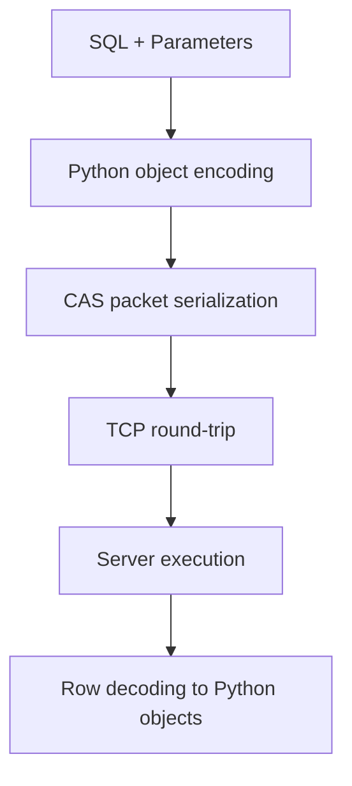
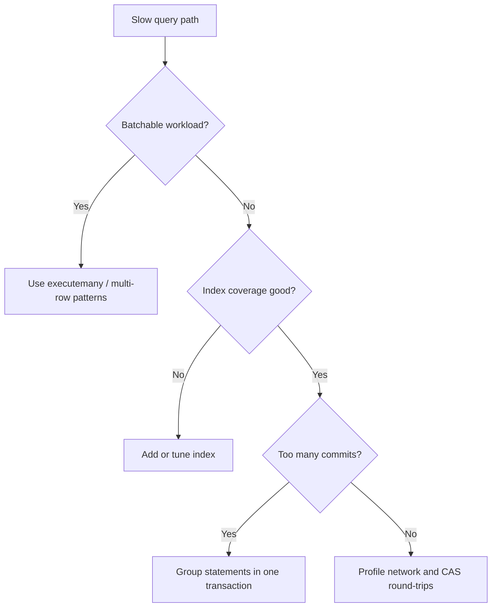
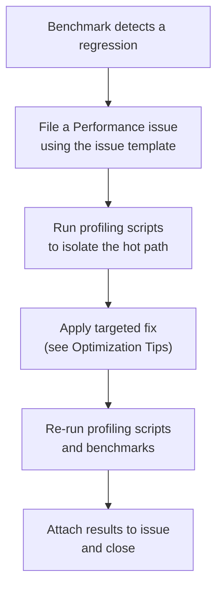

# Performance Guide

This guide covers the performance of `pycubrid` running on CUBRID: how to measure it, what is
measured for the current release, and how to profile and tune it.

It does not compare CUBRID with other database engines. A comparison across engines mixes
server-engine differences with driver overhead, so it cannot tell you how fast the driver is.

---

## Table of Contents

- [Performance Overview](#performance-overview)
- [Benchmark Methodology](#benchmark-methodology)
- [Current Release Baseline](#current-release-baseline)
- [Performance Regression](#performance-regression)
- [Sync and Async Characteristics](#sync-and-async-characteristics)
- [Batch Processing](#batch-processing)
- [Fetch and Memory Performance](#fetch-and-memory-performance)
- [Profiling and Optimization](#profiling-and-optimization)
- [Known Limitations](#known-limitations)
- [Reproduction Guide](#reproduction-guide)

---

## Performance Overview

`pycubrid` is a pure Python DBAPI2 driver that talks to CUBRID over the CAS binary protocol.




- `pycubrid` is pure Python, so packet encode/decode and row conversion run in the interpreter.
- CAS uses a binary protocol with explicit packet framing and parsing; this adds per-request work.
- Small, chatty queries amplify Python-level and round-trip overhead.
- Throughput improves when calls are batched and transaction boundaries are controlled.

Driver performance is tracked against two references, both on the same CUBRID server:

- **Release to release** — the current `pycubrid` release against an earlier release.
- **Driver overhead** — `pycubrid` against the official `CUBRIDdb` driver.

---

## Benchmark Methodology

A benchmark result is only useful when the driver is the one thing that changes.

- **Same server.** Run every driver or release under test against the same CUBRID server, on
  the same host, with the same schema and data. Do not compare results across database
  engines.
- **Same transaction mode.** Set `autocommit` explicitly on every connection under test. Drivers
  have different defaults, and a commit per statement changes the result.
- **Record the environment.** CPU, OS, Python version, CUBRID version, `pycubrid` version and
  `fetch_size`.
- **Repeat.** Run several rounds and report the median and spread, not a single run.

Tools in this repository:

| Tool | What it measures | Needs a server |
|---|---|---|
| `tests/test_benchmarks.py` | Connect, single-row CRUD, 100-row insert/select and prepared reuse (pytest-benchmark) | Yes |
| `tests/test_bench_fetch_parsing.py` | FETCH reply parsing of synthetic 2000-row replies | No |
| `scripts/bench_regression.py` | Median change between two pytest-benchmark JSON files | No |
| `scripts/profile_*.py` | cProfile of connect, execute and fetch | Yes |

Larger workloads and the harness for comparing drivers live in
[cubrid-benchmark](https://github.com/cubrid-lab/cubrid-benchmark).

---

## Current Release Baseline

Measured on 2026-10-11 for [#797](https://github.com/cubrid-lab/pycubrid/issues/797) with the
[`pycubrid-release-baseline`](https://github.com/cubrid-lab/cubrid-benchmark/tree/main/experiments/pycubrid-release-baseline)
experiment in `cubrid-benchmark`. That experiment also holds the raw results, the
reproduction command and the full tables.

| Item | Value |
|---|---|
| CPU | Intel Core i5-9400F @ 2.90 GHz, 6 cores (1 thread per core) |
| Memory | 31 GiB |
| OS | Ubuntu 22.04.5 LTS, Linux 5.15.0-198-generic, x86_64 |
| Python | CPython 3.12.13 |
| CUBRID | 11.4.6 (`cubrid/cubrid:11.4` in Docker 29.2.1, localhost) |
| `pycubrid` | `main` at `2228d66`, and 1.10.0 from PyPI |
| `CUBRIDdb` | cubrid-python `v11.3.0.51` (`c63ab9c`), C extension over CCI |
| Transaction mode | `autocommit=False` on every connection (`connect(autocommit=False)` for `pycubrid`), explicit `commit()` per write |
| `fetch_size` | 100 (default), plus 1,000 and 10,000 for the fetch cases |
| Data | 10,000 rows of `(INT PK, VARCHAR(100), VARCHAR(200), INT)` |
| Repetitions | 5 trials per driver in rotating order; samples pooled; warm-up discarded |
| Load | Shared machine with other users active, so results are noisy |

Every reported iteration was checked for the right row counts and values. Times are pooled
medians in milliseconds per operation; the full report also has p95, IQR and the per-trial
spread.

### Current release against 1.10.0

**No regression was detected.** A regression here means the `main` median is more than 5%
slower and the interquartile ranges do not overlap. The second condition means that only a
slowdown larger than the spread of the samples can be detected. Given the measured spread, the
rule detects slowdowns of at least:

| Operation | Minimum detectable slowdown |
|---|---:|
| `fetchone` / `fetchmany` / `fetchall`, 10,000 rows | 6-8% |
| `executemany()` 10,000 / 1,000 / 100 rows | 5% / 18% / 172% |
| connect + close | 22% |
| SELECT by primary key, single-row writes + commit | 25-26% |
| single-row execute without commit | 271-307% |

The per-trial medians of `main` and 1.10.0 overlap in every case except `executemany()` of
10,000 rows, where `main` is about 0.7% slower in every trial. That is well below the 5%
threshold.

| Operation | `main` | 1.10.0 | Ratio |
|---|---:|---:|---:|
| connect + close | 1.50 | 1.49 | 1.01 |
| SELECT by primary key | 0.60 | 0.60 | 1.00 |
| INSERT + commit | 34.5 | 33.9 | 1.02 |
| UPDATE + commit | 33.8 | 33.9 | 1.00 |
| DELETE + commit | 41.2 | 41.3 | 1.00 |
| `executemany()` 100 / 1,000 / 10,000 rows | 125 / 360 / 3,018 | 125 / 358 / 2,998 | 1.00 / 1.00 / 1.01 |
| `fetchone` / `fetchmany` / `fetchall`, 10,000 rows | 51.2 / 48.4 / 49.7 | 50.6 / 48.9 / 49.6 | 1.01 / 0.99 / 1.00 |

### `pycubrid` against `CUBRIDdb` on the same server

| Operation | `pycubrid` | `CUBRIDdb` | `pycubrid` / `CUBRIDdb` |
|---|---:|---:|---:|
| connect + close | 1.50 | 1.00 | 1.49× |
| SELECT by primary key | 0.60 | 0.55 | 1.10× |
| INSERT / UPDATE + commit | 34.5 / 33.8 | 33.5 / 33.6 | 1.03× / 1.01× |
| `executemany()` 100 / 1,000 / 10,000 rows | 125 / 360 / 3,018 | 109 / 266 / 2,150 | 1.15× / 1.35× / 1.40× |
| `fetchone` / `fetchmany` / `fetchall`, 10,000 rows | 51.2 / 48.4 / 49.7 | 40.6 / 40.7 / 39.4 | 1.26× / 1.19× / 1.26× |

- Single-row writes are bound by the server commit. Latency falls into clusters at about 33,
  41, 75 and 83 ms for both drivers, so driver overhead is a small share of a write.
  (DELETE + commit measured 41.2 ms against 33.8 ms only because the median fell into a
  different cluster.)
- `executemany()` sends one batch request, but it is still slower than `CUBRIDdb`, which runs
  one prepared execute per row; the time is spent on the server, see
  [where the gap comes from](#executemany-against-cubriddb-where-the-gap-comes-from).
- Fetching 10,000 rows takes 19-26% longer than with the C extension.

### Sync against async

PK SELECT throughput, in queries per second. Each worker has its own connection and runs 200
queries.

| Workers | Sync (threads) | Async (`pycubrid.aio` tasks) | `CUBRIDdb` (threads) |
|---:|---:|---:|---:|
| 1 | 1,510 | 1,414 | 1,725 |
| 8 | 5,336 | 5,672 | 981 |
| 32 | 5,173 | 5,693 | 956 |

On one connection, async is about 6% slower than sync. With 8-32 concurrent connections it
is 6-10% faster. From 1 to 8 workers, sync scales about 3.5× and async about 4.0×; both level
off after that. Per-query p95 at 32 workers is 13.0 ms for sync and 8.8 ms for async.
`CUBRIDdb` throughput drops when more than one thread uses it, because its C extension does
not release the GIL during CCI calls.

### `executemany()` batch throughput

| Rows | Time incl. commit (ms) | Rows/s | Peak Python heap |
|---:|---:|---:|---:|
| 100 | 125 | 803 | 42 KiB |
| 1,000 | 360 | 2,780 | 364 KiB |
| 10,000 | 3,018 | 3,314 | 3.6 MiB |

Client memory grows by about 380 bytes per row, which confirms
[Known Limitations](#known-limitations).

### `executemany()` against `CUBRIDdb`: where the gap comes from

The gap above was investigated in
[#822](https://github.com/cubrid-lab/pycubrid/issues/822) with the
[`pycubrid-executemany-overhead`](https://github.com/cubrid-lab/cubrid-benchmark/tree/main/experiments/pycubrid-executemany-overhead)
experiment (CUBRID 11.4.6, five trials, medians, commit included). The numbers come from a
shared, loaded machine; only the medians and the phase shares are reliable.

| Batch of | `pycubrid` / `CUBRIDdb` INSERT | UPDATE | DELETE | MERGE |
|---|---:|---:|---:|---:|
| 100 rows | 1.13× | 1.13× | 1.13× | 1.49× |
| 1,000 rows | 1.39× | 1.65× | 1.48× | 2.64× |
| 10,000 rows | 1.54× | 1.56× | 1.47× | 4.72× |

- **The gap is on the server, not in the driver.** For 10,000 INSERT rows, 95% of the
  statement phase is waiting for the broker's reply. Rendering parameters into SQL is 4% and
  packet write and parse together are under 1%. The broker SQL log shows the CAS busy for
  2,734 of the 2,865 ms the client measured.
- **One round trip does not make a batch cheaper.** The server spends about 275 µs on each
  literal statement in the batch, against about 131 µs on each execute of a statement
  prepared once. A round trip on loopback costs about 76 µs, so sending 10,000 prepared
  executes still finishes sooner than one batch of 10,000 literal statements.
- **Client optimisation cannot close it.** Caching the placeholder tokenisation and similar
  work would recover at most about 2-4% of the statement phase.
- **MERGE is the worst case.** Literal MERGE statements get few plan-cache hits (548-702 of
  1,000 in the broker log), which is why the batch is up to 4.72× `CUBRIDdb`.
- **Memory:** about 360 bytes per row while the batch is built; it is released after the
  call.

What you can do:

- Keep committing once per batch, not once per row. Commit is already 53% of a 100-row batch
  and identical for both drivers.
- For large MERGE batches, or when a batch is much slower than your own row-by-row
  measurement, consider a prepared loop with the explicit `pycubrid.compat.native` cursor
  (one `PREPARE`, then one execute per row). It reached 0.99-1.31× of `CUBRIDdb` for INSERT,
  UPDATE and DELETE and 1.17× for MERGE at 10,000 rows. The measurement ran with autocommit off
  and one explicit commit per batch; the harness set the driver's autocommit flag directly,
  and the public way to get the same mode is `connection.set_autocommit(False)` followed by
  `commit()`.
  Measure it on your own workload first:
  `bind_param()` takes only scalar INT, string and `NULL` values (collections and LOBs use the
  dedicated `bind_set()` and `bind_lob()` APIs), and the error behaviour differs. A prepared
  loop stops at the first failing row. A batch sends every statement to the server even after
  one fails; `executemany()` raises the first returned error and, since #841, reports every
  failed row on it (`batch_index`, `batch_errors`, `batch_rowcounts`; see
  [API_REFERENCE.md](API_REFERENCE.md#partial-failure-which-rows-failed)).
- Do not use `execute()` in a loop as a faster alternative. It was 1.6-6.1× `CUBRIDdb`'s
  `executemany()`, because every row is a new prepare plus extra requests.

Not established: the gap against `CUBRIDdb` on CUBRID 10.2, 11.0 and 11.2, and how the server
time splits between the CAS and the engine. Prepared batch paths were measured on all four
versions; see the next section. The placeholder tokenisation is now cached per call; see
[below](#placeholder-tokenisation-cached-per-executemany-call).

### Placeholder tokenisation cached per `executemany()` call

Since [#837](https://github.com/cubrid-lab/pycubrid/issues/837), the literal batch path of
`executemany()` splits the SQL on its `?` placeholders once per call instead of once per
parameter set. An exact `tuple` or `list` parameter set also skips the `typing.Sequence`
check; any other type takes the full check. The rendered SQL is byte-identical:
`tests/test_executemany_bind_cache.py` compares 390 statements (every literal type family
including subclasses, IANA time zones and the repeated DST hour, quotes, comments,
identifiers, both escape modes) with SQL that `executemany()` rendered before the change, and
the binding contract in [PARAMETER_BINDING.md](PARAMETER_BINDING.md) is unchanged.

10,000 rows of five parameters (`INT`, `VARCHAR`, `DOUBLE`, `DATETIME`, `NULL`), Python 3.12,
Intel Core i5-9400F, medians. "Offline" times `Cursor.executemany()` with
`_send_and_receive` mocked to answer the batch, as `render_with_cursor` in that test does;
"live" runs against a local Docker server with autocommit off and the commit outside the
CPU measurement:

| Measurement | Before | After |
|---|---:|---:|
| Client-side rendering, offline (server reply mocked) | 145 ms | 38.5 ms |
| Client CPU inside a live `executemany()`, CUBRID 11.4 | 194-198 ms | 52-98 ms |
| Client CPU inside a live `executemany()`, CUBRID 10.2 | 195-196 ms | 85-87 ms |
| `split_on_placeholders` time in a live cProfile | 0.12-0.13 s | 0.000 s |

The wall time of the live statement (about 2-6 s on this shared machine) is dominated by the
server and varied by more than the client gain from run to run, so no wall-clock speedup is
claimed. The `SELECT` per-row loop of `executemany()` still tokenises once per row, because
each row is a separate `execute()`.

### Prepared batch paths: the `EXECUTE_ARRAY` evaluation

[#836](https://github.com/cubrid-lab/pycubrid/issues/836) measured two prepared alternatives to
the literal batch with the same workload, in the
[`pycubrid-prepared-batch`](https://github.com/cubrid-lab/cubrid-benchmark/tree/main/experiments/pycubrid-prepared-batch)
experiment. Autocommit was off, the commit was included, and the medians come from five trials on
11.4 and three on the other versions, on a shared machine:

- a prepared loop with `pycubrid.compat.native`: one `PREPARE`, then one execute per row;
- a prototype of the `EXECUTE_ARRAY` request (function code 21): one `PREPARE`, one request
  carrying every row's bound values, one close. The prototype lived in the benchmark harness;
  pycubrid now sends this request with `executemany(..., prepared=True)` (#839, below).

Time of the `EXECUTE_ARRAY` prototype as a fraction of `executemany()` at 10,000 rows:

| CUBRID | INSERT | UPDATE | DELETE | MERGE |
|---|---:|---:|---:|---:|
| 11.4.6 | 0.40 | 0.33 | 0.35 | 0.15 |
| 11.2.9 | 0.44 | 0.38 | 0.39 | 0.16 |
| 11.0.16 | 0.55 | 0.50 | 0.51 | 0.16 |
| 10.2.18 | 0.53 | 0.51 | 0.51 | 0.61 |

- **`EXECUTE_ARRAY` is the fastest path on every version.** On 11.4 the statement phase for 10,000
  rows falls from 2,887 to 954 ms for INSERT and from 13,020 to 1,739 ms for MERGE. It is also
  0.41-0.54× of the prepared loop for INSERT, UPDATE and DELETE.
- **The prepared loop is not faster everywhere.** It is 0.79-1.06× of `executemany()` on 11.4 and
  11.2, but 1.13-1.22× on 11.0 and 10.2 for INSERT, UPDATE and DELETE. MERGE is faster with it on
  every version.
- **Transactions, partial failures and `rowcount` match the current batch.** On all four versions,
  when one row fails `EXECUTE_ARRAY` still executes the other rows, as `executemany()` does today.
  Only the failing row is undone. With autocommit on, each successful row is committed. With
  autocommit off, `rollback()` removes every row and `commit()` keeps the successful ones. The
  per-row counts and their sum are identical, and both paths report the same failed rows on
  the raised exception (#841). The prepared loop stops at the first failing row instead.
- **Types and coercion differ.** At the time of #836 the prepared encoders took only a 32-bit
  `int`, `str`, `None`, INT/STRING collections and LOB handles; #840 widened them to every scalar
  type the literal path renders. Values are coerced as host variables, not literals, so server
  error text differs. With autocommit on, a LOB handle fails after the first row's commit.

Decision: `executemany()` keeps the literal batch by default, because a default switch would change
which values are accepted and how they are converted. The `EXECUTE_ARRAY` path ships as an opt-in,
`executemany(..., prepared=True)`
([#839](https://github.com/cubrid-lab/pycubrid/issues/839)), on the wider prepared type set of
[#840](https://github.com/cubrid-lab/pycubrid/issues/840). Since
[#841](https://github.com/cubrid-lab/pycubrid/issues/841) the raised exception reports every failed
row on both paths; see [API_REFERENCE.md](API_REFERENCE.md#partial-failure-which-rows-failed).

<a id="shipped-prepared-batch"></a>

#### The shipped opt-in: `executemany(..., prepared=True)`

The same comparison through the driver itself, after #839: 10,000 rows of a three-column table
with a primary key, autocommit off, commit included, median of three trials (order alternated),
one container per version on a shared machine (one-minute load average 2.1-2.6). Times are the
literal `executemany()` and then `prepared=True`, in milliseconds:

| CUBRID | INSERT | UPDATE | DELETE | MERGE |
|---|---:|---:|---:|---:|
| 11.4.6 | 3,044 → 1,159 (0.38) | 3,141 → 1,121 (0.36) | 3,116 → 1,117 (0.36) | 10,047 → 2,012 (0.20) |
| 11.2 | 2,942 → 1,300 (0.44) | 3,615 → 1,196 (0.33) | 5,042 → 1,191 (0.24) | 17,708 → 2,164 (0.12) |
| 11.0 | 1,876 → 1,067 (0.57) | 2,131 → 1,094 (0.51) | 1,817 → 1,125 (0.62) | 8,979 → 1,860 (0.21) |
| 10.2 | 2,054 → 1,102 (0.54) | 2,384 → 1,090 (0.46) | 2,092 → 984 (0.47) | 10,426 → 1,842 (0.18) |

The ratios match the prototype for INSERT, UPDATE and DELETE. MERGE gains more than the prototype
measured on 10.2 (0.18 against 0.61) with this statement shape (`MERGE ... USING db_root ON
(t.id = CAST(? AS INT))` on a primary key). The literal 11.2 DELETE time is noisier than the
others. The integration tests (`tests/test_integration_execute_array.py`) check the transaction,
partial-failure, `rowcount`, NULL, mixed-type, collection and LOB behaviour on all four versions.
See [API_REFERENCE.md](API_REFERENCE.md) for the contract.

<a id="large-prepared-batch"></a>

#### Large prepared batches: memory, frame size and failures

[#854](https://github.com/cubrid-lab/pycubrid/issues/854) measured what one large
`executemany(..., prepared=True)` costs the client. Every row is encoded first and all rows go in
one `EXECUTE_ARRAY` frame, so cost grows with the batch.

Setup: rows `(i, "v%09d" % i, i)` into `(id INT PRIMARY KEY, v VARCHAR(32), n INT)`, autocommit
off, one commit. Each case ran once, in a fresh child process. A second fresh process with
`tracemalloc` gave the heap peak; its time is not used. The measurement ran on 2026-10-12 with
pycubrid 1.12.0 (`main` at `65bdd93`) and Python 3.12.13, on Linux 5.15, an Intel i5-9400F
(6 cores) and 31 GiB of RAM. The servers were Docker containers on the same host:
`cubrid/cubrid:10.2` (10.2.18.9024) and `cubrid/cubrid:11.4` (11.4.6.1963). The machine was shared,
with a one-minute load average of 2.3-6.2.

"List" passes a list built before the measurement; "generator" passes a one-shot generator. Time
is the `executemany()` call. Peak RSS is the process maximum (`getrusage`), and growth is that peak
minus the peak before the call. The heap peak is `tracemalloc` during the call. The
1,000,000-row cases ran on 11.4 only. The other RSS and heap values come from the 10.2 run; the
11.4 run differed by at most 0.2 MiB.

| Rows | Input | 10.2 time | 11.4 time | Peak RSS | RSS growth | Heap peak | `EXECUTE_ARRAY` bytes |
|---:|---|---:|---:|---:|---:|---:|---:|
| 10,000 | sync, list | 970 ms | 1,132 ms | 30.7 MiB | 5.6 MiB | 4.7 MiB | 460,030 |
| 10,000 | sync, generator | 960 ms | 1,032 ms | 28.9 MiB | 5.6 MiB | 4.7 MiB | 460,030 |
| 10,000 | async, list | 915 ms | 1,063 ms | 31.5 MiB | 5.4 MiB | 4.7 MiB | 460,030 |
| 10,000 | async, generator | 944 ms | 1,083 ms | 29.9 MiB | 5.4 MiB | 4.7 MiB | 460,030 |
| 100,000 | sync, list | 9,318 ms | 10,866 ms | 92.1 MiB | 52.4 MiB | 47.3 MiB | 4,600,030 |
| 100,000 | sync, generator | 8,746 ms | 10,482 ms | 76.0 MiB | 52.8 MiB | 47.3 MiB | 4,600,030 |
| 100,000 | async, list | 9,567 ms | 10,176 ms | 93.6 MiB | 53.0 MiB | 47.3 MiB | 4,600,030 |
| 100,000 | async, generator | 10,805 ms | 12,522 ms | 77.4 MiB | 53.0 MiB | 47.3 MiB | 4,600,030 |
| 1,000,000 | sync, list | — | 123,905 ms | 707.0 MiB | 522.4 MiB | 473.5 MiB | 46,000,030 |
| 1,000,000 | async, generator | — | 122,718 ms | 547.8 MiB | 523.4 MiB | 473.5 MiB | 46,000,030 |

Every case inserted every row: `rowcount` and `COUNT(*)` matched the row count. The `PREPARE`
request was 81 bytes in every case. The commit took 68-164 ms on 10.2 and 131-645 ms on 11.4 up
to 100,000 rows.

- **Memory grows linearly with the rows, about 0.5 KB per row here.** The heap peak is about 496
  bytes per row at 100,000 and at 1,000,000 rows, about 10.8 times the 46 bytes each row takes on
  the wire. It holds the encoded rows (one binding object per value), the writer's buffer and the
  final frame. Sync and async are the same.
- **A generator lowers the peak only by the size of the input list.** It saves building the list
  (about 16 MiB at 100,000 rows), but the encoded rows are still all kept until the reply.
- **The frame size is exact and predictable.** The `EXECUTE_ARRAY` request is 30 bytes plus
  46 bytes per row for this schema. The slow test checks that.
- **Time grows roughly linearly, and most of it is the server.** 100,000 rows took 8.7-12.5 s.
  1,000,000 rows took about 123 s on 11.4, 11 times the 100,000-row time, while the load
  average rose from 3.3 to 6.2. Encoding and serializing alone, timed offline with
  `_encode_prepared_rows()` and `ExecuteArrayPacket.write()`, take about 0.85 s per 100,000 rows.
- **The frame limit is far beyond these sizes.** `DATA_LENGTH` is a signed 32-bit integer, so a
  frame can carry at most 2,147,483,647 bytes. That is about 46.7 million rows of this schema,
  which would need about 22 GiB of heap first. A batch with large values reaches it sooner: about
  2,000 rows of 1 MiB text. Then `executemany()` raises `DataError` (caused by `struct.error`)
  before any byte of the request is sent. `PREPARE` has run by then: the session stays open, and
  the cursor owns the prepared handle and releases it with its next statement.

Transport failures (offline, sync and async, in
`tests/test_prepared_batch_failure_invariants.py`):

| Failure point | Raised | Can rows have run? | Session afterwards |
|---|---|---|---|
| Before `PREPARE` is sent | `OperationalError`, caused by the socket error | No | Retired |
| After `PREPARE`, before any `EXECUTE_ARRAY` byte | `OperationalError`, caused by the socket error | No | Retired |
| Part of `EXECUTE_ARRAY` sent | `OperationalError`, caused by the socket error | No (no complete request) | Retired |
| Whole request sent, reply missing or cut | `OperationalError` "connection lost during receive" | Yes, and with autocommit they may be committed | Retired |
| Frame over 2,147,483,647 bytes | `DataError`, caused by `struct.error` | No (only `PREPARE`) | Kept |

When a failure retires the session, the cursor's handle is dropped, `rowcount` is `-1` and no row
results are kept. The connection stays closed: the next call raises `InterfaceError` until the
caller reconnects. The batch is never sent again, before or after that reconnect. A generator that
raises while it is read propagates its own exception before anything is sent. After a missing or
cut reply the async cursor reports `asyncio.IncompleteReadError` as the cause; the sync cursor
detects the end of the stream itself and has no cause.

Decision: no runtime change. No failure, unsafe frame or excessive allocation was reproduced up to
1,000,000 rows, and the behavior is linear and predictable. To bound memory, split the input into
several `executemany()` calls. Automatic chunking or an input limit would change transaction and
error semantics, so it is not part of this change.

Not measured: CUBRID 11.0 and 11.2; 1,000,000 rows on 10.2 and for the other two inputs; repeated
trials (each case ran once); server memory; whether a broker refuses a request below the 32-bit
limit (the largest frame sent was 43.9 MiB, which 11.4 accepted; #881 below sent 128 MiB); wide
rows, LOB and collection values (measured in #881 below); TLS and remote networks; Python versions other than 3.12; RSS on other operating systems.

#### Wide values and two connections (#881)

[#881](https://github.com/cubrid-lab/pycubrid/issues/881) repeated the measurement with larger
values and with two batches at once, using `scripts/measure_prepared_wide_rows.py`. Each row is
`(id INT PRIMARY KEY, v <type>)`:

| Profile | Value | Column |
|---|---|---|
| `text-1k` | 1,000 ASCII characters | `VARCHAR(1000)` |
| `text-utf8-8k` | 2,700 Hangul characters (8,100 UTF-8 bytes), a new string per row | `VARCHAR(8192)` |
| `bytes-1k` | 1,024 bytes | `BIT VARYING(8192)` |
| `sequence-50` | `pycubrid.types.Sequence` of 50 strings of 13 characters | `SEQUENCE(VARCHAR(16))` |
| `blob` | one `create_lob()` handle (1 KiB written) bound in every row | `BLOB` (sync only) |

The modes are:
- `sync` and `async`: one connection.
- `sync-2conn`: two threads with one connection each.
- `async-2conn`: two connections on one event loop.

The two connections are separate physical sessions, each with its own table, and their batches start together.

Each case inserted 10,000 rows per connection with autocommit off and one commit, in a fresh child process. A second process with `tracemalloc` gave the heap peak. The heap peak includes the input rows, which are built in the measured process. RSS growth is the process peak minus the peak at start.

The run was on 2026-10-13, with pycubrid `main` at `22b0117`, Python 3.11.15 and CUBRID 11.4.6.1963 in Docker, on the host of the #854 measurement. That host was shared, with a load average of 1.1-8.3. Each case ran once.

| Values | Mode | Rows | Time | Request bytes per row | Heap peak per row | Heap / request | Heap peak | RSS growth |
|---|---|---:|---:|---:|---:|---:|---:|---:|
| `text-1k` | sync | 10,000 | 1,225 ms | 1,023 | 4,566 | 4.5 | 43.5 MiB | 44.0 MiB |
| `text-1k` | async | 10,000 | 2,018 ms | 1,023 | 4,545 | 4.4 | 43.3 MiB | 43.8 MiB |
| `text-1k` | sync-2conn | 20,000 | 1,881 ms | 1,023 | 3,991 | 3.9 | 76.1 MiB | 77.4 MiB |
| `text-1k` | async-2conn | 20,000 | 1,823 ms | 1,023 | 3,981 | 3.9 | 75.9 MiB | 77.6 MiB |
| `text-utf8-8k` | sync | 10,000 | 2,070 ms | 8,123 | 30,984 | 3.8 | 295.5 MiB | 289.6 MiB |
| `text-utf8-8k` | async | 10,000 | 2,093 ms | 8,123 | 36,290 | 4.5 | 346.1 MiB | 348.2 MiB |
| `text-utf8-8k` | sync-2conn | 20,000 | 2,599 ms | 8,123 | 30,970 | 3.8 | 590.7 MiB | 578.0 MiB |
| `text-utf8-8k` | async-2conn | 20,000 | 2,785 ms | 8,123 | 32,821 | 4.0 | 626.0 MiB | 624.2 MiB |
| `bytes-1k` | sync | 10,000 | 2,360 ms | 1,046 | 3,589 | 3.4 | 34.2 MiB | 34.4 MiB |
| `bytes-1k` | async | 10,000 | 2,313 ms | 1,046 | 3,568 | 3.4 | 34.0 MiB | 34.1 MiB |
| `bytes-1k` | sync-2conn | 20,000 | 3,448 ms | 1,046 | 3,001 | 2.9 | 57.2 MiB | 58.4 MiB |
| `bytes-1k` | async-2conn | 20,000 | 3,206 ms | 1,046 | 2,990 | 2.9 | 57.0 MiB | 58.3 MiB |
| `sequence-50` | sync | 10,000 | 5,992 ms | 923 | 8,651 | 9.4 | 82.5 MiB | 84.5 MiB |
| `sequence-50` | async | 10,000 | 4,649 ms | 923 | 8,631 | 9.4 | 82.3 MiB | 84.2 MiB |
| `sequence-50` | sync-2conn | 20,000 | 9,058 ms | 923 | 8,131 | 8.8 | 155.1 MiB | 159.9 MiB |
| `sequence-50` | async-2conn | 20,000 | 6,653 ms | 923 | 8,316 | 9.0 | 158.6 MiB | 164.7 MiB |
| `blob` | sync | 10,000 | 2,731 ms | 86 | 527 | 6.1 | 5.0 MiB | 6.0 MiB |
| `blob` | sync-2conn | 20,000 | 2,975 ms | 86 | 470 | 5.5 | 9.0 MiB | 10.5 MiB |

Every case inserted every row on every connection: `rowcount` and `COUNT(*)` matched. The request size per row is exactly the predicted encoding, which the slow test checks.

- **Wide values cost about three to four and a half times their wire size.** The peak holds the input value, its encoded bytes, the writer's buffer and the final frame. For `text-utf8-8k` that is about 31-36 KB per row, or 296-346 MiB for 10,000 rows.
  - The async cursor adds up to one more copy of the frame (36 KB per row), because the transport keeps a copy of what the socket has not yet accepted.
  - Collections cost more per wire byte (about 9 times), because every element is a separate bound string.
  - A LOB row carries only its 64-byte handle and is the cheapest.
- **Two connections cost the sum of two batches, not more.** The peak with two connections is 1.7-2.0 times the one-connection peak, so the per-row heap is not larger. Concurrency adds no amplification, in threads or in tasks. Each connection still holds its whole batch until its reply, so the client peak is the sum of the concurrent batches.
- **Large single values and server rejections behave as specified** (live, 11.4):
  - One 16, 64 and 128 MiB string, each in a one-row prepared batch into a `STRING` column, was stored and read back. A frame of 128 MiB is accepted.
  - A value too wide for its column (11 characters into `VARCHAR(10)`) fails only its row on the server, with `ProgrammingError` -494, `batch_index` 1 and `batch_rowcounts` `(1, -1, 1)`. The session stays open, and the other rows are kept after `commit()`.
  - The client can only know the 32-bit frame limit before sending, and #854 already covers it.

Decision: no runtime change. No unsafe condition was reproduced. Memory is predictable from the request size: about 3-4.5 times the frame for scalar values, more for collections, and summed over concurrent batches. To bound it, split the input into several `executemany()` calls.

Not measured:
- CUBRID 10.2 to 11.2;
- more than 10,000 rows per connection for these profiles;
- repeated trials;
- server memory;
- more than two connections;
- TLS and remote networks;
- other Python versions and operating systems.

### Fetch throughput and peak memory by `fetch_size`

10,000 rows over localhost:

| Method | `fetch_size` 100 | 1,000 | 10,000 | Peak Python heap (`fetch_size` 100) |
|---|---:|---:|---:|---:|
| `fetchone()` loop | 51.2 ms | — | — | 130 KiB |
| `fetchmany(100)` loop | 48.4 ms | 49.0 ms | 49.5 ms | 132 KiB |
| `fetchall()` | 49.7 ms | 48.9 ms | 48.1 ms | 2.1 MiB (the result list) |

About 200,000 rows/s in every case. Over localhost, `fetch_size` makes no measurable
difference; it may matter on a network with higher latency, which was not measured. Peak memory
was measured only at the default `fetch_size` of 100.

### Not measured

- Async for `CUBRIDdb`, which has no async API.
- A `fetch_size` sweep for `CUBRIDdb`, which does not expose a fetch size.
- Native (C) memory of `CUBRIDdb`. `tracemalloc` only sees the Python heap.
- Peak memory at `fetch_size` 1,000 and 10,000.
- Per-operation RSS. Only the process peak was recorded (about 39 MiB).
- `executemany()` against `CUBRIDdb` on CUBRID versions other than 11.4, and the split of
  `executemany()` server time between the CAS and the engine.
- The extra `lastrowid` round trip.
- Remote networks, TLS, LOB and collection types.
- Python versions other than 3.12, and CUBRID versions other than 11.4 (except the prepared batch
  evaluation, which ran on 10.2-11.4).

### Historical Results (2026-03, pycubrid 0.5.0)

The earliest published `pycubrid` measurements are kept, unchanged, in the
[`baseline-multilang` experiment](https://github.com/cubrid-lab/cubrid-benchmark/tree/main/experiments/baseline-multilang)
of `cubrid-benchmark` (run `2026-03-16_initial`: `pycubrid` 0.5.0, CPython 3.10.12,
CUBRID 11.2 in Docker).

They are **historical** and are not a baseline for the current release. Known limitations:

- They predate the cursor memory-bounding fix
  ([#203](https://github.com/cubrid-lab/pycubrid/issues/203),
  [PR #207](https://github.com/cubrid-lab/pycubrid/pull/207), released in 1.6.0). Before that
  fix, `Cursor` and `AsyncCursor` kept the whole result set in their row buffer, so fetch
  numbers from that period do not reflect current behaviour.
- They predate the fetch fix released in 0.6.0 (commit `bb687dc`). In 0.5.0, `fetchall()`
  returned only the first fetch batch, so SELECT scenarios that read more than one batch did
  not read the whole result.
- That experiment compares two database engines. This guide does not reproduce it, for the
  reason given at the top of the page.

---

## Performance Regression

The weekly **Bug Hunt** workflow (`.github/workflows/bug-hunt.yml`, job `perf-trend`) runs
`tests/test_benchmarks.py` against CUBRID 11.4 and compares the medians with the previous run
using `scripts/bench_regression.py`. It is a trend report: it does not set a fail threshold and
does not gate pull requests or releases.

The release-to-release comparison is published in
[Current Release Baseline](#current-release-baseline): `main` against 1.10.0.

Investigate when:

- The trend report shows a median increase over the previous run.
- A CI run flags a deviation from the previous run's numbers.
- You are about to submit a change to the hot path (protocol.py, packet.py, cursor.py).

### Comparing Two Runs

```bash
# Run the live microbenchmarks on the old and the new code:
pytest tests/test_benchmarks.py --benchmark-enable --benchmark-json=before.json
pytest tests/test_benchmarks.py --benchmark-enable --benchmark-json=after.json

# Report the median change per benchmark (add --fail-threshold PCT to fail on a regression):
python scripts/bench_regression.py --baseline before.json --current after.json
```

### Fetch Reply Parsing (Offline)

`tests/test_bench_fetch_parsing.py` times FC8 FETCH reply parsing with no
server (#559). It covers 2000-row synthetic replies for scalar, text, mixed
(with NULLs) and collection workloads, built with the fuzz seed builders, and
checks every parse against their exact expected rows. Without
`--benchmark-enable` each workload is parsed once as a correctness test, so
required CI has no timing threshold.

```bash
# Time it (30 rounds after 3 warmup rounds), with peak allocation in extra_info:
pytest tests/test_bench_fetch_parsing.py --benchmark-enable \
    --benchmark-json=fetch-parse.json

# Compare two runs:
python scripts/bench_regression.py --baseline before.json --current after.json
```

---

## Sync and Async Characteristics

- `pycubrid.connect()` returns a blocking `Connection`; `pycubrid.aio.connect()` returns an
  `AsyncConnection` that awaits network I/O instead of blocking.
- Both build and parse the same CAS packets, so the per-request encode/decode work is the same.
- An `AsyncConnection` serialises its requests with an `asyncio.Lock`: one connection runs one
  request at a time. Async helps when many connections or other I/O run concurrently on one
  event loop, not when a single connection runs one query after another.
- Async timings from the [timing hooks](#timing--profiling-hooks) include event-loop scheduling
  latency.

Measured sync and async throughput is in [Sync against async](#sync-against-async).

**Event-loop hold of an async batch (#882).** `AsyncCursor.executemany(..., prepared=True)`
encodes every row before its first request, without yielding; the default literal batch of an
`INSERT`, `UPDATE`, `DELETE` or `MERGE` renders its rows the same way. (Other statements run
one awaited request per row.) `scripts/measure_async_prepared_encoding.py`
measures that hold with a second task on the same loop that re-schedules itself with
`sleep(0)`. The figures below are for `prepared=True` with rows `(int, 'v%09d', int)` on
CUBRID 11.4 in Docker, with Python 3.11.15 on one Linux host, from one run:

| Rows | Input | Encoding alone (ms) | Whole call (ms) | Longest wait of the other task (ms) |
|---:|---|---:|---:|---:|
| 1,000 | list | 28.6 | 125.3 | 28.7 |
| 1,000 | generator | 29.2 | 126.7 | 29.2 |
| 10,000 | list | 87.8 | 909.5 | 91.9 |
| 10,000 | generator | 100.9 | 920.6 | 106.6 |
| 100,000 | list | 719.3 | 8,971.0 | 692.7 |
| 100,000 | generator | 759.2 | 8,964.5 | 755.9 |

The longest wait matches the encoding time: the driver-controlled hold is about 7-10 µs per
row of this shape. The rest of the call is not pure network time: it also builds and sends the
`EXECUTE_ARRAY` frame. But it yields to other tasks while it waits for the `PREPARE` and
`EXECUTE_ARRAY` replies, so no longer wait was seen there. A generator adds its own cost to the same hold. The first case includes one-time
warm-up. The hold is not changed: yielding during encoding would need an async encoder separate
from the sync driver's. Split batches of tens of thousands of rows if the loop must stay
responsive. A cancellation requested during encoding is raised before any request is sent (see
the [API reference](API_REFERENCE.md#prepared-batch-preparedtrue)).

---

## Batch Processing

`executemany()` on a sync or async cursor uses a batch path when the statement starts with
`INSERT`, `UPDATE`, `DELETE` or `MERGE`:

1. The driver renders every parameter set into a complete SQL string on the client (see
   [Parameter Binding](PARAMETER_BINDING.md)).
2. It sends all the strings in a single `BatchExecutePacket`, so the whole batch takes one
   round trip instead of one per row.
3. `rowcount` is the sum of the affected rows.

Other statements, such as `SELECT`, fall back to calling `execute()` once per parameter set.
With `prepared=True`, an INSERT, UPDATE, DELETE or MERGE is instead sent as one `PREPARE` and one
`EXECUTE_ARRAY` request with typed values, which takes about a third to a half of the literal
batch's time (a fifth or less for MERGE); see
[the shipped opt-in](#shipped-prepared-batch).
`executemany_batch(sql_list)` sends a list of SQL strings you have already rendered in the same
single request.

Practical advice:

- Group a write burst in one explicit transaction instead of committing per statement.
- Split very large parameter sequences into chunks; see
  [Known Limitations](#known-limitations) for why.

Measured batch throughput is in [`executemany()` batch throughput](#executemany-batch-throughput).
How the batch compares with `CUBRIDdb`, and why it can be slower, is in
[where the gap comes from](#executemany-against-cubriddb-where-the-gap-comes-from).

---

## Fetch and Memory Performance

`fetch_size` sets how many rows the driver asks the CAS broker for in each fetch round trip.
It defaults to `100`. Set it per connection with `pycubrid.connect(..., fetch_size=N)` or per
cursor with `cursor.fetch_size = N` (an integer of at least 1).
`fetch_size` is not `arraysize`: `arraysize` is only the default row count of `fetchmany()`.

Since 1.6.0 ([#203](https://github.com/cubrid-lab/pycubrid/issues/203)), each fetch replaces
the cursor's row buffer instead of adding to it, so the buffer holds at most one fetch batch:

- `fetchone()`, `fetchmany()` and iteration keep memory bounded by `fetch_size`.
- `fetchall()` builds one list with every remaining row, so its memory grows with the result
  set. It releases the internal buffer when it finishes.
- A larger `fetch_size` means fewer round trips and more memory per batch; a smaller one means
  the reverse.

Measured fetch throughput and peak memory for different `fetch_size` values are in
[Fetch throughput and peak memory by `fetch_size`](#fetch-throughput-and-peak-memory-by-fetch_size).

### Profiling Fetch

`scripts/profile_fetch.py` profiles `fetchone`, `fetchmany` and `fetchall` against a live
server.

```bash
# 1000 rows, 50 fetch iterations (default):
python scripts/profile_fetch.py

# 5000 rows, 20 iterations, fetchmany batch size 100:
python scripts/profile_fetch.py --rows 5000 --iterations 20 --fetch-size 100

# Save .prof for snakeviz:
python scripts/profile_fetch.py --output fetch.prof
```

---

## Profiling and Optimization

### Optimization Tips

- Use explicit transactions for write bursts instead of per-statement commits.
- Batch inserts and updates with `executemany()` where possible.
- Reuse long-lived connections to avoid repeated handshake cost.
- Select only required columns and avoid unnecessary full scans.
- Keep hot predicates indexed and validate plans in CUBRID.



### Performance Investigation

Use this workflow when a benchmark detects a measurable regression. The goal is to reproduce,
profile, fix, and verify — without hardcoding thresholds that age badly.



1. **File an issue** — use the
   [Performance Investigation template](../.github/ISSUE_TEMPLATE/performance.yml).
   Paste the benchmark output and link the CI run that triggered this.

2. **Profile the affected operation** — pick the script that matches the slow operation:

   | Operation | Script |
   |-----------|--------|
   | Connection handshake | `scripts/profile_connect.py` |
   | INSERT / SELECT / UPDATE / DELETE | `scripts/profile_execute.py` |
   | Row fetching (fetchone/fetchall/fetchmany) | `scripts/profile_fetch.py` |

3. **Optimise** — guided by cProfile's cumulative time, focus changes on the top frames.
   Keep patches targeted; avoid speculative refactors.

4. **Verify** — re-run the profiling script and the benchmarks.
   Attach before/after numbers to the issue.

### Running the Profiling Scripts

All scripts require a live CUBRID instance. Defaults target `localhost:33000/demodb` with
user `dba`. For `scripts/profile_fetch.py`, see [Profiling Fetch](#profiling-fetch).

#### Connection handshake

```bash
# 100 connect/close cycles (default):
python scripts/profile_connect.py

# Custom target, 50 iterations, save .prof:
python scripts/profile_connect.py \
    --host myhost --port 33000 --database testdb \
    --user dba --password secret \
    --iterations 50 --output connect.prof
```

#### Statement execution

```bash
# All DML operations, 100 iterations each (default):
python scripts/profile_execute.py

# INSERT only, 200 iterations:
python scripts/profile_execute.py --operation insert --iterations 200

# Save .prof for snakeviz:
python scripts/profile_execute.py --output exec.prof
```

#### Visualising .prof files with snakeviz

```bash
pip install snakeviz
snakeviz profile_output.prof
```

snakeviz opens an interactive flame graph in the browser, making it easy to drill into
nested call stacks.

### Timing & Profiling Hooks

For lightweight in-process diagnosis you can opt into the driver's built-in timing
instrumentation instead of running the cProfile-based scripts above. Hooks are **off by
default** — when disabled the timing module is never imported and the hot path runs
unchanged.

#### When to use which

| Use case | Tool |
|---|---|
| "Where is wall-clock time going across `connect` / `execute` / `fetch` / `close` in my application?" | `enable_timing=True` (this section) |
| "Which Python frames inside `cursor.execute` are hot?" | `scripts/profile_execute.py` (cProfile) |
| "Did this change make the driver slower than the previous run?" | [Performance Regression](#performance-regression) |

#### Enabling

Pass the `enable_timing=True` keyword to `pycubrid.connect()`:

```python
import pycubrid

conn = pycubrid.connect(
    host="localhost", port=33000, database="testdb", user="dba",
    enable_timing=True,
)
```

Or set the environment variable so timing is enabled for every connection in a process —
useful in benchmark harnesses and CI jobs:

```bash
export PYCUBRID_ENABLE_TIMING=1   # also accepts true / yes (case-insensitive)
python my_workload.py
```

The explicit keyword always wins over the environment variable. Async connections support
the same keyword on `pycubrid.aio.connect()`.

#### Reading the stats

```python
cur = conn.cursor()
cur.executemany(
    "INSERT INTO bench (n) VALUES (?)",
    [(i,) for i in range(1000)],
)
cur.execute("SELECT n FROM bench")
cur.fetchall()

stats = conn.timing_stats
print(stats)
# TimingStats(connect=1 calls, 12.345ms total, 12.345ms avg,
#             execute=2 calls, 18.700ms total, 9.350ms avg,
#             fetch=1 calls, 4.200ms total, 4.200ms avg,
#             close=0 calls)

# Programmatic access (nanoseconds, ints):
exec_avg_ms = stats.execute_total_ns / stats.execute_count / 1_000_000
print(f"average execute: {exec_avg_ms:.3f} ms")

# Reset between phases
stats.reset()
```

`Connection.timing_stats` is `None` when timing is disabled, so guard accordingly:

```python
if conn.timing_stats is not None:
    print(conn.timing_stats)
```

#### Categories and granularity

| Category | What it covers |
|---|---|
| `connect` | TCP socket setup + CAS broker handshake + database open. Recorded even on failure. |
| `execute` | Successful `Cursor.execute()` and `executemany()` calls, including their round trips. One `executemany()` call counts once on every path; the escape-mode probe of a new session is not counted (#899). |
| `fetch` | Server `FETCH` requests that `fetchone()` / `fetchmany()` / `fetchall()` send for rows beyond the buffer. Rows that arrived with the execute reply are not counted. |
| `close` | `Connection.close()` — `CloseDatabasePacket` round-trip + socket teardown. |

All cursors created from a connection report into the same `TimingStats`. Stats are
**per-connection**, cumulative since the last `reset()`.

#### Overhead and thread-safety

- **Disabled** — the timing module is not imported; per-call cost is a single attribute
  read (`self._timing is None`).
- **Enabled** — two `time.perf_counter_ns()` calls plus a lock-protected accumulator
  update per hook (~hundreds of nanoseconds).
- The `threading.Lock` inside `TimingStats` lets a monitoring thread safely read counters
  while a worker thread drives the connection. The connection itself remains
  `threadsafety = 1` (one connection per thread).

#### Timing limitations

- Async timings include event-loop scheduling latency; treat them as client-side
  end-to-end latency, not pure server time.
- Counters are cumulative only — there is no per-statement history. If you need
  per-statement breakdowns, run the cProfile-based scripts in
  [Performance Investigation](#performance-investigation).
- `ping()` and `commit()` / `rollback()` are not currently timed.

---

## Known Limitations

- **Pure Python.** Packet encode/decode and row conversion run in the interpreter; there is no
  C extension.
- **`executemany()` holds the whole batch in memory.** The batch path renders every parameter
  set into a SQL string before sending, then serialises all of them into one request. Client
  memory grows with the number and size of the parameter sets; split very large sequences into
  chunks.
- **`fetchall()` materialises the result.** Use `fetchone()`, `fetchmany()` or iteration for
  large result sets.
- **Async timing includes the event loop.** See
  [Sync and Async Characteristics](#sync-and-async-characteristics).
- **The published 2026-03 numbers are [historical](#historical-results-2026-03-pycubrid-050).**
  Use the [Current Release Baseline](#current-release-baseline) instead.

---

## Reproduction Guide

1. Start a CUBRID server. The repository's `docker compose up -d` starts one on
   `localhost:33000` with database `testdb` (see [Development](DEVELOPMENT.md)).
2. Run the microbenchmarks on each version you compare, on the same host and server, and save
   the JSON output.
3. Compare the runs with `scripts/bench_regression.py`.
4. For larger workloads, or to compare `pycubrid` with `CUBRIDdb` on the same server, use the
   [cubrid-benchmark](https://github.com/cubrid-lab/cubrid-benchmark) harness. Set
   `autocommit` explicitly for every driver.
5. Report the result in a [Performance issue](../.github/ISSUE_TEMPLATE/performance.yml) with
   the environment listed under [Benchmark Methodology](#benchmark-methodology).

```bash
docker compose up -d
export CUBRID_TEST_URL="cubrid://dba@localhost:33000/testdb"
pytest tests/test_benchmarks.py --benchmark-enable --benchmark-json=current.json
python scripts/bench_regression.py --baseline baseline.json --current current.json
```
