# Architecture guide

> Moved from the root [AGENTS.md](../../AGENTS.md) (#926). Owner: pycubrid maintainers.
> Every rule in the root file still applies. Scope: Package map and module responsibilities. [docs/ARCHITECTURE.md](../ARCHITECTURE.md) explains the design.

## Architecture

The [current package tree](https://github.com/cubrid-lab/pycubrid/tree/main/pycubrid)
has the sync core, the `aio` asyncio package and the opt-in `compat` package. Shared
sync/async logic lives in private `_*_common.py` modules so the two implementations do not
drift. [docs/ARCHITECTURE.md](../ARCHITECTURE.md) explains the request flow, CAS reconnection
and module boundaries; the diagram below is a map of the files, not a design document.

```mermaid
graph TD
    root["pycubrid/"]
    init["__init__.py - PEP 249 globals, connect(), exports"]
    exceptions[exceptions.py - PEP 249 exception hierarchy and warnings]
    errcodes[error_codes.py - CAS/CUBRID error codes, descriptions, SQLSTATE]
    types[types.py - PEP 249 type objects, constructors, typed collections]
    constants[constants.py - CAS protocol constants]
    packet[packet.py - PacketReader/PacketWriter binary serialization]
    protocol[protocol.py - CAS protocol packet classes]
    prepared[_prepared_binding.py - private typed bind encoders]
    conncommon[_connection_common.py - shared connection logic]
    cursorcommon[_cursor_common.py - shared cursor logic and literal binding]
    connection[connection.py - sync Connection]
    cursor[cursor.py - sync Cursor]
    lob[lob.py - LOB support]
    timing[timing.py - optional timing statistics]
    typed[py.typed - PEP 561 marker]
    aio["aio/ - asyncio API"]
    aioinit["__init__.py - pycubrid.aio.connect()"]
    aioconn[connection.py - AsyncConnection]
    aiocursor[cursor.py - AsyncCursor]
    compat["compat/ - opt-in official-driver compatibility"]
    cubriddb[cubriddb.py - CUBRIDdb-style connection]
    compatcursors[cursors.py - CUBRIDdb-style row cursors]
    native[native.py - native-style prepared cursor, set, lob]

    root --> init
    root --> exceptions
    root --> errcodes
    root --> types
    root --> constants
    root --> packet
    root --> protocol
    root --> prepared
    root --> conncommon
    root --> cursorcommon
    root --> connection
    root --> cursor
    root --> lob
    root --> timing
    root --> typed
    root --> aio
    root --> compat
    aio --> aioinit
    aio --> aioconn
    aio --> aiocursor
    compat --> cubriddb
    compat --> compatcursors
    compat --> native
```

### Module Responsibilities

| Module | Role |
|---|---|
| `__init__.py` | PEP 249 module globals (`apilevel`, `threadsafety`, `paramstyle`), `connect()`, re-exports |
| `exceptions.py` | `Warning`, `Error`, `InterfaceError`, `DatabaseError` and the PEP 249 `DatabaseError` subclasses, plus `UnknownConnectionOptionWarning` |
| `error_codes.py` | CAS/CUBRID error-code descriptions, the error-code-to-exception map and SQLSTATE lookup |
| `types.py` | `DBAPIType` class, `STRING`/`BINARY`/`NUMBER`/`DATETIME`/`ROWID` type objects, constructors, typed `Set`/`Multiset`/`Sequence` parameters |
| `constants.py` | `CASFunctionCode`, `CUBRIDDataType`, `CUBRIDStatementType`, protocol/data-size constants (enum members are the source of truth) |
| `packet.py` | Low-level binary read/write with big-endian byte ordering |
| `protocol.py` | High-level CAS packet classes for the implemented function codes |
| `_prepared_binding.py` | Private prepared bind types and encoders for FC3/FC21 (re-exported from `protocol.py`; must not import it, enforced by `tests/test_import_boundaries.py`) |
| `_connection_common.py` | `ConnectionCommonMixin` and pure helpers shared by `connection.py` and `aio/connection.py`: option and timeout validation, charset and TLS context resolution, escape-mode probe, schema results |
| `_cursor_common.py` | `CursorParamsMixin` and pure helpers shared by both cursors: literal parameter formatting and binding, placeholder splitting, `description` building, batch error mapping |
| `connection.py` | `Connection` — TCP socket management, transactions, autocommit, LOB creation, schema info |
| `cursor.py` | `Cursor` — execute, executemany, fetch, callproc, description, iteration |
| `lob.py` | `Lob` class — LOB type, length, file locator, packed handle |
| `timing.py` | `TimingStats`, attached when `enable_timing=True` or `PYCUBRID_ENABLE_TIMING` is set |
| `aio/` | `pycubrid.aio.connect()`, `AsyncConnection` and `AsyncCursor`, the asyncio counterparts of the sync classes |
| `compat/` | Opt-in, provisional compatibility surfaces: `compat.cubriddb` (CUBRIDdb-style connection and `Cursor`/`DictCursor`) and `compat.native` (native-style prepared cursor, `set`, `lob`). See [docs/UPSTREAM_COMPATIBILITY.md](../UPSTREAM_COMPATIBILITY.md) and the staged-namespace rules in [RELEASE_POLICY.md](../../RELEASE_POLICY.md) |
