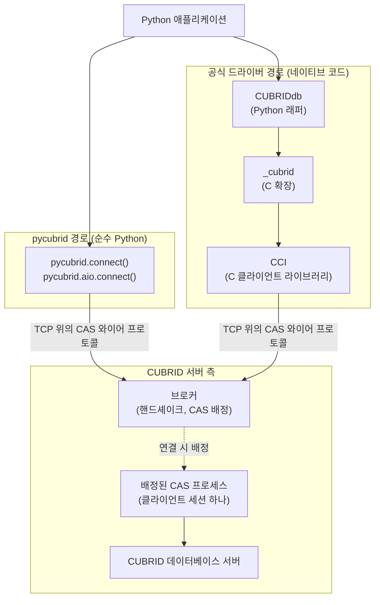

# CAS 아키텍처와 프로토콜 개념 (한국어)

> 🌐 [CAS_OVERVIEW.md](https://github.com/cubrid-lab/pycubrid/blob/main/docs/CAS_OVERVIEW.md)의 번역입니다. 영어 원문이 표준이며, CI가 영어 원문과의 구조 일치를 검사합니다.

pycubrid가 CUBRID와 통신하는 방식을 소개하는 심화 문서입니다. 브로커, CAS
프로세스, CAS 와이어 프로토콜, CCI가 각각 무엇인지, 그리고 이미 사용하는
DB-API 호출이 프로토콜의 어디와 만나는지 설명합니다. 첫 프로그램을 작성하는
데에는 이 문서가 필요하지 않습니다. [처음으로 CUBRID에 연결하기](quickstart.md)부터
시작하세요.

이 문서는 개념만 설명합니다. 정식 세부 사항은 [CAS 프로토콜 참조](PROTOCOL.md)
(프레임, 모든 함수 코드, 패킷 레이아웃), [아키텍처](ARCHITECTURE.md)(요청 흐름,
모듈 경계), [연결 가이드](CONNECTION.md)(옵션, TLS, 재연결 동작)에 있습니다.
이 문서와 그 문서들이 다르면 그 문서들이 우선합니다.

---

## "CAS"의 두 가지 의미

CUBRID에서 **CAS**는 **Common Application Server**를 뜻합니다. CUBRID 브로커가
관리하는 서버 프로세스로, 연결된 클라이언트 하나를 대신해 SQL을 실행합니다.
pycubrid 문서와 코드에 나오는 모든 "CAS"(CAS 프로세스, CAS info, `CHECK_CAS`,
CAS 와이어 프로토콜)는 이 의미입니다.

이는 **Compare-And-Swap**(CAS)과 관계가 없습니다. Compare-And-Swap은 "읽은 값이
그대로일 때만 갱신"하는 원자적 연산으로, 락 없는 프로그래밍과 낙관적 동시성
제어에 쓰입니다. 예를 들어 Azure Blob Storage의 조건부(ETag 기반) 쓰기가 이에
해당합니다. pycubrid는 compare-and-swap 기능을 제공하지 않습니다. SQL에서
흔히 쓰는 낙관적 패턴은
`UPDATE ... SET ..., version = version + 1 WHERE id = ? AND version = ?` 같은
조건부 갱신 후 `cursor.rowcount`가 `1`인지 확인하는 방식입니다.

## 구성 요소

| 구성 요소 | 정체 | 제공 주체 |
|---|---|---|
| CUBRID 브로커 | 클라이언트 연결을 받고(기본 포트 33000) 연결 핸드셰이크에 응답하며 클라이언트에 CAS 프로세스를 배정 | CUBRID 서버 설치본 |
| CAS 프로세스 | 브로커가 관리하는 프로세스로, 한 번에 하나의 클라이언트 연결을 담당: 요청을 받아 데이터베이스 서버에서 SQL을 실행하고 결과를 반환 | CUBRID 서버 설치본 |
| CUBRID 데이터베이스 서버 | 데이터를 저장하고 CAS 프로세스를 위해 쿼리를 실행하는 데이터베이스 엔진 | CUBRID 서버 설치본 |
| CAS 와이어 프로토콜 | 클라이언트 드라이버와 브로커/CAS 사이에 TCP로 주고받는 바이너리 요청/응답 형식(pycubrid는 프로토콜 버전 8) | CUBRID가 정의하고 각 드라이버가 구현 |
| CCI | CUBRID의 C 클라이언트 인터페이스 라이브러리로, CAS 와이어 프로토콜을 C로 구현 | CUBRID (`cubrid-cci`) |
| pycubrid | CCI나 C 확장 없이 CAS 와이어 프로토콜을 직접 구현한 순수 Python DB-API 2.0 드라이버 | 이 프로젝트 |

pycubrid는 클라이언트입니다. 브로커, CAS 프로세스, 데이터베이스 엔진, SQL을
구현하지 않으며, 브로커와 CAS가 이미 이해하는 프로토콜을 말할 뿐입니다.
핸드셰이크에서 JDBC 클라이언트 타입(`CLIENT_JDBC = 3`)으로 자신을 알리므로,
CAS는 pycubrid를 JDBC 호환 클라이언트로 취급합니다.

## 두 가지 클라이언트 경로

공식 Python 드라이버 `CUBRIDdb`는 네이티브 코드를 거쳐 같은 서버 구성 요소에
도달합니다. pycubrid는 그 네이티브 스택 전체를 Python으로 대체합니다.



이 그림은 **논리적** 경로입니다. 브로커는 연결 설정에 참여합니다. 핸드셰이크에
응답하고 클라이언트를 CAS 프로세스에 넘기는데, 같은 소켓을 그대로 쓰거나(브로커
상태 `0`) 클라이언트가 다시 접속할 CAS 포트를 돌려줍니다(상태가 `0`보다 큼).
그 뒤 세션의 모든 요청은 그 CAS 프로세스가 처리하며, pycubrid는 요청마다 브로커
핸드셰이크를 다시 거치지 않습니다. 핸드셰이크를 반복하는 것은 새 물리 세션을
열 때뿐입니다. 예를 들어 `CHECK_CAS` 확인이 실패한 뒤입니다
([운영상의 결과](#운영상의-결과) 참고).

`pycubrid.compat.cubriddb`와 `pycubrid.compat.native`는 네이티브 경로가 아닙니다.
pycubrid의 순수 Python 전송 위에서 공식 API의 일부를 흉내 내는 제한된 호환
기능이며, 네이티브와 완전히 같지는 않습니다.
[공식 드라이버 API 목록](UPSTREAM_COMPATIBILITY.md)을 참고하세요.

## 한 프로그램을 단계별로

아래 프로그램은 일반 DB-API 호출만 사용합니다. 이 절의 나머지 부분은 각 호출이
무엇을 보내는지 대응시킵니다. 함수 코드는 FC*n*으로 적으며, 전체 목록은
[함수 코드](PROTOCOL.md#함수-코드)에 있습니다.

```python
import pycubrid

conn = pycubrid.connect(
    host="localhost", port=33000, database="testdb", user="dba", password=""
)
cur = conn.cursor()
cur.execute("SELECT class_name FROM db_class WHERE owner_name = ?", ("DBA",))
first = cur.fetchone()
more = cur.fetchmany(10)
conn.commit()
cur.close()
conn.close()
```

| 호출 | 와이어에 보내는 주요 요청 |
|---|---|
| `pycubrid.connect()` | 핸드셰이크, 선택적 리다이렉트, 선택적 TLS 업그레이드, `OPEN_DATABASE`. 이어서 `no_backslash_escapes`를 넘기지 않았다면 이스케이프 모드 확인(FC41, FC6, FC1 롤백) |
| `cur.execute()` | 마지막 응답이 트랜잭션 밖이었다면 `CHECK_CAS`(FC32), 그다음 완성된 SQL 텍스트를 담은 `PREPARE_AND_EXECUTE`(FC41) 한 번 |
| `cur.fetchone()`, `cur.fetchmany()` | 버퍼에 행이 남아 있으면 아무것도 보내지 않음. 버퍼가 비었고 서버에 행이 남아 있으면 `FETCH`(FC8) |
| `conn.commit()`, `conn.rollback()` | 마지막 응답이 트랜잭션 밖이었다면 FC32, 열린 커서가 가진 쿼리 핸들마다 `CLOSE_REQ_HANDLE`(FC6), 그다음 `END_TRAN`(FC1) |
| `cur.close()` | 커서가 아직 핸들을 가지고 있으면 `CLOSE_REQ_HANDLE`(FC6) (여기서는 `commit()`이 이미 해제했으므로 없음) |
| `conn.close()` | 남은 커서 핸들에 FC6, 그다음 `CON_CLOSE`(FC31), 그 뒤 소켓을 닫음 |

### 연결

`connect()`는 브로커에 TCP 소켓을 열고 매직 문자열 `CUBRK`(평문) 또는
`CUBRS`(TLS 요청)로 시작하는 10바이트 핸드셰이크를 보냅니다. 브로커는 부호 있는
상태 값으로 응답합니다. `0`이면 현재 소켓을 유지하고, 양수이면 (두 번째
핸드셰이크 없이) 다시 접속할 CAS 포트이며, 음수이면 `OperationalError`로 연결을
거부합니다. `ssl`을 지정했다면 그다음 자격 증명을 보내기 전에 살아 있는 소켓을
TLS로 업그레이드합니다.

이어서 드라이버는 `OPEN_DATABASE`(데이터베이스, 사용자, 비밀번호)를 보냅니다.
응답에는 첫 CAS info 바이트, 문장 풀링 같은 브로커 정보, 세션 ID가 들어 있습니다.
반환하기 전에 드라이버는 짧은 확인 쿼리 한 번으로 서버의 백슬래시 이스케이프
모드를 알아내고, 그 쿼리를 닫은 뒤 롤백합니다. `no_backslash_escapes`를 넘기면
이 단계를 건너뜁니다. `connect(autocommit=True)`는 그다음 `SET_DB_PARAMETER`(FC5)와
`END_TRAN`(FC1)을 보냅니다. 자세한 내용:
[브로커 핸드셰이크](CONNECTION.md#브로커-핸드셰이크),
[이스케이프 모드 협상](PARAMETER_BINDING.md#이스케이프-모드-협상).

### 실행

일반 `execute()`에서 pycubrid는 각 `?` 플레이스홀더를 클라이언트에서 이스케이프된
SQL 리터럴로 렌더링하고, **완성된 SQL 문자열 하나**를 자동 커밋 플래그와 함께
`PREPARE_AND_EXECUTE`(FC41) 요청으로 보냅니다. 응답에는 서버가 배정한 **쿼리
핸들**, 문장 타입, 컬럼 메타데이터, 전체 행 수, 첫 번째 행 묶음이 들어 있습니다.
`INSERT` 뒤에는 `cursor.lastrowid`를 채우기 위해 `GET_LAST_INSERT_ID`(FC40)도
보냅니다.

쿼리 핸들은 CAS 프로세스가 보관하는 결과의 이름입니다. 그 핸들을 만든 물리
세션(소켓과 CAS 세션)에서만 유효합니다.

### 가져오기

`fetchone()`과 `fetchmany()`는 먼저 이미 받은 행을 돌려줍니다. 그 행이 바닥났고
서버가 행이 더 있다고 알렸다면, 커서는 쿼리 핸들, 지금까지 읽은 위치, 가져올
크기(`fetch_size`, 기본값 `100`)를 담아 `FETCH`(FC8)를 보냅니다. 따라서 큰 결과는
여러 번의 FETCH 요청이 필요하며, 모두 원래 실행과 같은 세션에서 이루어집니다.

### 커밋 또는 롤백

`commit()`과 `rollback()`은 먼저 열린 커서가 가진 쿼리 핸들을
`CLOSE_REQ_HANDLE`(FC6)로 해제한 뒤, 커밋 또는 롤백을 담은 `END_TRAN`(FC1)을
보냅니다. 커서에 이미 버퍼된 행은 계속 읽을 수 있지만, 끝나지 않은 결과는 더
가져올 수 없습니다. 오토커밋 모드에서는 각 문장이 자동 커밋 플래그를 담으므로
문장마다 `END_TRAN`을 보내지 않습니다.

### 닫기

`cursor.close()`는 아직 핸들을 가지고 있으면 FC6으로 해제합니다. 문장 풀링을
쓰는 서버에서 오토커밋 모드라면 이 해제가 다음 FC41 요청에 실려 갈 수도
있습니다. 이 지연 닫기는 [패킷 프레이밍](PROTOCOL.md#패킷-프레이밍)을 참고하세요.
`connection.close()`는 남은 커서를 닫고 `CON_CLOSE`(FC31)를 보낸 뒤 소켓을
닫습니다. 닫기는 최선 노력 방식이며 재연결하지 않습니다.

## 프레임 핵심

핸드셰이크 이후의 모든 요청과 응답은 같은 프레임을 씁니다.

| 필드 | 크기 | 의미 |
|---|---|---|
| 데이터 길이 | 4바이트 | 페이로드만의 길이(8바이트 헤더 제외), big-endian 부호 있는 정수 |
| CAS info | 4바이트 | 클라이언트와 CAS가 주고받는 세션 상태. 첫 바이트가 트랜잭션 상태 |
| 페이로드 | 가변 | 요청: 함수 코드 바이트와 인자. 응답: 응답 코드, 그다음 결과 데이터 |

- **함수 코드**(FC)는 요청 페이로드의 첫 바이트로 연산을 고릅니다. 예를 들어
  FC41은 SQL 실행, FC8은 행 가져오기입니다.
- 음수 **응답 코드**는 오류이며, 드라이버가 해당 DB-API 예외로 바꿉니다.
- 첫 CAS info 바이트는 IN_TRAN(트랜잭션이 열림)이면 `1`, OUT_TRAN(열린 트랜잭션
  없음)이면 `0`입니다. OUT_TRAN은 세션이나 소켓이 해제되었다는 뜻이 **아닙니다**.
- 핸드셰이크 요청과 응답, 그리고 `OPEN_DATABASE` 요청은 이 프레임 없이 보냅니다.

전체 레이아웃은 [패킷 프레이밍](PROTOCOL.md#패킷-프레이밍)에 있습니다.

## 값이 서버에 전달되는 방식

pycubrid에는 두 가지 바인딩 경로가 있으며, 어느 쪽을 쓸지는 명시적으로 고릅니다.

| 호출 | 보내는 내용 | 함수 코드 |
|---|---|---|
| `cursor.execute(sql, params)` | 완성된 SQL 문자열 하나. 값은 클라이언트에서 이스케이프된 SQL 리터럴로 렌더링 | FC41 |
| `cursor.executemany(sql, rows)` (기본) | `INSERT`, `UPDATE`, `DELETE`, `MERGE`: 렌더링된 SQL 문자열 묶음 하나. 다른 문장은 행마다 실행 | FC20(배치) 또는 행마다 FC41 |
| `cursor.executemany(sql, rows, prepared=True)` | prepared 문장 하나와 모든 행의 값을 타입 지정 호스트 변수로 전송, SQL 렌더링 없음. `INSERT`, `UPDATE`, `DELETE`, `MERGE`만 해당, 동기와 비동기 모두 지원 | FC2(`PREPARE`), 그다음 FC21(`EXECUTE_ARRAY`) |

일반 경로는 서버 측 prepared 바인딩이 **아닙니다**. CAS는 완성된 SQL을 받고,
드라이버는 문장 핸들 캐시를 두지 않습니다. 선택형 `prepared=True` 경로는 고유한
타입 규칙과 리터럴과의 차이가 있습니다.
[`executemany(..., prepared=True)`](PARAMETER_BINDING.md#executemany-preparedtrue)와
[Prepared 호스트 변수 매핑](PARAMETER_BINDING.md#prepared-호스트-변수-매핑)을
참고하세요. 별도의 `pycubrid.compat.native` prepared 커서(FC2, FC3)는 제한된 호환
API이며 일반 커서의 일부가 아닙니다.

## 운영상의 결과

### 세션은 상태를 가진다

요청 하나하나가 독립적이라고 생각하기 쉽지만 그렇지 않습니다. 연결은 CAS
프로세스 하나와 이어진 물리 세션 하나이며, 그 세션은 `commit()`과 `rollback()`
뒤에도 유지됩니다. 세션 변수와 `SET TRANSACTION ISOLATION LEVEL`은 CAS 세션에
있고, 쿼리 핸들, LOB 핸들, 스키마 결과는 그것을 만든 세션에 속합니다. 새 물리
세션은 이것들 없이 시작하며, pycubrid는 명시적으로 설정한 `autocommit` 값만
복원합니다.

### CHECK_CAS와 세션 교체

CAS 프로세스는 OUT_TRAN 응답 직후 소켓을 닫을 수 있습니다(예: 메모리 한도로 인한
재시작, `cubrid broker reset`, 대기 중인 다른 클라이언트에게 CAS를 넘길 때).
그래서 마지막 응답이 OUT_TRAN이면 pycubrid는 JDBC 드라이버처럼 다음 요청 전에
`CHECK_CAS`(FC32)를 보냅니다. CAS가 응답하면 같은 세션을 유지합니다. 응답하지
않으면 드라이버는 **그 요청에 대해 한 번** 대체 세션을 열고, 요청을 그곳에 처음으로
보냅니다. SQL을 다시 실행하지 않으며, 잃어버린 세션에 의존하는 요청(그 결과의
FETCH, 그 세션의 LOB)은 대신 `OperationalError`를 발생시킵니다. 트랜잭션 밖에서
보내는 요청마다, 즉 오토커밋 모드의 모든 문장마다 왕복이 한 번 더 듭니다. 자세한
내용: [트랜잭션 경계에서 CAS가 재활용되는 경우](CONNECTION.md#트랜잭션-경계에서-cas가-재활용되는-경우),
[CAS 재연결](ARCHITECTURE.md#cas-재연결).

### 전송 실패 뒤의 알 수 없는 결과

요청을 보낸 뒤 소켓이 실패하거나 시간 초과되거나 잘못된 응답이 오면, 드라이버는
서버가 그 요청을 실행했는지 알 수 없습니다. 드라이버는 연결을 닫고 그 세션의 모든
핸들을 폐기한 뒤 `OperationalError`를 발생시킵니다. 요청을 다시 보내지 않으므로,
이미 실행되었을 수 있는 `INSERT`, `UPDATE`, `DELETE`, `COMMIT`은 재전송되지
않습니다. `connect()` 또는 `ping(reconnect=True)`로 다시 연결하고, 필요하면
데이터를 확인한 뒤, 작업을 다시 시도해도 안전한지 애플리케이션에서 판단하세요.
[명시적 ping 복구 후 세션 상태 복원](CONNECTION.md#명시적-ping-복구-후-세션-상태-복원)을
참고하세요.

### TLS는 클라이언트 옵션이다

TLS는 클라이언트에서 선택합니다. `pycubrid.connect()`와 `pycubrid.aio.connect()`
모두 `ssl=True`(TLS 1.2 이상의 검증된 기본 컨텍스트) 또는 직접 만든
`ssl.SSLContext`를 받습니다. 드라이버는 핸드셰이크에서 TLS를 요청하고(`CUBRS`)
`OPEN_DATABASE` 전에 소켓을 업그레이드하므로, 자격 증명과 SQL은 pycubrid와
브로커/CAS 사이에서 암호화되어 전달됩니다. 브로커가 TLS를 받아들여야 하며, 요청을
거부하면 `connect()`가 `OperationalError`를 발생시킵니다. 옵션과 시간 제한:
[SSL/TLS](CONNECTION.md#ssltls).

## 다음 읽을거리

- [CAS 프로토콜 참조](PROTOCOL.md): 프레임, 핸드셰이크, 모든 함수 코드와 패킷.
- [아키텍처](ARCHITECTURE.md): 요청 흐름, CAS 재연결, 모듈 경계.
- [연결 가이드](CONNECTION.md): 연결 옵션, TLS, 오토커밋, 복구.
- [파라미터 바인딩](PARAMETER_BINDING.md): 두 경로의 바인딩 계약.
