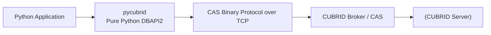
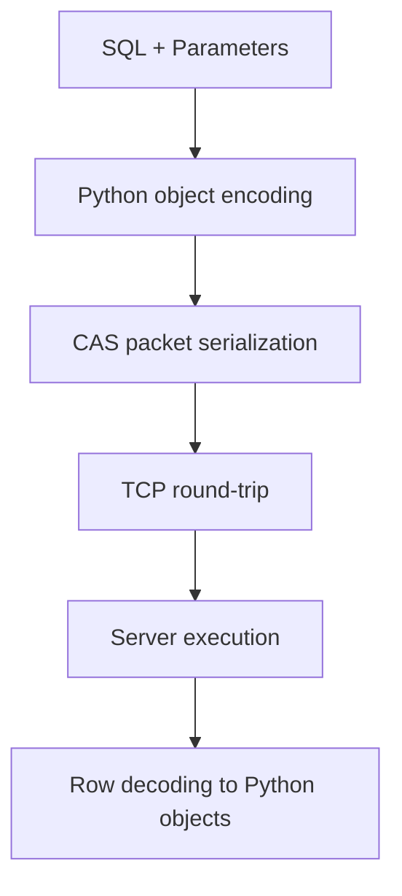
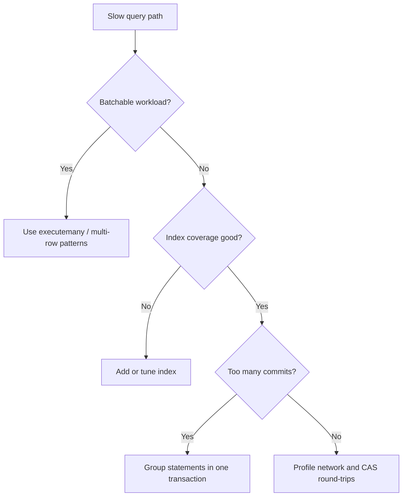
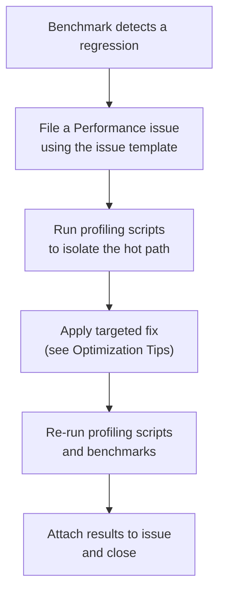

# 성능 가이드 (한국어)

> 🌐 [PERFORMANCE.md](https://github.com/cubrid-lab/pycubrid/blob/main/docs/PERFORMANCE.md)의 번역입니다. 영어 원문이 표준이며, CI가 영어 원문과의 구조 일치를 검사합니다.

이 가이드는 CUBRID에서 동작하는 `pycubrid`의 성능을 다룹니다. 성능을 측정하는 방법, 현재 릴리스에서 측정된 항목, 프로파일링과 튜닝 방법을 설명합니다.

이 가이드는 CUBRID를 다른 데이터베이스 엔진과 비교하지 않습니다. 엔진 간 비교는 서버 엔진의 차이와 드라이버 오버헤드가 섞여 있어 드라이버가 얼마나 빠른지 알려 주지 못합니다.

---

## 목차

- [성능 개요](#성능-개요)
- [벤치마크 방법론](#벤치마크-방법론)
- [현재 릴리스 기준선](#현재-릴리스-기준선)
- [성능 회귀](#성능-회귀)
- [동기와 비동기 특성](#동기와-비동기-특성)
- [배치 처리](#배치-처리)
- [Fetch와 메모리 성능](#fetch와-메모리-성능)
- [프로파일링과 최적화](#프로파일링과-최적화)
- [알려진 한계](#알려진-한계)
- [재현 가이드](#재현-가이드)

---

<a id="성능-개요"></a>

## 성능 개요

`pycubrid`는 CAS 바이너리 프로토콜로 CUBRID와 통신하는 순수 Python DBAPI2 드라이버입니다.





- `pycubrid`는 순수 Python이므로 패킷 인코딩/디코딩과 행 변환이 인터프리터에서 실행됩니다.
- CAS는 명시적 패킷 프레이밍과 파싱을 가진 바이너리 프로토콜을 사용합니다 — 요청별 작업이 추가됩니다.
- 작고 잦은 쿼리는 Python 수준 오버헤드와 왕복 오버헤드를 증폭시킵니다.
- 호출을 배치하고 트랜잭션 경계를 제어하면 처리량이 개선됩니다.

드라이버 성능은 같은 CUBRID 서버에서 두 가지 기준으로 추적합니다:

- **릴리스 간 비교** — 현재 `pycubrid` 릴리스와 이전 릴리스.
- **드라이버 오버헤드** — `pycubrid`와 공식 `CUBRIDdb` 드라이버.

---

<a id="벤치마크-방법론"></a>

## 벤치마크 방법론

벤치마크 결과는 드라이버만 바뀔 때에만 의미가 있습니다.

- **같은 서버.** 측정 대상 드라이버나 릴리스를 모두 같은 호스트, 같은 스키마와 데이터를 가진 같은 CUBRID 서버에서 실행하세요. 데이터베이스 엔진이 다른 결과끼리 비교하지 마세요.
- **같은 트랜잭션 모드.** 측정하는 모든 연결에서 `autocommit`을 명시적으로 설정하세요. 드라이버마다 기본값이 다르고, 문장마다 커밋하면 결과가 달라집니다.
- **환경 기록.** CPU, OS, Python 버전, CUBRID 버전, `pycubrid` 버전, `fetch_size`.
- **반복.** 한 번의 실행이 아니라 여러 라운드를 실행하고 중앙값과 분산을 보고하세요.

이 저장소의 도구:

| 도구 | 측정 대상 | 서버 필요 |
|---|---|---|
| `tests/test_benchmarks.py` | 연결, 단일 행 CRUD, 100행 삽입/조회, prepared 재사용 (pytest-benchmark) | 예 |
| `tests/test_bench_fetch_parsing.py` | 합성 2000행 응답의 FETCH 응답 파싱 | 아니요 |
| `scripts/bench_regression.py` | 두 pytest-benchmark JSON 파일 간 중앙값 변화 | 아니요 |
| `scripts/profile_*.py` | connect, execute, fetch의 cProfile | 예 |

더 큰 워크로드와 드라이버 비교용 하니스는 [cubrid-benchmark](https://github.com/cubrid-lab/cubrid-benchmark)에 있습니다.

---

<a id="현재-릴리스-기준선"></a>

## 현재 릴리스 기준선

2026-10-11에 [#797](https://github.com/cubrid-lab/pycubrid/issues/797)을 위해 `cubrid-benchmark`의 [`pycubrid-release-baseline`](https://github.com/cubrid-lab/cubrid-benchmark/tree/main/experiments/pycubrid-release-baseline) 실험으로 측정했습니다. 원시 결과, 재현 명령과 전체 표도 그 실험에 있습니다.

| 항목 | 값 |
|---|---|
| CPU | Intel Core i5-9400F @ 2.90 GHz, 6코어 (코어당 스레드 1개) |
| 메모리 | 31 GiB |
| OS | Ubuntu 22.04.5 LTS, Linux 5.15.0-198-generic, x86_64 |
| Python | CPython 3.12.13 |
| CUBRID | 11.4.6 (Docker 29.2.1의 `cubrid/cubrid:11.4`, localhost) |
| `pycubrid` | `2228d66` 시점의 `main`, 그리고 PyPI의 1.10.0 |
| `CUBRIDdb` | cubrid-python `v11.3.0.51` (`c63ab9c`), CCI 위의 C 확장 |
| 트랜잭션 모드 | 모든 연결에서 `autocommit=False` (`pycubrid`는 `connect(autocommit=False)`), 쓰기마다 명시적 `commit()` |
| `fetch_size` | 100 (기본값), fetch 케이스에는 1,000과 10,000도 측정 |
| 데이터 | `(INT PK, VARCHAR(100), VARCHAR(200), INT)` 10,000행 |
| 반복 | 드라이버별 5회 시행, 순서를 돌아가며 실행, 샘플을 합침, 워밍업 제외 |
| 부하 | 다른 사용자가 쓰는 공유 머신이므로 결과에 잡음이 있음 |

보고된 모든 반복은 행 수와 값이 맞는지 검사했습니다. 시간은 연산당 밀리초 단위의 합친 중앙값이며, 전체 보고서에는 p95, IQR, 시행별 분산도 있습니다.

<a id="현재-릴리스와-1100-비교"></a>

### 현재 릴리스와 1.10.0 비교

**회귀는 발견되지 않았습니다.** 여기서 회귀는 `main`의 중앙값이 5%보다 더 느리고 사분위 범위가 겹치지 않는 경우입니다. 두 번째 조건 때문에 샘플의 분산보다 큰 저하만 발견할 수 있습니다. 측정된 분산으로 볼 때, 이 규칙이 발견할 수 있는 최소 저하는 다음과 같습니다:

| 연산 | 발견 가능한 최소 저하 |
|---|---:|
| `fetchone` / `fetchmany` / `fetchall`, 10,000행 | 6-8% |
| `executemany()` 10,000 / 1,000 / 100행 | 5% / 18% / 172% |
| connect + close | 22% |
| 기본 키로 SELECT, 단일 행 쓰기 + commit | 25-26% |
| commit 없는 단일 행 실행 | 271-307% |

`main`과 1.10.0의 시행별 중앙값은 10,000행 `executemany()`를 제외한 모든 케이스에서 겹칩니다. 그 케이스에서 `main`은 모든 시행에서 약 0.7% 느리며, 이는 5% 임계값보다 훨씬 작습니다.

| 연산 | `main` | 1.10.0 | 비율 |
|---|---:|---:|---:|
| connect + close | 1.50 | 1.49 | 1.01 |
| 기본 키로 SELECT | 0.60 | 0.60 | 1.00 |
| INSERT + commit | 34.5 | 33.9 | 1.02 |
| UPDATE + commit | 33.8 | 33.9 | 1.00 |
| DELETE + commit | 41.2 | 41.3 | 1.00 |
| `executemany()` 100 / 1,000 / 10,000행 | 125 / 360 / 3,018 | 125 / 358 / 2,998 | 1.00 / 1.00 / 1.01 |
| `fetchone` / `fetchmany` / `fetchall`, 10,000행 | 51.2 / 48.4 / 49.7 | 50.6 / 48.9 / 49.6 | 1.01 / 0.99 / 1.00 |

<a id="같은-서버에서-pycubrid와-cubriddb-비교"></a>

### 같은 서버에서 `pycubrid`와 `CUBRIDdb` 비교

| 연산 | `pycubrid` | `CUBRIDdb` | `pycubrid` / `CUBRIDdb` |
|---|---:|---:|---:|
| connect + close | 1.50 | 1.00 | 1.49× |
| 기본 키로 SELECT | 0.60 | 0.55 | 1.10× |
| INSERT / UPDATE + commit | 34.5 / 33.8 | 33.5 / 33.6 | 1.03× / 1.01× |
| `executemany()` 100 / 1,000 / 10,000행 | 125 / 360 / 3,018 | 109 / 266 / 2,150 | 1.15× / 1.35× / 1.40× |
| `fetchone` / `fetchmany` / `fetchall`, 10,000행 | 51.2 / 48.4 / 49.7 | 40.6 / 40.7 / 39.4 | 1.26× / 1.19× / 1.26× |

- 단일 행 쓰기는 서버의 commit에 묶여 있습니다. 두 드라이버 모두 지연 시간이 약 33, 41, 75, 83 ms 부근에 모이므로, 쓰기에서 드라이버 오버헤드가 차지하는 몫은 작습니다. (DELETE + commit이 33.8 ms 대비 41.2 ms로 측정된 것은 중앙값이 다른 묶음에 걸렸기 때문입니다.)
- `executemany()`는 배치 요청 하나를 보내지만, 행마다 준비된 실행을 한 번씩 하는 `CUBRIDdb`보다 여전히 느립니다. 시간은 서버에서 쓰입니다. [격차의 원인](#executemany-cubriddb-비교-격차의-원인)을 참고하세요.
- 10,000행 fetch는 C 확장보다 19-26% 오래 걸립니다.

<a id="동기와-비동기-비교"></a>

### 동기와 비동기 비교

기본 키 SELECT 처리량(초당 쿼리 수)입니다. 워커마다 자기 연결을 갖고 쿼리 200개를 실행합니다.

| 워커 | 동기 (스레드) | 비동기 (`pycubrid.aio` 태스크) | `CUBRIDdb` (스레드) |
|---:|---:|---:|---:|
| 1 | 1,510 | 1,414 | 1,725 |
| 8 | 5,336 | 5,672 | 981 |
| 32 | 5,173 | 5,693 | 956 |

연결 하나에서는 비동기가 동기보다 약 6% 느립니다. 동시 연결 8-32개에서는 6-10% 빠릅니다. 워커 1개에서 8개로 늘 때 동기는 약 3.5배, 비동기는 약 4.0배 늘어나고, 그 뒤로는 거의 늘지 않습니다. 워커 32개에서 쿼리별 p95는 동기 13.0 ms, 비동기 8.8 ms입니다. `CUBRIDdb`는 C 확장이 CCI 호출 중에 GIL을 놓지 않으므로, 둘 이상의 스레드가 쓰면 처리량이 떨어집니다.

<a id="executemany-배치-처리량"></a>

### `executemany()` 배치 처리량

| 행 수 | commit 포함 시간 (ms) | 초당 행 수 | 최대 Python 힙 |
|---:|---:|---:|---:|
| 100 | 125 | 803 | 42 KiB |
| 1,000 | 360 | 2,780 | 364 KiB |
| 10,000 | 3,018 | 3,314 | 3.6 MiB |

클라이언트 메모리는 행당 약 380바이트씩 늘어나며, [알려진 한계](#알려진-한계)의 설명과 일치합니다.

<a id="executemany-cubriddb-비교-격차의-원인"></a>

### `executemany()`와 `CUBRIDdb` 비교: 격차의 원인

위의 격차는 [#822](https://github.com/cubrid-lab/pycubrid/issues/822)에서
[`pycubrid-executemany-overhead`](https://github.com/cubrid-lab/cubrid-benchmark/tree/main/experiments/pycubrid-executemany-overhead)
실험으로 조사했습니다(CUBRID 11.4.6, 5회 시행, 중앙값, commit 포함). 수치는 다른 사용자도 쓰는 부하가 걸린 머신에서 얻었으므로, 중앙값과 단계별 비중만 신뢰할 수 있습니다.

| 배치 크기 | `pycubrid` / `CUBRIDdb` INSERT | UPDATE | DELETE | MERGE |
|---|---:|---:|---:|---:|
| 100행 | 1.13× | 1.13× | 1.13× | 1.49× |
| 1,000행 | 1.39× | 1.65× | 1.48× | 2.64× |
| 10,000행 | 1.54× | 1.56× | 1.47× | 4.72× |

- **격차는 드라이버가 아니라 서버에 있습니다.** INSERT 10,000행에서 문장 실행 구간의 95%는 브로커의 응답을 기다리는 시간입니다. 파라미터를 SQL로 렌더링하는 데 4%, 패킷 쓰기와 파싱을 합쳐 1% 미만이 듭니다. 브로커 SQL 로그에서 CAS는 클라이언트가 잰 2,865 ms 중 2,734 ms 동안 배치를 처리했습니다.
- **왕복이 한 번이라고 배치가 더 싸지지는 않습니다.** 서버는 배치 안의 리터럴 문장 하나에 약 275 µs를 쓰고, 한 번 준비한 문장의 실행 한 번에는 약 131 µs를 씁니다. 루프백 왕복은 약 76 µs이므로, 준비된 실행 10,000번을 보내는 쪽이 리터럴 문장 10,000개를 한 번에 보내는 배치보다 먼저 끝납니다.
- **클라이언트 최적화로는 메울 수 없습니다.** 플레이스홀더 토큰화 캐시 같은 작업으로 되찾을 수 있는 것은 문장 실행 구간의 최대 약 2-4%입니다.
- **MERGE가 최악의 경우입니다.** 리터럴 MERGE 문장은 계획 캐시 적중이 적어(브로커 로그에서 1,000개 중 548-702개) 배치가 `CUBRIDdb`의 최대 4.72배입니다.
- **메모리:** 배치를 만드는 동안 행당 약 360바이트이며, 호출이 끝나면 해제됩니다.

할 수 있는 일:

- commit은 행마다가 아니라 배치마다 한 번만 하세요. commit은 100행 배치 시간의 53%를 차지하며 두 드라이버에서 같습니다.
- 큰 MERGE 배치이거나, 배치가 직접 측정한 행 단위 실행보다 훨씬 느리다면 명시적 `pycubrid.compat.native` 커서로 준비된 루프(`PREPARE` 한 번, 이후 행마다 실행 한 번)를 고려하세요. 10,000행에서 INSERT, UPDATE, DELETE는 `CUBRIDdb`의 0.99-1.31배, MERGE는 1.17배였습니다. 측정은 autocommit을 끄고 배치마다 명시적 commit을 한 번 하는 방식으로 했으며, 측정 하네스는 드라이버의 autocommit 플래그를 직접 설정했습니다. 같은 모드를 얻는 공개 방법은 `connection.set_autocommit(False)` 후 `commit()`입니다. 먼저 자신의 워크로드에서 측정하세요. `bind_param()`은 스칼라 INT, 문자열, `NULL`만 받고(컬렉션과 LOB은 전용 `bind_set()`, `bind_lob()` API를 씁니다), 오류 동작도 다릅니다. 준비된 루프는 처음 실패한 행에서 멈춥니다. 배치는 한 문장이 실패해도 모든 문장을 서버로 보냅니다. `executemany()`는 반환된 첫 오류를 예외로 발생시키며, #841부터 그 예외에 실패한 모든 행을 담습니다(`batch_index`, `batch_errors`, `batch_rowcounts`, [API_REFERENCE.md](API_REFERENCE.md#부분-실패-실패한-행) 참고).
- `execute()`를 반복문에서 쓰는 것은 더 빠른 대안이 아닙니다. 행마다 새로 준비하고 요청이 추가되므로 `CUBRIDdb`의 `executemany()`의 1.6-6.1배였습니다.

확인되지 않은 것: CUBRID 10.2, 11.0, 11.2에서 `CUBRIDdb`와의 격차, 그리고 서버 시간이 CAS와 엔진에 어떻게 나뉘는지. 준비된 배치 경로는 네 버전 모두에서 측정했습니다(다음 절 참고). 플레이스홀더 토큰화는 이제 호출마다 한 번만 합니다([아래](#executemany-호출마다-한-번만-하는-플레이스홀더-토큰화) 참고).

<a id="executemany-호출마다-한-번만-하는-플레이스홀더-토큰화"></a>

### `executemany()` 호출마다 한 번만 하는 플레이스홀더 토큰화

[#837](https://github.com/cubrid-lab/pycubrid/issues/837)부터 `executemany()`의 리터럴 배치
경로는 SQL을 `?` 플레이스홀더로 나누는 작업을 파라미터 세트마다가 아니라 호출마다 한 번만
합니다. 정확히 `tuple`이나 `list`인 파라미터 세트는 `typing.Sequence` 검사도 건너뛰며, 그
밖의 타입은 전체 검사를 거칩니다. 렌더링된 SQL은 바이트 단위로 같습니다.
`tests/test_executemany_bind_cache.py`가 문장 390개(하위 클래스, IANA 시간대, DST 반복 시간을
포함한 모든 리터럴 타입 계열, 따옴표, 주석, 식별자, 두 이스케이프 모드)를 변경 전
`executemany()`가 렌더링한 SQL과 비교하며, [PARAMETER_BINDING.md](PARAMETER_BINDING.md)의
바인딩 계약은 바뀌지 않습니다.

파라미터 다섯 개(`INT`, `VARCHAR`, `DOUBLE`, `DATETIME`, `NULL`)짜리 10,000행, Python 3.12,
Intel Core i5-9400F, 중앙값. "오프라인"은 그 테스트의 `render_with_cursor`처럼
`_send_and_receive`가 배치에 응답하도록 모의한 `Cursor.executemany()`를 잽니다. "실제"는 로컬
Docker 서버에 autocommit을 끄고 실행하며 commit은 CPU 측정 밖에 둡니다:

| 측정 | 변경 전 | 변경 후 |
|---|---:|---:|
| 클라이언트 렌더링, 오프라인(서버 응답 모의) | 145 ms | 38.5 ms |
| 실제 `executemany()` 안의 클라이언트 CPU, CUBRID 11.4 | 194-198 ms | 52-98 ms |
| 실제 `executemany()` 안의 클라이언트 CPU, CUBRID 10.2 | 195-196 ms | 85-87 ms |
| 실제 cProfile의 `split_on_placeholders` 시간 | 0.12-0.13 s | 0.000 s |

실제 문장의 경과 시간(이 공유 머신에서 약 2-6초)은 서버가 대부분을 차지하고 실행마다
클라이언트 이득보다 크게 흔들렸으므로, 경과 시간 단축은 주장하지 않습니다. `executemany()`의
`SELECT` 행 단위 반복은 행마다 별도의 `execute()`이므로 여전히 행마다 토큰화합니다.

<a id="준비된-배치-경로-execute_array-평가"></a>

### 준비된 배치 경로: `EXECUTE_ARRAY` 평가

[#836](https://github.com/cubrid-lab/pycubrid/issues/836)에서는 리터럴 배치를 대신할 두 가지 준비된 경로를 같은 워크로드로
[`pycubrid-prepared-batch`](https://github.com/cubrid-lab/cubrid-benchmark/tree/main/experiments/pycubrid-prepared-batch)
실험에서 측정했습니다. autocommit은 끄고 commit을 포함했으며, 중앙값은 11.4에서 5회, 다른 버전에서 3회 시행으로 얻었습니다. 다른 사용자도 쓰는 머신에서 측정했습니다.

- `pycubrid.compat.native`의 준비된 루프: `PREPARE` 한 번, 이후 행마다 실행 한 번
- `EXECUTE_ARRAY` 요청(함수 코드 21)의 프로토타입: `PREPARE` 한 번, 모든 행의 바인딩 값을 담은 요청 한 번, 닫기 한 번. 프로토타입은 벤치마크 하네스 안에 있었고, 이제 pycubrid는 `executemany(..., prepared=True)`로 이 요청을 보냅니다(#839, 아래 참고).

10,000행에서 `EXECUTE_ARRAY` 프로토타입의 시간을 `executemany()`에 대한 비율로 나타낸 값:

| CUBRID | INSERT | UPDATE | DELETE | MERGE |
|---|---:|---:|---:|---:|
| 11.4.6 | 0.40 | 0.33 | 0.35 | 0.15 |
| 11.2.9 | 0.44 | 0.38 | 0.39 | 0.16 |
| 11.0.16 | 0.55 | 0.50 | 0.51 | 0.16 |
| 10.2.18 | 0.53 | 0.51 | 0.51 | 0.61 |

- **모든 버전에서 `EXECUTE_ARRAY`가 가장 빠릅니다.** 11.4에서 10,000행의 문장 실행 구간은 INSERT가 2,887 ms에서 954 ms로, MERGE가 13,020 ms에서 1,739 ms로 줄었습니다. INSERT, UPDATE, DELETE에서는 준비된 루프의 0.41-0.54배이기도 합니다.
- **준비된 루프가 어디서나 빠르지는 않습니다.** INSERT, UPDATE, DELETE에서 11.4와 11.2에서는 `executemany()`의 0.79-1.06배이지만 11.0과 10.2에서는 1.13-1.22배입니다. MERGE는 모든 버전에서 준비된 루프가 더 빠릅니다.
- **트랜잭션, 부분 실패, `rowcount`는 현재 배치와 같습니다.** 네 버전 모두에서 한 행이 실패해도 `EXECUTE_ARRAY`는 지금의 `executemany()`처럼 나머지 행을 실행합니다. 실패한 행만 취소됩니다. autocommit이 켜져 있으면 성공한 행마다 commit되고, 꺼져 있으면 `rollback()`은 모든 행을 없애고 `commit()`은 성공한 행을 남깁니다. 행별 건수와 그 합도 같고, 두 경로 모두 발생한 예외에 같은 실패 행을 보고합니다(#841). 반면 준비된 루프는 처음 실패한 행에서 멈춥니다.
- **타입과 변환은 다릅니다.** #836 당시 준비된 인코더는 32비트 `int`, `str`, `None`, INT/STRING 컬렉션, LOB 핸들만 받았고, #840이 리터럴 경로가 렌더링하는 모든 스칼라 타입으로 넓혔습니다. 값은 리터럴이 아니라 호스트 변수로 변환되므로 서버 오류 문구가 다릅니다. autocommit이 켜져 있으면 LOB 핸들은 첫 행의 commit 뒤에 실패합니다.

결정: `executemany()`는 기본으로 리터럴 배치를 유지합니다. 기본 경로를 바꾸면 받을 수 있는 값과 변환 방식이 달라지기 때문입니다. `EXECUTE_ARRAY` 경로는 [#840](https://github.com/cubrid-lab/pycubrid/issues/840)의 더 넓은 준비된 타입 집합 위에서 옵트인 `executemany(..., prepared=True)`([#839](https://github.com/cubrid-lab/pycubrid/issues/839))로 제공됩니다. [#841](https://github.com/cubrid-lab/pycubrid/issues/841)부터 두 경로 모두 발생한 예외가 실패한 모든 행을 알려 줍니다. [API_REFERENCE.md](API_REFERENCE.md#부분-실패-실패한-행)를 참고하세요.

<a id="shipped-prepared-batch"></a>

#### 제공된 옵트인: `executemany(..., prepared=True)`

#839 이후 드라이버 자체로 같은 비교를 했습니다. 기본 키가 있는 3컬럼 테이블에 10,000행, autocommit 끔, commit 포함, 세 번 시행의 중앙값(순서 교대), 버전마다 컨테이너 하나, 다른 사용자도 쓰는 머신(1분 부하 평균 2.1-2.6)입니다. 리터럴 `executemany()` 시간과 `prepared=True` 시간(밀리초)입니다.

| CUBRID | INSERT | UPDATE | DELETE | MERGE |
|---|---:|---:|---:|---:|
| 11.4.6 | 3,044 → 1,159 (0.38) | 3,141 → 1,121 (0.36) | 3,116 → 1,117 (0.36) | 10,047 → 2,012 (0.20) |
| 11.2 | 2,942 → 1,300 (0.44) | 3,615 → 1,196 (0.33) | 5,042 → 1,191 (0.24) | 17,708 → 2,164 (0.12) |
| 11.0 | 1,876 → 1,067 (0.57) | 2,131 → 1,094 (0.51) | 1,817 → 1,125 (0.62) | 8,979 → 1,860 (0.21) |
| 10.2 | 2,054 → 1,102 (0.54) | 2,384 → 1,090 (0.46) | 2,092 → 984 (0.47) | 10,426 → 1,842 (0.18) |

INSERT, UPDATE, DELETE의 비율은 프로토타입과 같습니다. 이 문 형태(기본 키에 대한 `MERGE ... USING db_root ON (t.id = CAST(? AS INT))`)에서 MERGE는 10.2에서 프로토타입이 측정한 것보다 더 빨라집니다(0.61 대신 0.18). 11.2의 리터럴 DELETE 시간은 다른 값보다 잡음이 큽니다. 통합 테스트(`tests/test_integration_execute_array.py`)가 네 버전 모두에서 트랜잭션, 부분 실패, `rowcount`, NULL, 타입 혼합, 컬렉션, LOB 동작을 확인합니다. 계약은 [API_REFERENCE.md](API_REFERENCE.md)를 참고하세요.

<a id="large-prepared-batch"></a>

#### 대량 준비된 배치: 메모리, 프레임 크기, 실패

[#854](https://github.com/cubrid-lab/pycubrid/issues/854)는 큰 `executemany(..., prepared=True)` 한 번이 클라이언트에 드는 비용을 측정했습니다. 모든 행을 먼저 인코딩하고 모든 행을 `EXECUTE_ARRAY` 프레임 하나로 보내므로 비용은 배치와 함께 커집니다.

설정: `(id INT PRIMARY KEY, v VARCHAR(32), n INT)`에 `(i, "v%09d" % i, i)` 행, autocommit 끔, commit 한 번. 각 경우는 새 자식 프로세스에서 한 번씩 실행했습니다. 힙 최대값은 `tracemalloc`을 켠 또 다른 새 프로세스에서 얻었고, 그 시간은 쓰지 않습니다. 측정일은 2026-10-12이고 pycubrid 1.12.0(`main`의 `65bdd93`), Python 3.12.13, Linux 5.15, Intel i5-9400F(6코어), RAM 31 GiB입니다. 서버는 같은 호스트의 Docker 컨테이너 `cubrid/cubrid:10.2`(10.2.18.9024)와 `cubrid/cubrid:11.4`(11.4.6.1963)입니다. 다른 사용자도 쓰는 머신이었고 1분 부하 평균은 2.3-6.2였습니다.

"리스트"는 측정 전에 만든 리스트를, "제너레이터"는 한 번만 순회할 수 있는 제너레이터를 넘깁니다. 시간은 `executemany()` 호출입니다. 최대 RSS는 프로세스 최대값(`getrusage`)이고, 증가량은 그 최대값에서 호출 전 최대값을 뺀 값입니다. 힙 최대값은 호출 중 `tracemalloc` 값입니다. 1,000,000행은 11.4에서만 실행했습니다. 나머지 RSS와 힙은 10.2 실행 값이며 11.4 실행과의 차이는 최대 0.2 MiB입니다.

| 행 | 입력 | 10.2 시간 | 11.4 시간 | 최대 RSS | RSS 증가 | 힙 최대 | `EXECUTE_ARRAY` 바이트 |
|---:|---|---:|---:|---:|---:|---:|---:|
| 10,000 | 동기, 리스트 | 970 ms | 1,132 ms | 30.7 MiB | 5.6 MiB | 4.7 MiB | 460,030 |
| 10,000 | 동기, 제너레이터 | 960 ms | 1,032 ms | 28.9 MiB | 5.6 MiB | 4.7 MiB | 460,030 |
| 10,000 | 비동기, 리스트 | 915 ms | 1,063 ms | 31.5 MiB | 5.4 MiB | 4.7 MiB | 460,030 |
| 10,000 | 비동기, 제너레이터 | 944 ms | 1,083 ms | 29.9 MiB | 5.4 MiB | 4.7 MiB | 460,030 |
| 100,000 | 동기, 리스트 | 9,318 ms | 10,866 ms | 92.1 MiB | 52.4 MiB | 47.3 MiB | 4,600,030 |
| 100,000 | 동기, 제너레이터 | 8,746 ms | 10,482 ms | 76.0 MiB | 52.8 MiB | 47.3 MiB | 4,600,030 |
| 100,000 | 비동기, 리스트 | 9,567 ms | 10,176 ms | 93.6 MiB | 53.0 MiB | 47.3 MiB | 4,600,030 |
| 100,000 | 비동기, 제너레이터 | 10,805 ms | 12,522 ms | 77.4 MiB | 53.0 MiB | 47.3 MiB | 4,600,030 |
| 1,000,000 | 동기, 리스트 | — | 123,905 ms | 707.0 MiB | 522.4 MiB | 473.5 MiB | 46,000,030 |
| 1,000,000 | 비동기, 제너레이터 | — | 122,718 ms | 547.8 MiB | 523.4 MiB | 473.5 MiB | 46,000,030 |

모든 경우 모든 행이 들어갔습니다. `rowcount`와 `COUNT(*)`가 행 수와 같았습니다. `PREPARE` 요청은 모든 경우 81바이트였습니다. commit은 100,000행까지 10.2에서 68-164 ms, 11.4에서 131-645 ms였습니다.

- **메모리는 행 수에 선형으로 늘며 여기서는 행당 약 0.5 KB입니다.** 힙 최대값은 100,000행과 1,000,000행 모두 행당 약 496바이트로, 한 행이 전송에 쓰는 46바이트의 약 10.8배입니다. 인코딩된 행(값마다 바인딩 객체 하나), writer 버퍼, 최종 프레임을 담습니다. 동기와 비동기는 같습니다.
- **제너레이터는 입력 리스트 크기만큼만 최대값을 낮춥니다.** 리스트를 만들지 않아도 되지만(100,000행에서 약 16 MiB), 인코딩된 행은 응답이 올 때까지 모두 남습니다.
- **프레임 크기는 정확히 예측됩니다.** 이 스키마에서 `EXECUTE_ARRAY` 요청은 30바이트에 행당 46바이트를 더한 크기입니다. slow 테스트가 이를 확인합니다.
- **시간은 대략 선형으로 늘고 대부분은 서버 시간입니다.** 100,000행은 8.7-12.5초 걸렸습니다. 1,000,000행은 11.4에서 약 123초로 100,000행 시간의 11배였고, 그동안 부하 평균은 3.3에서 6.2로 올랐습니다. 인코딩과 직렬화만은 `_encode_prepared_rows()`와 `ExecuteArrayPacket.write()`로 오프라인에서 재면 100,000행당 약 0.85초입니다.
- **프레임 한도는 이 크기보다 훨씬 큽니다.** `DATA_LENGTH`는 부호 있는 32비트 정수이므로 프레임은 최대 2,147,483,647바이트입니다. 이 스키마로 약 4,670만 행이고, 그 전에 힙이 약 22 GiB 필요합니다. 큰 값의 배치는 더 빨리 도달합니다. 1 MiB 텍스트라면 약 2,000행입니다. 그러면 `executemany()`는 요청의 어떤 바이트도 보내기 전에 `DataError`(원인 `struct.error`)를 발생시킵니다. 그때는 `PREPARE`가 이미 실행되었으므로 세션은 열린 채이고, 커서가 준비된 핸들을 갖고 있다가 다음 문장에서 해제합니다.

전송 실패(오프라인, 동기와 비동기, `tests/test_prepared_batch_failure_invariants.py`):

| 실패 시점 | 발생 예외 | 행이 실행되었을 수 있는가 | 이후 세션 |
|---|---|---|---|
| `PREPARE`를 보내기 전 | 소켓 오류가 원인인 `OperationalError` | 아니요 | 폐기 |
| `PREPARE` 후, `EXECUTE_ARRAY` 바이트를 보내기 전 | 소켓 오류가 원인인 `OperationalError` | 아니요 | 폐기 |
| `EXECUTE_ARRAY`의 일부만 전송 | 소켓 오류가 원인인 `OperationalError` | 아니요(완전한 요청 없음) | 폐기 |
| 요청 전체 전송 후 응답이 없거나 잘림 | `OperationalError` "connection lost during receive" | 예, autocommit이면 커밋되었을 수도 있음 | 폐기 |
| 2,147,483,647바이트를 넘는 프레임 | `struct.error`가 원인인 `DataError` | 아니요(`PREPARE`만) | 유지 |

실패로 세션이 폐기되면 커서의 핸들도 버려지고 `rowcount`는 `-1`이며 행 결과는 남지 않습니다. 연결은 닫힌 채로 남아, 호출자가 다시 연결할 때까지 다음 호출은 `InterfaceError`를 발생시킵니다. 다시 연결하기 전이든 후든 배치를 다시 보내지 않습니다. 읽는 도중 예외를 던지는 제너레이터는 아무것도 보내기 전에 그 예외를 그대로 전파합니다. 응답이 없거나 잘린 경우 비동기 커서는 원인으로 `asyncio.IncompleteReadError`를 보고하고, 동기 커서는 스트림 끝을 직접 감지하므로 원인이 없습니다.

결정: 런타임 변경 없음. 1,000,000행까지 실패, 안전하지 않은 프레임, 과도한 할당이 재현되지 않았고 동작은 선형이며 예측 가능합니다. 메모리를 제한하려면 입력을 여러 `executemany()` 호출로 나누세요. 자동 분할이나 입력 한도는 트랜잭션과 오류 의미를 바꾸므로 이 변경에 포함하지 않습니다.

측정하지 않음: CUBRID 11.0과 11.2, 10.2와 나머지 두 입력의 1,000,000행, 반복 시행(각 경우 한 번 실행), 서버 메모리, 브로커가 32비트 한도보다 작은 요청을 거부하는지(보낸 가장 큰 프레임은 43.9 MiB였고 11.4가 받아들였습니다), 넓은 행·LOB·컬렉션 값, TLS와 원격 네트워크, Python 3.12 외의 버전, 다른 운영체제의 RSS.

<a id="fetch_size별-fetch-처리량과-최대-메모리"></a>

### `fetch_size`별 fetch 처리량과 최대 메모리

localhost에서 10,000행:

| 방법 | `fetch_size` 100 | 1,000 | 10,000 | 최대 Python 힙 (`fetch_size` 100) |
|---|---:|---:|---:|---:|
| `fetchone()` 반복 | 51.2 ms | — | — | 130 KiB |
| `fetchmany(100)` 반복 | 48.4 ms | 49.0 ms | 49.5 ms | 132 KiB |
| `fetchall()` | 49.7 ms | 48.9 ms | 48.1 ms | 2.1 MiB (결과 리스트) |

모든 경우 초당 약 200,000행입니다. localhost에서는 `fetch_size`에 따른 차이가 측정되지 않았습니다. 지연이 더 큰 네트워크에서는 차이가 날 수 있지만 측정하지 않았습니다. 최대 메모리는 기본 `fetch_size` 100에서만 측정했습니다.

<a id="측정하지-않은-항목"></a>

### 측정하지 않은 항목

- `CUBRIDdb`의 비동기. 비동기 API가 없습니다.
- `CUBRIDdb`의 `fetch_size` 비교. fetch 크기를 노출하지 않습니다.
- `CUBRIDdb`의 네이티브(C) 메모리. `tracemalloc`은 Python 힙만 봅니다.
- `fetch_size` 1,000과 10,000에서의 최대 메모리.
- 연산별 RSS. 프로세스 최대값(약 39 MiB)만 기록했습니다.
- CUBRID 11.4 외의 버전에서 `CUBRIDdb`와 비교한 `executemany()`, 그리고 `executemany()`의 서버 시간이 CAS와 엔진에 어떻게 나뉘는지.
- 추가 `lastrowid` 왕복.
- 원격 네트워크, TLS, LOB, 컬렉션 타입.
- Python 3.12 외의 버전, CUBRID 11.4 외의 버전(10.2-11.4에서 측정한 준비된 배치 평가는 제외).

<a id="과거-결과-2026-03-pycubrid-050"></a>

### 과거 결과 (2026-03, pycubrid 0.5.0)

가장 처음 공개된 `pycubrid` 측정값은 `cubrid-benchmark`의 [`baseline-multilang` 실험](https://github.com/cubrid-lab/cubrid-benchmark/tree/main/experiments/baseline-multilang)에 수정 없이 보존되어 있습니다 (실행 `2026-03-16_initial`: `pycubrid` 0.5.0, CPython 3.10.12, Docker의 CUBRID 11.2).

이 수치는 **과거 결과**이며 현재 릴리스의 기준선이 아닙니다. 알려진 한계:

- 커서 메모리 제한 수정([#203](https://github.com/cubrid-lab/pycubrid/issues/203), [PR #207](https://github.com/cubrid-lab/pycubrid/pull/207), 1.6.0에서 릴리스) 이전에 측정되었습니다. 이 수정 전에는 `Cursor`와 `AsyncCursor`가 결과 집합 전체를 행 버퍼에 보관했으므로, 그 시기의 fetch 수치는 현재 동작을 반영하지 않습니다.
- 0.6.0에서 릴리스된 fetch 수정(커밋 `bb687dc`) 이전에 측정되었습니다. 0.5.0에서는 `fetchall()`이 첫 번째 fetch 배치만 반환했으므로, 배치 하나보다 많이 읽는 SELECT 시나리오는 결과 전체를 읽지 않았습니다.
- 그 실험은 두 데이터베이스 엔진을 비교합니다. 이 가이드는 페이지 첫머리에서 설명한 이유로 그 비교를 싣지 않습니다.

---

<a id="성능-회귀"></a>

## 성능 회귀

주간 **Bug Hunt** 워크플로(`.github/workflows/bug-hunt.yml`, 잡 `perf-trend`)는 CUBRID 11.4에서 `tests/test_benchmarks.py`를 실행하고 `scripts/bench_regression.py`로 이전 실행과 중앙값을 비교합니다. 이것은 추세 보고서입니다: 실패 임계값을 두지 않으며 풀 리퀘스트나 릴리스를 막지 않습니다.

릴리스 간 비교는 [현재 릴리스 기준선](#현재-릴리스-기준선)에 있습니다: `main`과 1.10.0 비교.

다음과 같을 때 조사하세요:

- 추세 보고서가 이전 실행 대비 중앙값 증가를 보일 때.
- CI 실행이 이전 실행 수치와의 편차를 플래그할 때.
- 핫 경로(protocol.py, packet.py, cursor.py)에 변경을 제출하기 직전.

### 두 실행 비교

```bash
# 이전 코드와 새 코드에서 라이브 마이크로벤치마크 실행:
pytest tests/test_benchmarks.py --benchmark-enable --benchmark-json=before.json
pytest tests/test_benchmarks.py --benchmark-enable --benchmark-json=after.json

# 벤치마크별 중앙값 변화 보고 (회귀 시 실패하려면 --fail-threshold PCT 추가):
python scripts/bench_regression.py --baseline before.json --current after.json
```

### FETCH 응답 파싱 (오프라인)

`tests/test_bench_fetch_parsing.py`는 서버 없이 FC8 FETCH 응답 파싱 시간을
측정합니다(#559). 스칼라, 텍스트, 혼합(NULL 포함), 컬렉션 워크로드에 대해 fuzz
시드 빌더로 만든 2000행 합성 응답을 사용하고, 모든 파싱 결과를 빌더가 정한 정확한
기대 행과 비교합니다. `--benchmark-enable` 없이 실행하면 각 워크로드를 한 번만
파싱하는 정확성 테스트가 되므로, 필수 CI에는 시간 임계값이 없습니다.

```bash
# 시간 측정 (워밍업 3회 후 30라운드), 최대 할당량은 extra_info에 기록:
pytest tests/test_bench_fetch_parsing.py --benchmark-enable \
    --benchmark-json=fetch-parse.json

# 두 실행 비교:
python scripts/bench_regression.py --baseline before.json --current after.json
```

---

<a id="동기와-비동기-특성"></a>

## 동기와 비동기 특성

- `pycubrid.connect()`는 블로킹 `Connection`을, `pycubrid.aio.connect()`는 블로킹 대신 네트워크 I/O를 await하는 `AsyncConnection`을 반환합니다.
- 둘 다 같은 CAS 패킷을 만들고 파싱하므로 요청별 인코딩/디코딩 작업은 같습니다.
- `AsyncConnection`은 `asyncio.Lock`으로 요청을 직렬화합니다: 연결 하나는 한 번에 요청 하나를 실행합니다. 비동기는 하나의 이벤트 루프에서 여러 연결이나 다른 I/O가 동시에 실행될 때 도움이 되며, 연결 하나가 쿼리를 차례로 실행할 때는 도움이 되지 않습니다.
- [타이밍 훅](#타이밍--프로파일링-훅)의 비동기 타이밍에는 이벤트 루프 스케줄링 지연이 포함됩니다.

측정된 동기와 비동기 처리량은 [동기와 비동기 비교](#동기와-비동기-비교)에 있습니다.

**비동기 배치의 이벤트 루프 점유(#882).** `AsyncCursor.executemany(..., prepared=True)`는 첫
요청 전에 양보하지 않고 모든 행을 인코딩하며, `INSERT`, `UPDATE`, `DELETE`, `MERGE`의 기본
리터럴 배치도 같은 방식으로 행을 렌더링합니다(그 밖의 문은 행마다 await하는 요청을 하나씩
보냅니다). `scripts/measure_async_prepared_encoding.py`는 같은 루프에서
`sleep(0)`으로 자신을 다시 예약하는 두 번째 태스크로 이 점유 시간을 측정합니다. 아래 값은
Docker의 CUBRID 11.4, 한 Linux 호스트의 Python 3.11.15에서 `(int, 'v%09d', int)` 행으로
`prepared=True`를 한 번 실행한 결과입니다:

| 행 | 입력 | 인코딩만 (ms) | 호출 전체 (ms) | 다른 태스크의 최장 대기 (ms) |
|---:|---|---:|---:|---:|
| 1,000 | list | 28.6 | 125.3 | 28.7 |
| 1,000 | generator | 29.2 | 126.7 | 29.2 |
| 10,000 | list | 87.8 | 909.5 | 91.9 |
| 10,000 | generator | 100.9 | 920.6 | 106.6 |
| 100,000 | list | 719.3 | 8,971.0 | 692.7 |
| 100,000 | generator | 759.2 | 8,964.5 | 755.9 |

최장 대기는 인코딩 시간과 같습니다. 드라이버가 제어하는 점유는 이 형태의 행 하나당
약 7-10 µs입니다. 호출의 나머지는 순수한 네트워크 시간이 아니라 `EXECUTE_ARRAY` 프레임을 만들고
보내는 시간도 포함하지만, `PREPARE`와 `EXECUTE_ARRAY` 응답을 기다리는 동안 다른 태스크에
양보하므로 그 구간에서는 더 긴 대기가 보이지 않았습니다.
제너레이터는 자신의 비용을 같은 점유에 더합니다. 첫 경우에는 한 번의 준비 시간이 포함됩니다.
점유는 바꾸지 않았습니다. 인코딩 중에 양보하려면 동기 드라이버와 별도인 비동기 인코더가
필요합니다. 루프의 응답성이 중요하면 수만 행의 배치는 나누세요. 인코딩 중에 요청된 취소는
어떤 요청도 보내기 전에 발생합니다([API 레퍼런스](API_REFERENCE.md#준비된-배치-preparedtrue) 참고).

---

<a id="배치-처리"></a>

## 배치 처리

동기 또는 비동기 커서의 `executemany()`는 문장이 `INSERT`, `UPDATE`, `DELETE`, `MERGE`로 시작하면 배치 경로를 사용합니다:

1. 드라이버가 모든 파라미터 세트를 클라이언트에서 완전한 SQL 문자열로 렌더링합니다 ([파라미터 바인딩](PARAMETER_BINDING.md) 참고).
2. 모든 문자열을 하나의 `BatchExecutePacket`으로 보내므로, 배치 전체가 행마다 왕복하는 대신 한 번의 왕복으로 끝납니다.
3. `rowcount`는 영향받은 행 수의 합입니다.

`SELECT` 같은 다른 문장은 파라미터 세트마다 `execute()`를 한 번씩 호출하는 방식으로 대체됩니다. `prepared=True`이면 INSERT, UPDATE, DELETE, MERGE를 타입이 있는 값과 함께 `PREPARE` 한 번과 `EXECUTE_ARRAY` 요청 한 번으로 보내며, 리터럴 배치 시간의 약 3분의 1에서 2분의 1(MERGE는 5분의 1 이하)이 걸립니다. [제공된 옵트인](#shipped-prepared-batch)을 참고하세요. `executemany_batch(sql_list)`는 이미 렌더링한 SQL 문자열 목록을 같은 단일 요청으로 보냅니다.

실용적인 조언:

- 쓰기 폭주는 문장마다 커밋하지 말고 하나의 명시적 트랜잭션으로 묶으세요.
- 매우 큰 파라미터 시퀀스는 나누어 보내세요. 이유는 [알려진 한계](#알려진-한계)를 참고하세요.

측정된 배치 처리량은 [`executemany()` 배치 처리량](#executemany-배치-처리량)에 있습니다.
`CUBRIDdb`와의 비교와 배치가 더 느릴 수 있는 이유는 [격차의 원인](#executemany-cubriddb-비교-격차의-원인)에 있습니다.

---

<a id="fetch와-메모리-성능"></a>

## Fetch와 메모리 성능

`fetch_size`는 드라이버가 fetch 왕복마다 CAS 브로커에 요청하는 행 수입니다. 기본값은 `100`입니다. 연결별로 `pycubrid.connect(..., fetch_size=N)`, 커서별로 `cursor.fetch_size = N`(1 이상의 정수)으로 설정합니다.
`fetch_size`는 `arraysize`와 다릅니다: `arraysize`는 `fetchmany()`의 기본 행 수일 뿐입니다.

1.6.0([#203](https://github.com/cubrid-lab/pycubrid/issues/203))부터 각 fetch는 커서의 행 버퍼에 추가하지 않고 버퍼를 교체하므로, 버퍼에는 최대 한 fetch 배치만 남습니다:

- `fetchone()`, `fetchmany()`, 반복(iteration)은 메모리를 `fetch_size`로 제한합니다.
- `fetchall()`은 남은 모든 행으로 리스트 하나를 만들므로 메모리가 결과 집합 크기에 비례해 커집니다. 끝나면 내부 버퍼를 해제합니다.
- `fetch_size`가 크면 왕복이 줄고 배치당 메모리가 늘어나며, 작으면 그 반대입니다.

측정된 `fetch_size` 값별 fetch 처리량과 최대 메모리는 [`fetch_size`별 fetch 처리량과 최대 메모리](#fetch_size별-fetch-처리량과-최대-메모리)에 있습니다.

<a id="fetch-프로파일링"></a>

### Fetch 프로파일링

`scripts/profile_fetch.py`는 라이브 서버에서 `fetchone`, `fetchmany`, `fetchall`을 프로파일링합니다.

```bash
# 1000행, fetch 50회 반복 (기본):
python scripts/profile_fetch.py

# 5000행, 20회 반복, fetchmany 배치 크기 100:
python scripts/profile_fetch.py --rows 5000 --iterations 20 --fetch-size 100

# snakeviz용 .prof 저장:
python scripts/profile_fetch.py --output fetch.prof
```

---

<a id="프로파일링과-최적화"></a>

## 프로파일링과 최적화

### 최적화 팁

- 쓰기 폭주 시 문장별 커밋 대신 명시적 트랜잭션을 사용하세요.
- 가능하면 `executemany()`로 삽입과 갱신을 배치하세요.
- 반복되는 핸드셰이크 비용을 피하기 위해 장수명 연결을 재사용하세요.
- 필요한 컬럼만 선택하고 불필요한 전체 스캔을 피하세요.
- 핫 조건자에 인덱스를 유지하고 CUBRID에서 실행 계획을 검증하세요.



<a id="성능-조사"></a>

### 성능 조사

벤치마크가 측정 가능한 회귀를 감지할 때 이 워크플로를 사용하세요. 목표는 재현·프로파일·수정·검증입니다 — 쉽게 낡는 하드코딩 임계값 없이.



1. **이슈 제출** — [성능 조사 템플릿](https://github.com/cubrid-lab/pycubrid/blob/main/.github/ISSUE_TEMPLATE/performance.yml)을 사용하세요. 벤치마크 출력을 붙여넣고 이를 촉발한 CI 실행을 링크하세요.

2. **영향받는 연산 프로파일링** — 느린 연산에 맞는 스크립트를 고르세요:

   | 연산 | 스크립트 |
   |-----------|--------|
   | 연결 핸드셰이크 | `scripts/profile_connect.py` |
   | INSERT / SELECT / UPDATE / DELETE | `scripts/profile_execute.py` |
   | 행 가져오기 (fetchone/fetchall/fetchmany) | `scripts/profile_fetch.py` |

3. **최적화** — cProfile의 누적 시간에 따라 상위 프레임에 변경을 집중하세요. 패치는 표적화되게; 투기적 리팩터링은 피하세요.

4. **검증** — 프로파일링 스크립트와 벤치마크를 재실행하세요. 이슈에 이전/이후 수치를 첨부하세요.

### 프로파일링 스크립트 실행

모든 스크립트는 라이브 CUBRID 인스턴스가 필요합니다. 기본값은 사용자 `dba`로 `localhost:33000/demodb`를 대상으로 합니다. `scripts/profile_fetch.py`는 [Fetch 프로파일링](#fetch-프로파일링)을 참고하세요.

#### 연결 핸드셰이크

```bash
# connect/close 100사이클 (기본):
python scripts/profile_connect.py

# 커스텀 대상, 50회 반복, .prof 저장:
python scripts/profile_connect.py \
    --host myhost --port 33000 --database testdb \
    --user dba --password secret \
    --iterations 50 --output connect.prof
```

#### 문장 실행

```bash
# 모든 DML 연산, 각 100회 반복 (기본):
python scripts/profile_execute.py

# INSERT만, 200회 반복:
python scripts/profile_execute.py --operation insert --iterations 200

# snakeviz용 .prof 저장:
python scripts/profile_execute.py --output exec.prof
```

#### snakeviz로 .prof 파일 시각화

```bash
pip install snakeviz
snakeviz profile_output.prof
```

snakeviz는 브라우저에서 인터랙티브 플레임 그래프를 열어 중첩 호출 스택을 파고들기 쉽게 합니다.

<a id="타이밍--프로파일링-훅"></a>

### 타이밍·프로파일링 훅

가벼운 프로세스 내 진단을 위해서는 위의 cProfile 기반 스크립트 대신 드라이버 내장 타이밍 계측을 옵트인할 수 있습니다. 훅은 **기본 꺼짐**입니다 — 비활성 시 타이밍 모듈을 임포트하지 않고 핫 경로가 그대로 실행됩니다.

#### 무엇을 쓸지

| 사용 사례 | 도구 |
|---|---|
| "내 애플리케이션에서 `connect` / `execute` / `fetch` / `close`에 실제 시간이 얼마나 가나?" | `enable_timing=True` (이 섹션) |
| "`cursor.execute` 내부의 어느 Python 프레임이 뜨거운가?" | `scripts/profile_execute.py` (cProfile) |
| "이 변경으로 드라이버가 이전 실행보다 느려졌나?" | [성능 회귀](#성능-회귀) |

#### 활성화

`pycubrid.connect()`에 `enable_timing=True` 키워드를 전달하세요:

```python
import pycubrid

conn = pycubrid.connect(
    host="localhost", port=33000, database="testdb", user="dba",
    enable_timing=True,
)
```

또는 환경 변수를 설정해 프로세스의 모든 연결에 타이밍을 활성화하세요 — 벤치마크 하니스와 CI 잡에서 유용합니다:

```bash
export PYCUBRID_ENABLE_TIMING=1   # true / yes도 허용 (대소문자 무시)
python my_workload.py
```

명시적 키워드가 항상 환경 변수보다 우선합니다. 비동기 연결도 `pycubrid.aio.connect()`에서 같은 키워드를 지원합니다.

#### 통계 읽기

```python
cur = conn.cursor()
cur.executemany(
    "INSERT INTO bench (n) VALUES (?)",
    [(i,) for i in range(1000)],
)
cur.execute("SELECT n FROM bench")
cur.fetchall()

stats = conn.timing_stats
print(stats)
# TimingStats(connect=1 calls, 12.345ms total, 12.345ms avg,
#             execute=2 calls, 18.700ms total, 9.350ms avg,
#             fetch=1 calls, 4.200ms total, 4.200ms avg,
#             close=0 calls)

# 프로그래밍 방식 접근 (나노초, int):
exec_avg_ms = stats.execute_total_ns / stats.execute_count / 1_000_000
print(f"average execute: {exec_avg_ms:.3f} ms")

# 단계 사이에 리셋
stats.reset()
```

타이밍이 비활성화되면 `Connection.timing_stats`는 `None`이므로 그에 맞게 방어하세요:

```python
if conn.timing_stats is not None:
    print(conn.timing_stats)
```

#### 분류와 세분성

| 분류 | 다루는 것 |
|---|---|
| `connect` | TCP 소켓 설정 + CAS 브로커 핸드셰이크 + 데이터베이스 열기. 실패 시에도 기록됨. |
| `execute` | 성공한 `Cursor.execute()`와 `executemany()` 호출과 그 왕복. `executemany()` 한 번은 모든 경로에서 한 번으로 집계하며, 새 세션의 이스케이프 모드 probe는 집계하지 않음(#899). |
| `fetch` | `fetchone()` / `fetchmany()` / `fetchall()`이 버퍼 이후의 행을 위해 보내는 서버 `FETCH` 요청. execute 응답과 함께 온 행은 집계하지 않음. |
| `close` | `Connection.close()` — `CloseDatabasePacket` 왕복 + 소켓 해체. |

연결에서 만들어진 모든 커서는 같은 `TimingStats`에 보고합니다. 통계는 **연결별**이며 마지막 `reset()` 이후 누적됩니다.

#### 오버헤드와 스레드 안전성

- **비활성** — 타이밍 모듈이 임포트되지 않음. 호출당 비용은 속성 읽기 하나(`self._timing is None`).
- **활성** — 훅당 `time.perf_counter_ns()` 두 번 호출과 잠금 보호 누산기 갱신 (~수백 나노초).
- `TimingStats` 내부의 `threading.Lock` 덕분에 워커 스레드가 연결을 구동하는 동안 모니터링 스레드가 안전하게 카운터를 읽을 수 있습니다. 연결 자체는 여전히 `threadsafety = 1`입니다 (스레드당 연결 하나).

#### 타이밍 한계

- 비동기 타이밍에는 이벤트 루프 스케줄링 지연이 포함됩니다 — 순수 서버 시간이 아니라 클라이언트 측 종단 간 지연으로 다루세요.
- 카운터는 누적만 가능 — 문장별 이력이 없습니다. 문장별 세분화가 필요하면 [성능 조사](#성능-조사)의 cProfile 기반 스크립트를 실행하세요.
- `ping()`과 `commit()` / `rollback()`은 현재 타이밍에 포함되지 않습니다.

---

<a id="알려진-한계"></a>

## 알려진 한계

- **순수 Python.** 패킷 인코딩/디코딩과 행 변환이 인터프리터에서 실행되며, C 확장은 없습니다.
- **`executemany()`는 배치 전체를 메모리에 보관합니다.** 배치 경로는 보내기 전에 모든 파라미터 세트를 SQL 문자열로 렌더링한 뒤, 전부를 하나의 요청으로 직렬화합니다. 클라이언트 메모리는 파라미터 세트의 수와 크기에 비례해 늘어나므로, 매우 큰 시퀀스는 나누어 보내세요.
- **`fetchall()`은 결과를 모두 메모리에 올립니다.** 큰 결과 집합에는 `fetchone()`, `fetchmany()`, 반복을 사용하세요.
- **비동기 타이밍에는 이벤트 루프가 포함됩니다.** [동기와 비동기 특성](#동기와-비동기-특성)을 참고하세요.
- **공개된 2026-03 수치는 [과거 결과](#과거-결과-2026-03-pycubrid-050)입니다.** 대신 [현재 릴리스 기준선](#현재-릴리스-기준선)을 사용하세요.

---

<a id="재현-가이드"></a>

## 재현 가이드

1. CUBRID 서버를 시작하세요. 저장소의 `docker compose up -d`는 `localhost:33000`에 데이터베이스 `testdb`로 서버를 시작합니다 ([개발 가이드](DEVELOPMENT.md) 참고).
2. 비교하는 각 버전에서 같은 호스트와 서버로 마이크로벤치마크를 실행하고 JSON 출력을 저장하세요.
3. `scripts/bench_regression.py`로 실행 결과를 비교하세요.
4. 더 큰 워크로드나 같은 서버에서 `pycubrid`와 `CUBRIDdb`를 비교하려면 [cubrid-benchmark](https://github.com/cubrid-lab/cubrid-benchmark) 하니스를 사용하세요. 모든 드라이버에서 `autocommit`을 명시적으로 설정하세요.
5. [벤치마크 방법론](#벤치마크-방법론)에 나열된 환경과 함께 [성능 이슈](https://github.com/cubrid-lab/pycubrid/blob/main/.github/ISSUE_TEMPLATE/performance.yml)로 결과를 보고하세요.

```bash
docker compose up -d
export CUBRID_TEST_URL="cubrid://dba@localhost:33000/testdb"
pytest tests/test_benchmarks.py --benchmark-enable --benchmark-json=current.json
python scripts/bench_regression.py --baseline baseline.json --current current.json
```
